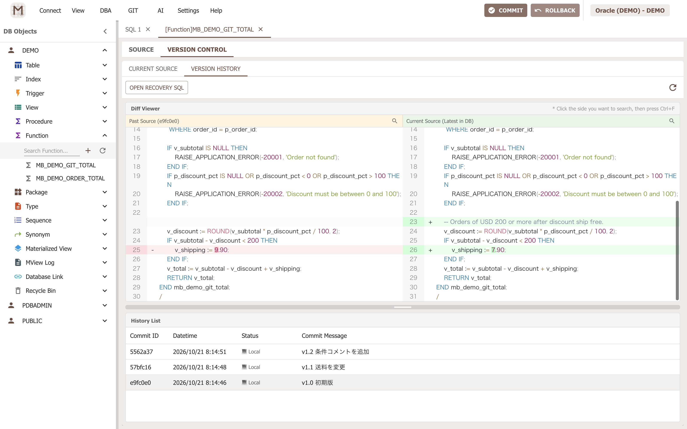
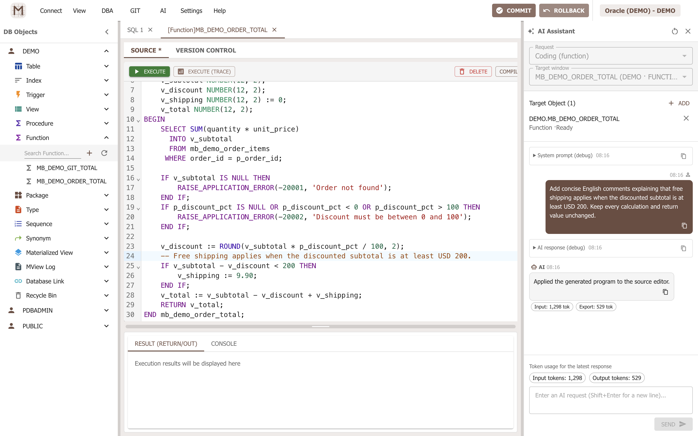
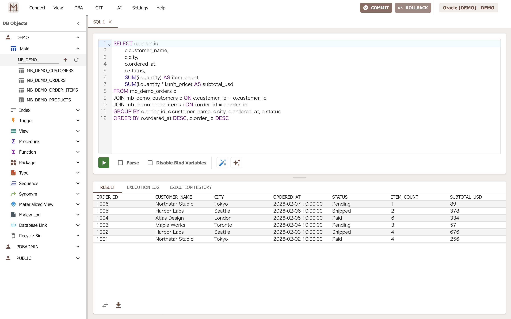
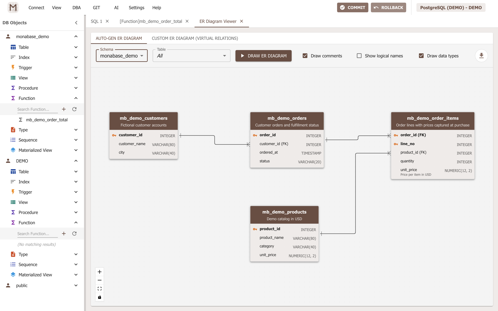
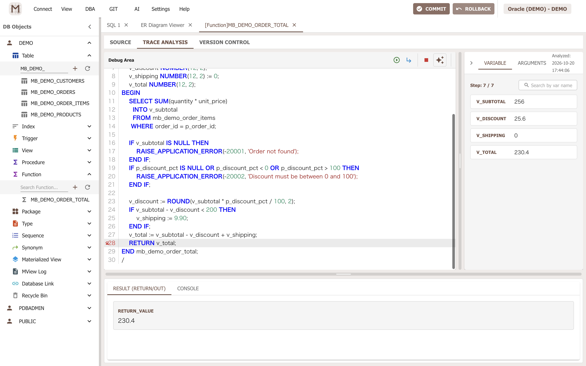
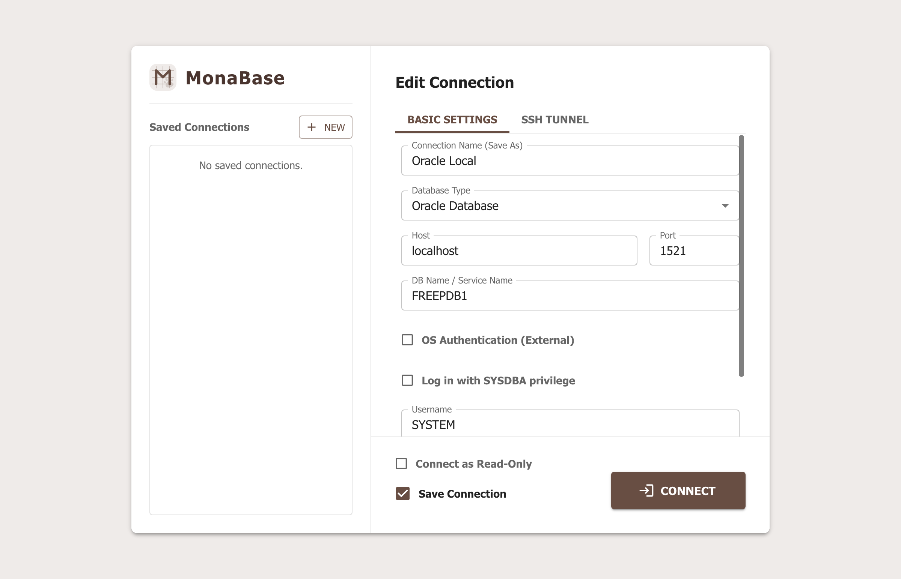

[English](README.md) | **日本語**

<p align="center"></p>

# MonaBase

**Oracle Database 12以降**と**PostgreSQL**に対応した、**AIネイティブなデスクトップ型データベースIDE**です。Electron、React、TypeScriptで開発しています。

ストアドプログラムの作成・修正、トレースに基づくデバッグ、SQL作成、SQLチューニング、テストデータ生成をAIで支援します。**ストアドプログラムのソースとカスタムER図をGitで管理**し、変更内容を確認してから反映できます。さらに、メイン画面の**Commit／Rollbackによるトランザクション制御**と**読み取り専用接続モード**で、DBへの変更を意識した作業を支援します。

**公式サイト：** [MonaBase](https://eijiikemura.github.io/monabase/) · **マニュアル：** [日本語](https://eijiikemura.github.io/monabase/ja/guides/getting-started/) / [English](https://eijiikemura.github.io/monabase/guides/getting-started/) · **ダウンロード：** [GitHub Releases](https://github.com/eijiikemura/monabase/releases)（公開済みリリースの有無をご確認ください）

## 主な機能

- **5つのAIアシスタント。** ソース編集、トレース解析、SQL作成、チューニング、データ生成の各画面から、その作業に必要なコンテキストを用意してAIを利用できます。OpenAI互換のプロバイダーとモデルを選択できます。
- **実行記録とAIを組み合わせたトレース解析。** プログラムの実行を記録し、ソース行や変数値を確認できます。AIは実行記録に基づく擬似ステップ実行を組み立てます。記録済みトレースの解析には、Oracleのライブな`DBMS_DEBUG`セッションを維持する必要がありません。
- **ソースとER図のGitバージョン管理。** ストアド定義やカスタムER図の変更履歴を記録し、差分比較や過去の設計確認、履歴からの復旧SQLの参照ができます。
- **トランザクション制御と本番環境を意識した安全機能。** 対応する画面でDMLを実行し、未確定のトランザクション状態を確認して、メイン画面から明示的にCommitまたはRollbackできます。読み取り専用接続、接続先を識別する色、操作前のレビューも誤操作のリスクを下げます。
- データベースオブジェクトの参照・管理、SQLの作成・実行、実行計画の確認、結果編集、データのインポート／エクスポートに対応します。
- 日本語と英語の表示、テーマや日付形式のカスタマイズに対応します。

## データベース開発の各工程を支援するAI

MonaBaseのAIは、汎用的なコード補完パネルだけではなく、作業中の画面に組み込まれています。

| AIアシスタント | 主な用途 |
| --- | --- |
| ストアド・トリガーの実装 | 対象のオブジェクト定義をコンテキストにして、プロシージャ、ファンクション、パッケージ本体、トリガーの作成・修正を依頼し、提案されたソース差分を確認します。 |
| トレースに基づくデバッグ | 記録された実行順序、行、分岐、変数値を追い、想定と実際の動作が異なる箇所を調べます。 |
| SQL作成 | SQLウィンドウやクエリビルダーで、関連するテーブルやビューをコンテキストにして、必要なクエリを自然言語で指示します。 |
| SQLチューニング | 実行計画や関連定義を使ってSQLを検討し、改善案を実際の実行計画と結果で検証します。 |
| テストデータ生成 | 必要なサンプルデータを指示し、生成ルールとプレビューを確認してから、明示的にデータを登録します。 |

**AIがデータベースに直接接続したり、SQL実行ツールを与えられたりすることはありません。** MonaBaseは選択されたコンテキストを設定済みのAIサービスへ送信します。ソースの適用、SQLの実行、データ登録は、利用者が確認して開始する操作です。送信前のプレビューと提案差分を確認できます。対応するプログラムオブジェクトでは、Gitコミット画面で**保存済みの「採用されたAI変更要約」**を編集可能なコミットメッセージとして再利用できます。この操作自体は**新たなAIリクエストを送信しません**。ただし、AI支援を依頼する際には、選択したソースやトレースの値がAI事業者へ送信されます。

**OpenAI互換のChat Completionsエンドポイント**とモデルを設定できます。互換性のあるクラウドサービスやローカルAIプロバイダーを選べますが、利用できる機能やコンテキスト長はサービス・モデルによって異なります。AI機能は任意です。

## ライブデバッグではなく、記録した実行を解析

MonaBaseは、対応するプログラムにトレース処理を組み込み、その実行を後から調べられる形で記録します。数千行規模のPL/SQLプログラムなど、ライブな`DBMS_DEBUG`によるデバッグが煩雑になったり不安定になったりする場面でも、取得済みトレースの解析ならデバッグ対象とデバッグ側の2セッション間で同期を維持する必要がありません。[OracleのDBMS_DEBUG公式ドキュメント](https://docs.oracle.com/en/database/oracle/oracle-database/19/arpls/DBMS_DEBUG.html)には、このライブデバッグの仕組みが説明されています。

同じ実行記録をAIの解析材料にもできます。トレースをデバッグアシスタントへ渡し、**擬似的なステップ実行**を組み立ててもらい、繰り返し実行された行やループ、記録された変数値を調べて、仮説を実行結果と照合できます。AIはソースだけでなく実行記録を根拠に推論しますが、DB上で自律的にステップ実行やSQL実行をするわけではありません。

トレース解析は**記録の再生**であり、接続したまま操作するライブデバッガではありません。対応構文、トレース量、実行時間などによる制約もあります。また、トレース記録のために計測対象プログラムを実際に動かすと、データ変更などの副作用が生じ得ます。記録時は適切なテストデータを利用してください。

## DB設計もGitでバージョン管理

**カスタムER図も、ストアドソースと同様にGitで管理できる設計資料**です。レイアウトや図上のリレーションを保存し、設計変更の履歴を残して、最終的な画像だけでなく過去の設計も確認できます。ER図上のリレーションを編集しても、データベースの外部キー制約は自動変更されません。

オブジェクトのGitタブにある**スキーマ変更レビュー**では、DBの定義とGitに記録されたソース、ローカルファイルを比較できます。一覧を再取得して差分を確認し、複数のカテゴリから関連オブジェクトを選択して1つのコミットにまとめられます。**2つの版を比較**では保存済みの任意の2バージョンを比較します。Pullで競合した場合はファイルごとに内容を確認し、テキストを解決するか片側を採用して、マージの完了または中止を選択できます。これらのGit操作によってDBへSQLが自動適用されることはありません。

## 本番環境での慎重な作業を支援

参照作業には**読み取り専用接続モード**を利用できます。MonaBaseは実行可能なSQLをチェックし、DBの読み取り専用トランザクションを利用して、更新処理、ストアド実行、トレース実行をこのモードで制限します。書き込み可能なメイン接続では、対応するSQL画面やデータ編集画面で実行したDMLを未確定のまま保持し、メイン画面上部の**Commit**または**Rollback**で確定・取り消しできます。これらは該当する接続とトランザクションの範囲で動作し、独立した任意のDBセッションまで一括制御するものではありません。接続先を示す色や操作レビューも、対象と内容の確認に役立ちます。詳しくは[トランザクション制御ガイド](https://eijiikemura.github.io/monabase/ja/guides/transaction-control/)をご覧ください。

これらの保護機能は、DBアカウントの最小権限設定や本番環境の変更管理手順を補完するものです。OracleとPostgreSQLでは対応操作が異なり、DDLによってそれ以前の変更が暗黙的にコミットされる場合もあります。**Rollbackですべての変更を取り消せるわけではありません。**

## スクリーンショット

Gitによるストアドプログラムの履歴と左右のソース差分：



対象DBのコンテキストを使ったAIコーディング、実際の応答、変更内容の確認：



OracleのSQL編集画面と受注データの検索結果：



PostgreSQLのカスタムER図（保存した図はGitで履歴管理可能）：



AIデバッグの根拠として利用できる、Oracleの実行ステップと変数値の記録：



これらの画像は架空のデモデータで作成しています。接続先ラベルは匿名化しています。再現方法は[スクリーンショットの撮影手順とデモSQL](docs/SCREENSHOTS.md)をご覧ください。

## 接続設定



## 公式サイトとマニュアル

[`website/`](website/README.md)にあるAstro + Starlightプロジェクトで、日本語・英語のトップページと、画面ごとのマニュアルを管理しています。[はじめて使う](https://eijiikemura.github.io/monabase/ja/guides/getting-started/)、[トランザクション制御](https://eijiikemura.github.io/monabase/ja/guides/transaction-control/)、[お問い合わせ](https://eijiikemura.github.io/monabase/ja/guides/contact/)、[プライバシーポリシー](https://eijiikemura.github.io/monabase/ja/guides/privacy-policy/)などがあり、Oracle／PostgreSQLの対応バッジも表示されます。ローカルプレビュー、`i18n:extract`、検証、GitHub Pagesへの公開方法は`website/README.md`をご覧ください。Webサイトの依存関係はデスクトップアプリとは独立しています。

## 開発環境の準備

デスクトップアプリはElectron 44を使用しています。v1.0.1からWindows x64とmacOS 13以上のApple Silicon（arm64）向け配布に対応します。Intel Mac・Linux向け配布はありません。Linux上の自動テストは継続しています。

Node.js 22.12以降、npm、およびDB操作を行うためのOracleまたはPostgreSQL環境を用意してください。

```sh
npm ci
npm run dev
```

開発コマンドではViteとElectronを同時に起動します。OracleまたはPostgreSQLを用意し、ログイン画面で接続を設定してください。OracleのOS認証には64bit版Oracle Clientが必要で、設定画面でそのフォルダーを選択します。SSHトンネル接続では初回にサーバーのフィンガープリントを確認します。保存済みのホスト鍵が変わると接続をブロックします。AIは任意機能で、使用時にはAI設定画面から互換エンドポイントとモデルを指定します。

SSH秘密鍵ファイルの上限は1MiB、PostgreSQLのカスタムCA証明書バンドルの上限は4MiBです。通常ファイルへのシンボリックリンクも使用できます。アプリはこれらのファイルを読み取りますが、ファイルの内容やアクセス権は変更しません。

## 検証とビルド

```sh
npm run check
npm run build:renderer
```

`check`ではlint、TypeScriptの型チェック、テストスイートを実行します。テストではDBの模擬実装を使うため、通常は実DBを必要としません。レンダラーのビルドでは、デスクトップ用インストーラーを作成せずにWebアプリ部分を確認します。

```sh
npm run build
npm run build:win
```

これらのコマンドでデスクトップアプリの成果物を`release/`に作成します。CIはLinuxで共通テストを実行し、WindowsとmacOSで展開済みアプリをビルド・検証します。別のワークフローでは、使い捨てのPostgreSQL／Oracle環境とElectronサイドバー操作をテストします。詳細は[テストガイド](docs/TESTING.md)をご覧ください。インストーラー作成、署名、追加のDB・バージョン検証は[リリースチェックリスト](docs/RELEASE_CHECKLIST.md)に従います。

Windows向けにはインストーラー版とポータブル版のEXEを別々に作成します。v1.0.1からMac版も正式に提供します。Mac版はDeveloper ID署名・Apple公証済みDMGです。DMGを開き、MonaBaseをアプリケーションへ移し、DMGを取り出してから起動してください。詳細は[Mac配布手順](docs/MACOS_DISTRIBUTION.md)を参照してください。手動実行の**Prepare release**ワークフローでは、Windows x64のビルドを行い、GitHub Artifact Attestationsとチェックサムを生成して、**下書きのGitHub Release**に添付します。通常のpushだけではリリースは公開されません。バージョンタグ、公開、ダウンロード検証の手順は[リリース手順](docs/RELEASE_CHECKLIST.md#prepare-a-github-release)をご覧ください。Windows配布物はコード署名されておらず、AttestationはOSのコード署名の代わりにはなりません。Mac版はローカルで署名・公証したDMGとSHA256SUMS-mac-arm64を手動で添付します。手動Mac版にはGitHub Artifact Attestationは付与されません。

署名のないWindowsアプリはSmartScreenによって警告される場合があります。**続行する前に配布元とリリースファイルを確認**してください。SmartScreen全体を無効にしないでください。詳しくは[インストールガイド](https://eijiikemura.github.io/monabase/ja/guides/getting-started/)を参照してください。Microsoft Store版は、実際に公開されてから利用可能な配布方法として案内します。

Microsoft Store用AppXは `npm run build:store` で作成します。タイル画像とパッケージ内部の確認方法は[Store向け配布ガイド](docs/MICROSOFT_STORE.md)を参照してください。

## 設定とローカルデータ

言語設定が保存されていない場合、アプリはOSの言語に応じて日本語または英語を選択します。`settings.example.json`は設定例であり、自動読み込みされません。

ローカル設定、DBのGitワークスペース、AI履歴、トレース、リリース成果物はソース管理の対象から除外されます。DB・SSHのパスワードとAI APIキーは、保存時にOSのセキュアストレージを使って暗号化されます。セキュアストレージを利用できない場合、新しい資格情報は現在のセッションでのみ保持します。保存済みの資格情報を読み取れない場合も、そのデータを勝手に削除せず、設定画面に警告を表示します。Macではアプリや実行環境の更新後、キーチェーンへのアクセス許可を求められる場合があります。

設定、Gitワークスペース、AI履歴、トレースは、開発時にはプロジェクトの作業ディレクトリ、インストール版ではOSのアプリケーションデータディレクトリ、Windowsポータブル版ではランチャーのディレクトリを使用します。接続プロファイル、SQL履歴、AI接続設定は、いずれの起動形態でもOSのアプリケーションデータディレクトリを使用します。既存のワークスペースデータの移行時は、移行先にあるファイルを置き換えたり元データを削除したりせず、不足する旧データをコピーします。詳しくは[リリースガイド](docs/RELEASE_CHECKLIST.md#data-location-and-migration)を参照してください。

### 既存のトレース・PostgreSQL履歴ファイル

現在のトレースは、接続、スキーマ、オブジェクト種別、正確なオブジェクト名、PostgreSQLの入力引数型を区別して保存します。旧形式の`trace_NAME.json`ファイルは削除されずディスクに残ります。現在の接続に対応する記録が必要な場合は、トレースを再実行してください。PostgreSQLのルーチンに関するGit・AI履歴もオーバーロードを区別するようになりました。従来の名前だけによる履歴ファイルは保持され、新しい履歴は次の保存またはコミットから記録されます。詳しくは[識別情報と互換性](docs/ARCHITECTURE.md#routine-and-trace-identities)をご覧ください。

その他のDBソースオブジェクトでは、`.objects-v2`の下に衝突を起こしにくいファイル名を使用します。既存のSQLファイルはそのまま保持され、検証済みの旧定義はソース履歴に含まれます。詳しくは[Gitの保存と互換性](docs/ARCHITECTURE.md#git-failures)をご覧ください。

## 開発への参加

開発手順は[CONTRIBUTING.md](CONTRIBUTING.md)、コード構成は[docs/ARCHITECTURE.md](docs/ARCHITECTURE.md)、翻訳ルールは[docs/INTERNATIONALIZATION.md](docs/INTERNATIONALIZATION.md)をご覧ください。

再現可能な不具合は[Issues](https://github.com/eijiikemura/monabase/issues)、使い方の質問や広い範囲の機能提案は[Discussions](https://github.com/eijiikemura/monabase/discussions)をご利用ください。サンプルやスクリーンショットには、接続資格情報、非公開のDB定義、個人情報、本番データを含めないでください。

## ライセンス

MonaBaseは[Apache License 2.0](LICENSE)で公開しています。第三者コンポーネントにはそれぞれのライセンスが適用されます。

Copyright 2026 eiji ikemura. 特に断りのない限り、このライセンスはMonaBase独自のソースコード、テスト、サンプル、ドキュメント、設定、画像・アートワークに適用されます。ソースファイルには短い著作権表示と`SPDX-License-Identifier: Apache-2.0`を記載しています。JSONやPNGなどコメントを記載できない形式も、このリポジトリの宣言とLICENSEファイルの対象です。既存の第三者の著作権表示やライセンスは引き続き適用されます。

公式サイト：[MonaBase](https://eijiikemura.github.io/monabase/) · [日本語マニュアル](https://eijiikemura.github.io/monabase/ja/guides/getting-started/) · [English manual](https://eijiikemura.github.io/monabase/guides/getting-started/)

## フィードバックとメンテナンス

このプロジェクトでは**Pull Requestを受け付けていません**。不具合は[Issues](https://github.com/eijiikemura/monabase/issues)、使い方の質問や機能アイデアは[Discussions](https://github.com/eijiikemura/monabase/discussions)をご利用ください。セキュリティ上の問題はGitHubの**非公開脆弱性報告**（Security → **Report a vulnerability**）から報告してください。詳しくは[SECURITY.md](SECURITY.md)と[CIのセキュリティ資料](docs/CI_SECURITY.md)を参照してください。

## お問い合わせ

- **不具合の報告：** [GitHub Issues](https://github.com/eijiikemura/monabase/issues)
- **使い方の質問・機能の提案：** [GitHub Discussions](https://github.com/eijiikemura/monabase/discussions)
- **セキュリティ上の脆弱性：** [GitHub Security](https://github.com/eijiikemura/monabase/security) → **Report a vulnerability**（非公開で報告。公開Issueには投稿しないでください）
- **その他の非公開相談：** [X @eijiikemura](https://x.com/eijiikemura)のDM。フォロー関係にかかわらずメッセージリクエストを受け付け、スパムフィルターで確認します。すべての問い合わせへの返信を保証するものではありません。Xアカウントを持たない方の一般相談向けに、メールやその他の非公開窓口は設けていません。

詳しくは[お問い合わせページ](https://eijiikemura.github.io/monabase/ja/guides/contact/)と[プライバシーポリシー](https://eijiikemura.github.io/monabase/ja/guides/privacy-policy/)をご覧ください。GitHub・Xのメッセージには、各サービスのプライバシーポリシーが適用されます。

英語での問い合わせには、AI翻訳を使って回答する場合があります。

**注意：** 公開Issue・Discussions・DMには、パスワード、APIキー、接続資格情報、非公開ソース、個人情報、機密性の高いDBデータを送らないでください。脆弱性は公開せず、非公開の報告機能を利用してください。
