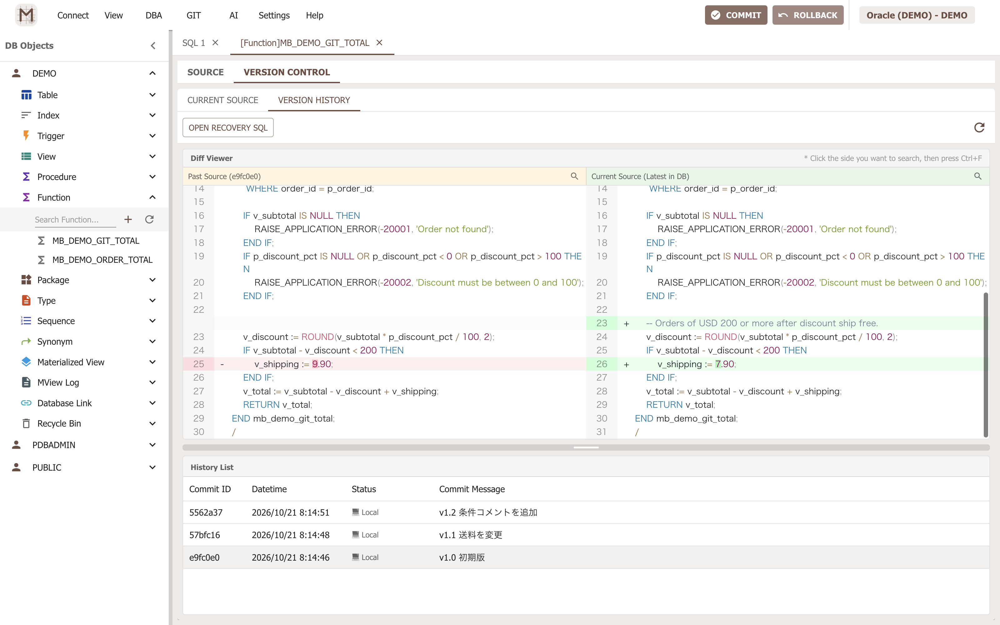
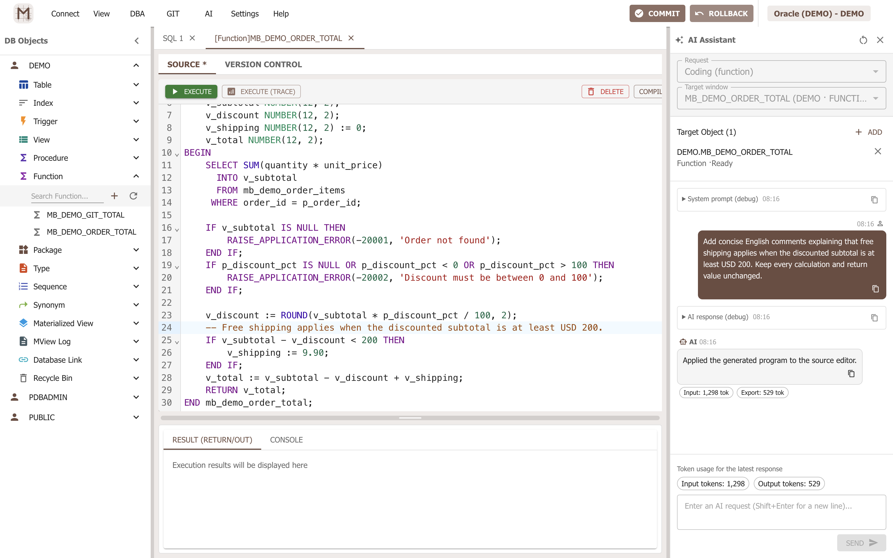
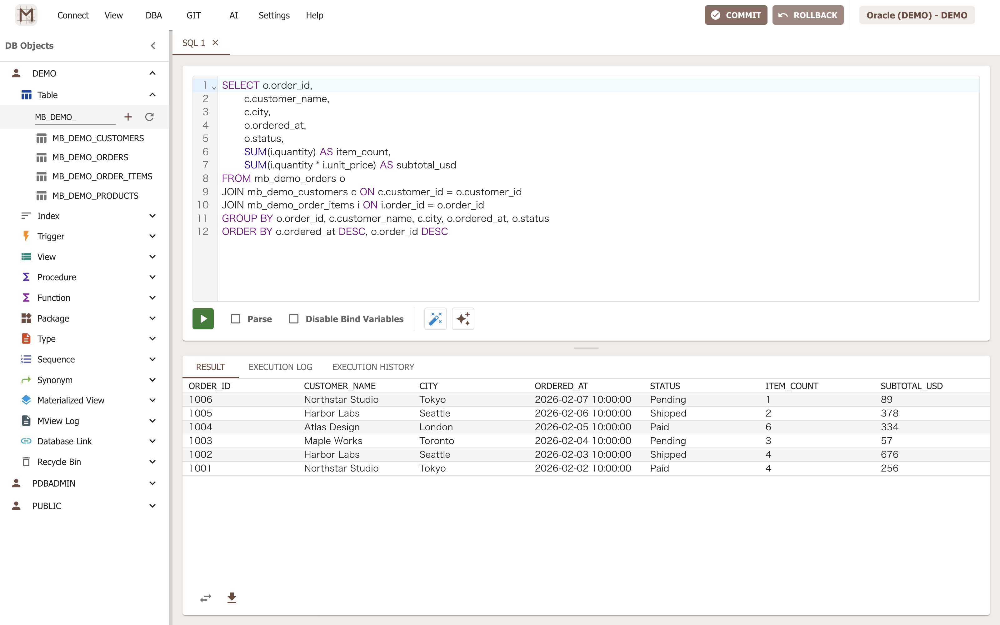
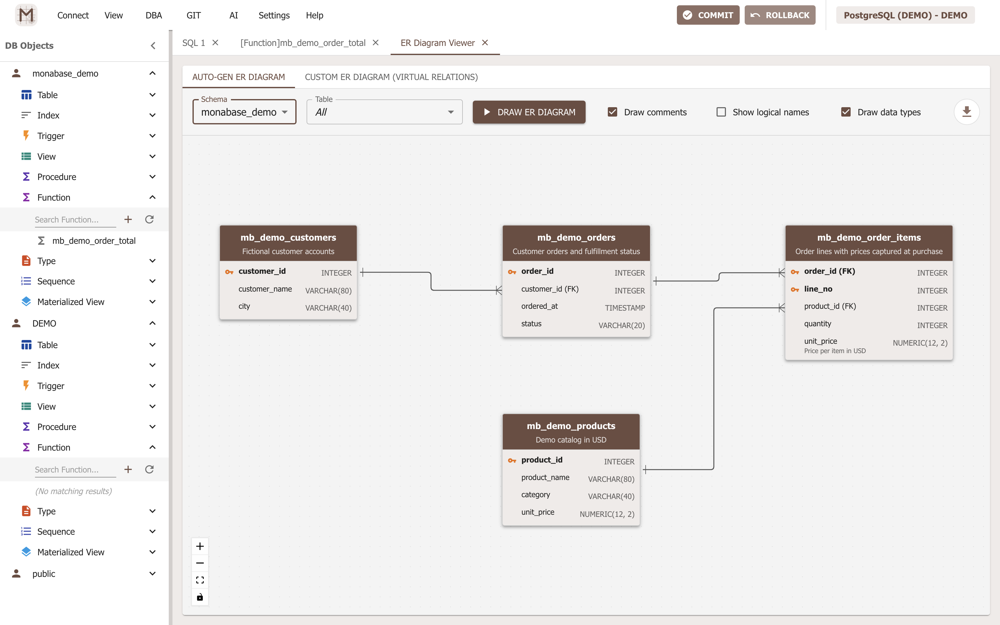
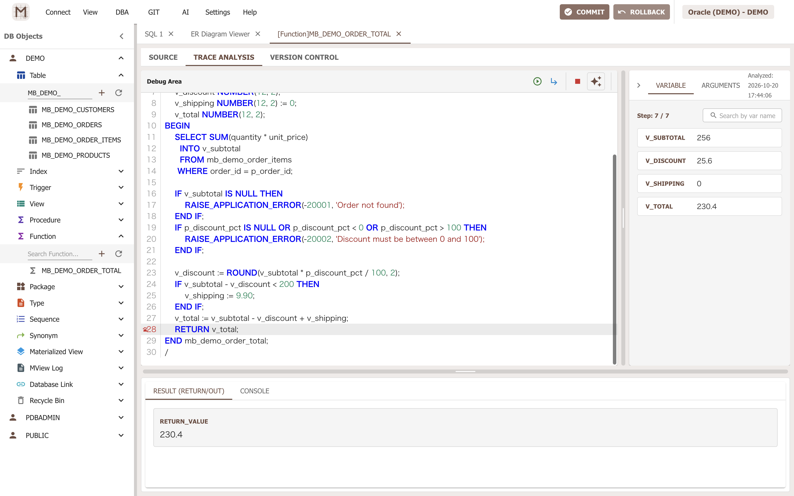
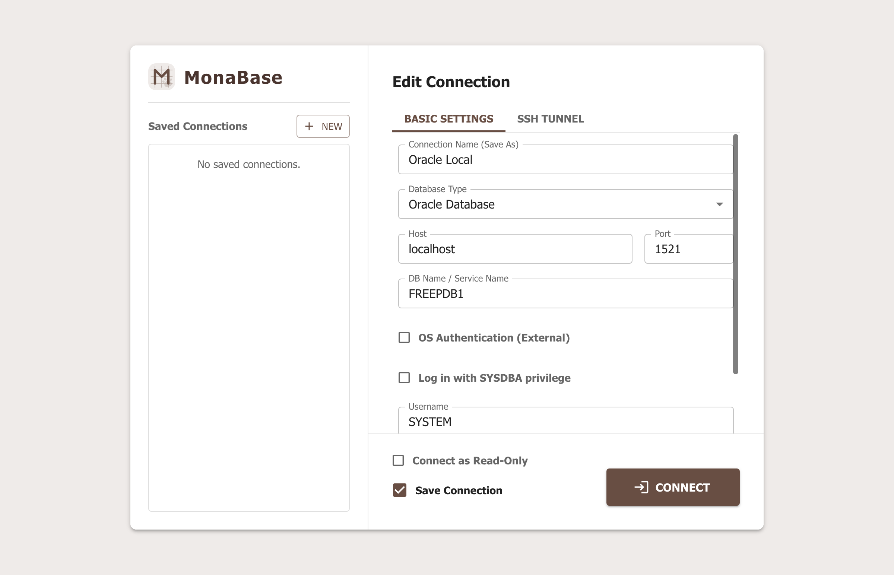

**English** | [日本語](README.ja.md)

<p align="center"></p>

# MonaBase

An **AI-native desktop database IDE** for **Oracle Database 12+** and **PostgreSQL**, built with Electron, React, and TypeScript.

Bring AI into stored-program coding, trace-based debugging, SQL creation, SQL tuning and test-data generation. Keep **stored source and custom ER diagrams in Git**, review changes before applying them, and control pending database changes with **Commit/Rollback in the main window** and an optional **read-only connection mode**.

**Website:** [MonaBase](https://eijiikemura.github.io/monabase/) · **Manual:** [English](https://eijiikemura.github.io/monabase/guides/getting-started/) / [日本語](https://eijiikemura.github.io/monabase/ja/guides/getting-started/) · **Download:** [GitHub Releases](https://github.com/eijiikemura/monabase/releases) (check published availability)

## Features

- **Five integrated AI assistants.** Work with AI from the code, trace, SQL, tuning and data-generation screens, with context prepared for each task. Choose your own OpenAI-compatible provider and model.
- **Trace-based debugging with AI-readable evidence.** Record execution, inspect source lines and variable values, and ask AI to reconstruct a pseudo step-through from the actual trace. Analysis does not require a live Oracle `DBMS_DEBUG` session.
- **Git versioning for source and ER diagrams.** Record stored definitions and custom diagram revisions, compare source changes, retain earlier designs, and open recovery SQL from source history.
- **Transaction control and safer production workflows.** Execute DML in supported windows, inspect the pending transaction state, then explicitly Commit or Rollback from the main window. Read-only connection mode, connection identity colors and operation reviews help reduce accidental changes.
- Browse and manage database objects, build and execute SQL, inspect execution plans, edit results, and import or export data.
- Work in English or Japanese, with configurable themes and date formats.

## AI-native across the database workflow

AI is integrated into the work you are doing, rather than limited to a generic code-completion panel:

| Assistant | How it helps |
| --- | --- |
| Stored-program and trigger coding | Create or revise procedures, functions, package bodies and triggers using selected object definitions; review the proposed source diff. |
| Trace-based debugging | Follow recorded execution order, lines, branches and variable values; investigate where actual behavior diverged from expectations. |
| SQL creation | Describe the query you need in the SQL window or query builder, with the relevant tables and views as context. |
| SQL tuning | Review SQL with execution-plan information and related definitions; test proposed improvements against actual plans and results. |
| Test-data creation | Describe the sample data you need, review generation rules and previews, then insert data deliberately. |

**AI does not connect directly to your database or receive a SQL-execution tool.** MonaBase sends selected context to the configured service; source application, SQL execution and data insertion remain actions you review and initiate. Preview outgoing requests and inspect proposed differences. For supported program objects, the Git commit dialog can reuse a **previously saved, adopted AI change summary** as an editable commit message; using this summary does **not** send a new AI request. Selected source and trace values are still shared with your provider when you request AI assistance.

Configure an **OpenAI-compatible Chat Completions endpoint** and model, including compatible hosted services or local AI providers. You are not tied to one vendor; capabilities and context limits depend on the service and model. AI support is optional.

## Debug from recorded execution, not a live debug session

MonaBase instruments supported programs and records their execution for later inspection. This is especially useful for large PL/SQL programs, including multi-thousand-line programs where a live `DBMS_DEBUG` workflow can become cumbersome or unstable: inspecting a completed trace no longer depends on maintaining synchronization between the target and debugging sessions. [Oracle describes that live two-session mechanism in its DBMS_DEBUG documentation](https://docs.oracle.com/en/database/oracle/oracle-database/19/arpls/DBMS_DEBUG.html).

The same execution record gives AI something concrete to inspect. Send the trace to the debugging assistant to reconstruct a **pseudo step-by-step execution**, examine repeated lines and loops, inspect captured variable values, and check a hypothesis against the recorded run. AI can reason from execution evidence rather than source alone; it does not autonomously step or execute the database.

Trace analysis is recorded replay, not an attached live debugger or a guarantee of unlimited program size. Supported syntax, trace volume and runtime affect recording, and executing the instrumented program can still change data. Use representative test data when recording traces.

## Version your database design, too

**Custom ER diagrams are Git-managed design artifacts**, alongside stored source. Save layouts and diagram relationships, record revisions as the design evolves, and retain earlier designs rather than keeping only a final exported image. Editing a diagram does not apply a database constraint.

From an object's Git tab, **Schema changes** compares DB definitions with recorded Git sources and local files. Refresh the list, review differences, select related objects across categories, and record them in one commit. **Compare two revisions** compares any two saved versions. Pull conflicts open a per-file review; resolve the text or choose a side, then complete or abort the merge. These Git operations do not apply SQL to the database.

## Designed for deliberate production work

Use **read-only connection mode** for inspection: MonaBase checks permitted SQL, uses database read-only transactions, and blocks updates, stored execution and trace execution in this mode. On a writable main connection, DML performed in supported SQL and data-editing windows can remain uncommitted until you explicitly choose **Commit** or **Rollback** in the main window. These controls apply to the relevant connection and transaction context, not arbitrary independent database sessions. Connection colors and reviews help you confirm the target and change before execution. See the [transaction control guide](https://eijiikemura.github.io/monabase/guides/transaction-control/).

These protections complement a least-privilege database account and your production change process. Oracle and PostgreSQL differ in supported operations; DDL can implicitly commit earlier work under MonaBase's transaction policy, so Rollback is not a universal undo operation.

## Screenshots

Stored program source history and side-by-side diffs in Git:



Integrated AI coding with selected database context, a real response, and reviewed source changes:



SQL editing and order results in Oracle:



Custom ER diagrams in PostgreSQL—the saved diagram can also be versioned in Git:



Recorded execution steps and variable values in Oracle, available as evidence for the AI debugging assistant:



These captures use fictional demo data. Connection labels are anonymized. See the [screenshot walkthrough and demo SQL](docs/SCREENSHOTS.md) to reproduce the workflow.

## Connection setup



## Website and manual

The Astro + Starlight project in [`website/`](website/README.md) provides a bilingual landing page and screen-by-screen guides, including [Getting Started](https://eijiikemura.github.io/monabase/guides/getting-started/), [transaction control](https://eijiikemura.github.io/monabase/guides/transaction-control/), [contact](https://eijiikemura.github.io/monabase/guides/contact/) and the [privacy policy](https://eijiikemura.github.io/monabase/guides/privacy-policy/). See its README for local preview, `i18n:extract`, validation and GitHub Pages publication. Website dependencies are separate from the desktop app.

## Development setup

The desktop app uses Electron 44. From v1.0.1, prebuilt releases support Windows x64 and macOS 13+ on Apple Silicon (arm64). Intel Macs and Linux distributions are not supported; Linux remains a test platform.

Use Node.js 22.12 or later, npm, and access to an Oracle or PostgreSQL database for interactive database operations.

```sh
npm ci
npm run dev
```

The development command starts Vite and Electron together. Prepare an Oracle or PostgreSQL database and configure its connection on the login screen. Oracle OS authentication requires a 64-bit Oracle Client; select its folder in Settings. SSH tunnel connections ask you to verify the server's fingerprint on first use; a changed saved key blocks the connection. AI support is optional and requires a compatible endpoint and model configured in the AI settings screen.

SSH private-key files are limited to 1 MiB, and custom PostgreSQL CA certificate bundles to 4 MiB. Selected links to regular files are supported; the application reads these files without changing their contents or permissions.

## Validation

```sh
npm run check
npm run build:renderer
```

`check` runs lint, TypeScript checking, and the test suite. Tests use database doubles and do not require a live database. The renderer build checks the web application without creating a desktop installer.

```sh
npm run build
npm run build:win
```

These commands create desktop artifacts in `release/`. CI runs common tests on Linux and builds and verifies unpacked applications on Windows and macOS. A separate workflow tests disposable PostgreSQL and Oracle databases and Electron sidebar operations; see [the testing guide](docs/TESTING.md). Installer creation, signing, and additional database/version checks follow [docs/RELEASE_CHECKLIST.md](docs/RELEASE_CHECKLIST.md).

Windows builds produce separate installer and portable EXEs. From v1.0.1, macOS Apple Silicon DMGs are Developer ID-signed, Apple-notarized and stapled. Open the DMG, drag MonaBase to Applications, eject the DMG and launch from Applications. See [macOS distribution](docs/MACOS_DISTRIBUTION.md) for the separate local signing/notarization workflow; its verified DMG and `SHA256SUMS-mac-arm64` are attached manually. Linux distributions are not provided. The manual **Prepare release** workflow builds Windows x64, generates GitHub Artifact Attestations and checksums, and attaches the files to a **draft** GitHub Release. Ordinary pushes do not publish releases. See the [release instructions](docs/RELEASE_CHECKLIST.md#prepare-a-github-release) for version tags, publication and download verification. The Windows artifacts are unsigned; their attestations do not replace OS code signing. The manually built Mac DMG has Apple notarization but no GitHub Artifact Attestation. Windows SmartScreen may warn about an unrecognized or unsigned app. **Verify the source and release files before proceeding**; do not disable SmartScreen globally. See the [installation guide](https://eijiikemura.github.io/monabase/guides/getting-started/) for more information. A Microsoft Store listing should be treated as available only after it is published.

Microsoft Store AppX builds use `npm run build:store`; see the [Store packaging guide](docs/MICROSOFT_STORE.md) for branded tile assets and archive verification.

## Configuration and local data

The app selects English or Japanese based on the system language unless a saved language preference exists. `settings.example.json` documents settings; it is not loaded automatically.

Local settings, database Git workspaces, AI history, traces, and release artifacts are excluded from source control. Database and SSH passwords and AI API keys are encrypted with the operating system's secure storage when saved. If secure storage is unavailable, new credentials are kept only for the current session. Unreadable saved credentials are retained and the settings screen displays a warning. macOS may request Keychain access after an application/runtime update.

Settings, Git workspaces, AI history, and traces use the project working directory during development, the OS application data directory in installed builds, and the launcher directory in Windows portable builds. Connection profiles, SQL history, and AI connection settings use the OS application data directory in every mode. Missing legacy workspace data is copied without replacing existing destinations or deleting originals. See the [release guide](docs/RELEASE_CHECKLIST.md#data-location-and-migration) for the full policy.

### Existing trace and PostgreSQL history files

Traces are now scoped to their connection, schema, object kind, exact name, and
PostgreSQL input argument types. Existing `trace_NAME.json` files remain on disk;
run the trace again to create a result for the current connection. PostgreSQL
routine Git and AI histories now distinguish overloads. Previous name-only files
are preserved, and new history starts with the next save or commit. See
[identity and compatibility details](docs/ARCHITECTURE.md#routine-and-trace-identities).

Other database source objects now use collision-resistant filenames under
`.objects-v2`. Existing SQL files remain intact; verified legacy definitions are
included in source history. See [Git storage and compatibility](docs/ARCHITECTURE.md#git-failures).

## Contributing

See [CONTRIBUTING.md](CONTRIBUTING.md) for the development workflow and [docs/ARCHITECTURE.md](docs/ARCHITECTURE.md) for the code layout. Translation conventions are described in [docs/INTERNATIONALIZATION.md](docs/INTERNATIONALIZATION.md).

Please use [Issues](https://github.com/eijiikemura/monabase/issues) for reproducible bugs and [Discussions](https://github.com/eijiikemura/monabase/discussions) for questions and broader feature proposals. Remove connection credentials, private database definitions, personal information and production data from examples and screenshots.

## License

MonaBase is licensed under the [Apache License 2.0](LICENSE). Third-party components retain their respective licenses.

Copyright 2026 eiji ikemura. Unless otherwise indicated, this license applies to
MonaBase's original source code, tests, examples, documentation, configuration and
artwork. Source files carry a short copyright notice and
`SPDX-License-Identifier: Apache-2.0`. Formats that cannot carry comments, such as
JSON and PNG, are covered by this repository-level declaration and the LICENSE
file. Existing third-party notices and licenses remain applicable.

Website: [MonaBase official site](https://eijiikemura.github.io/monabase/) · [English manual](https://eijiikemura.github.io/monabase/guides/getting-started/) · [日本語マニュアル](https://eijiikemura.github.io/monabase/ja/guides/getting-started/)


## Feedback and maintenance

This project does not accept pull requests. Use [Issues](https://github.com/eijiikemura/monabase/issues) for bugs, [Discussions](https://github.com/eijiikemura/monabase/discussions) for questions and feature ideas, and GitHub **Private Vulnerability Reporting** (Security → **Report a vulnerability**) for security reports. See [SECURITY.md](SECURITY.md) and [CI security](docs/CI_SECURITY.md) for reporting and the maintainer-only workflow.


## Support & Communication

- **Bug reports:** [GitHub Issues](https://github.com/eijiikemura/monabase/issues).
- **Usage questions and feature ideas:** [GitHub Discussions](https://github.com/eijiikemura/monabase/discussions).
- **Security vulnerabilities:** [GitHub Security](https://github.com/eijiikemura/monabase/security) → **Report a vulnerability** (private reporting; do not open a public issue).
- **Other private inquiries:** [X @eijiikemura](https://x.com/eijiikemura) via DM. Message requests are accepted regardless of follow status and filtered for spam; a reply is not guaranteed. There is no email or private general-inquiry alternative for people without an X account.

See the [contact page](https://eijiikemura.github.io/monabase/guides/contact/) and [privacy policy](https://eijiikemura.github.io/monabase/guides/privacy-policy/) for details. GitHub and X handle messages under their respective privacy policies.

English is not my first language, so I may use AI-assisted translation when communicating in English. Thank you for your understanding!

**Note:** Do not send passwords, API keys, credentials, private source, personal information, or sensitive database data in public issues, discussions, or DMs. Do not disclose vulnerabilities publicly before reporting them privately.