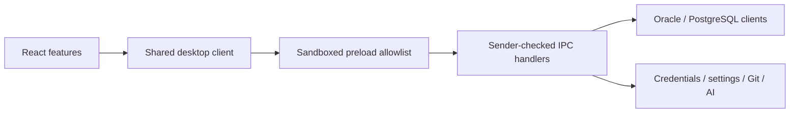

# Architecture

MonaBase has two runtime boundaries: React renders the interface, and Electron's main process owns database connections, files, credentials, Git, and AI networking.

## Layout

| Location | Responsibility |
| --- | --- |
| `src/app/` | Application theme definitions |
| `src/features/oracle/`, `src/features/postgresql/` | Database-specific workspaces and object editors |
| `src/features/data-generator/` | Shared generation rules, validation, exact helpers, preview and batch workflow; database adapters retain row-generation differences |
| `src/features/sql/`, `table/`, `stored/`, `er/`, `git/`, `ai/`, `objects/`, `data-grid/`, `dba/` | Shared feature behavior |
| `src/components/` | Reusable dialogs, inputs, and visual components |
| `src/shared/api/` | Renderer-owned desktop client and loading/transaction notifications |
| `src/shared/types/`, `utils/`, `hooks/` | Shared types, small functions, and hooks |
| `src/locales/` | English and Japanese catalogs |
| `electron/main.js` | App startup, window security, and handler registration |
| `electron/preload.js` | Self-contained sandboxed bridge; no Node.js access is exposed to React |
| `electron/ipc/` | Database, AI, Git, ER, and file-operation handlers |
| `electron/services/` | Credential, connection, AI setting, and application setting persistence |
| `electron/services/storagePaths.js` | Writable data locations and non-destructive legacy migration |
| `electron/services/traceStore.js` | Shared trace JSON persistence behind thin Oracle/PostgreSQL adapters |
| `electron/postgres/sqlText.js` | Quote-aware named binds and command classification |
| `electron/oracle/`, `electron/postgres/` | Drivers, formatting, and trace instrumentation |
| `tests/` | Unit/regression tests, real database integration tests, and Electron UI checks |
| `scripts/verify-package.cjs` | Verify actual packaged resources and installed/portable trace persistence |
| `examples/screenshots/` | Fictional Oracle and PostgreSQL schemas, data, functions, and screenshot queries |

Database-specific adapters intentionally remain separate. Oracle and PostgreSQL differ in DDL, transaction state, types, trace instrumentation, and administrative capabilities.

React source editors keep load status separate from editable text in `features/objects/useEditableSource.ts`. A blank draft does not imply missing data. Request versions invalidate stale results on replacement, identity changes, and unmount; edits during a fetch are preserved while the saved baseline is updated. Sidebar categories and table searches similarly accept only their current request's results. Table pagination fetches from its explicit event handler, without a second fetch from an effect.

`shared/hooks/useWorkspaceTabs.ts` updates the tab list, active tab, and next ID together using pure state updaters. Limit alerts run after commit, and confirmations run in event handlers. SQL log merging copies arrays before reversing them. SQL result columns use their full input definitions for memoization. `features/data-grid/StableGridFooter.tsx` keeps the grid slot component stable while context supplies its contents, preserving import/export dialog state through parent renders.

`App.tsx` uses React `lazy` and `Suspense` to load the selected database workspace only after a successful connection. Login and settings remain in the startup bundle. Vite extracts code shared by both workspaces into additional chunks, so a selected workspace can also load shared feature code. The loading state follows the current theme and language. A screen error boundary provides a disconnect action and restart guidance if loading or rendering fails; it never reloads the application automatically or interrupts a transaction without confirmation.

## AI evidence and verification

The AI sidebar adds optional input examples, expected/actual results, constraints
and user-run verification output to the request preview. Preparing a repair
request only edits the draft; sending, adopting code, compilation and execution
remain separate user actions. Requirements are cleared when the request target
changes and are not written to personal configuration.

`get-ai-database-context` reads a fixed, whitelisted set of settings from the idle
main session through `electron/services/aiDatabaseContext.js`. Session settings
must describe that connection, so this dedicated read bypasses the general SQL
execution wrapper without issuing BEGIN/COMMIT/ROLLBACK. It holds the main busy
guard and refuses a changed/disconnected target. Object definitions, catalog
dependencies and statistics still use background metadata connections. Their
session settings need not match the main session; prompts state this distinction.
No credentials, host configuration or arbitrary SQL enter this context IPC.

`relatedObjects.ts` suggests at most 100 catalog-recorded references from up to
20 selected objects. The user explicitly adds candidates before their definitions
are fetched and sent. Dynamic SQL and dependencies not tracked by the DB require
manual selection. PostgreSQL routine OIDs preserve overload identity.

Trace files capture original source, a SHA-256 identifier and line-mapping
metadata with the execution. PostgreSQL frontend-instrumented routines also send
their original source; trigger simulations retain the body and procedure-to-body
map, restricted to visited lines. This is a display correspondence and can map
generated code to the nearest original line; it is not proof of exact statement
execution. Instrumented-only or older traces without a snapshot are explicitly marked
unverified. The editable current source is not proof of executed behavior.

Estimated SQL plans retain the prepared SQL, bind types/values, planning duration
and any earlier observation of the exact SQL/binds/schema. Planning time is not
query execution time. No SQL is rerun to collect AI context. Bind values are
excluded from tuning requests/exports by default; sharing consent applies only
to the selected plan snapshot. Statistics include their available analyze dates.

## Imports and type checking

Use `@/` for imports that otherwise climb two or more directories under `src/`;
keep short relative imports for neighboring modules. Both TypeScript and Vite
resolve `@/` to `src/`. Tests that provide dependency doubles use the same import
names as the application.

Frontend code and Vite configuration enable TypeScript `strict` checking. Model
unloaded state with explicit nullable types, validate optional values before use,
and keep dynamically named database columns as `unknown` until inspected.

## Feature responsibilities

Oracle sidebar SQL lives in `sidebarQueries.ts`; `useSidebarObjects.ts` owns list
loading, filters, pagination, and object status. `useSidebarLogic.ts` coordinates
screen actions and object changes.

Each database has a `tableQueryBuilder.ts` for SQL value formatting and search
clauses, and a `tableDataTransfer.ts` for import/export. Its table hook coordinates
UI state and execution on the existing main/background connections. Each database's
`tableRecordEditor.ts` owns record dialogs and update execution; the table hook
retains search, pagination, and selection. `sidebarDataTransfer.ts` owns sidebar
imports and exports. Shared context interfaces live in `features/table/`, while
`shared/types/queryConditions.ts` holds the filter model independently of UI
components. Record and sidebar import tests verify that changes remain uncommitted. PostgreSQL
row normalization lives in `tableResultRows.ts`, sharing consistent formatting between initial
and paginated results.

Each trigger editor delegates temporary trace program generation and source-line
mapping to `triggerTraceProgram.ts`. These builders do not update React state or
execute database requests, so they can be tested independently.

## Shared data contracts

`src/shared/types/` owns models that are used across features. These modules and
`shared/api/desktopContract.ts` do not import feature implementations:

- `objectTypes.ts`: database object identities, categories, and reference data.
- `aiTypes.ts`: conversations, source identities, selections, and renderer callback contracts.
- `sqlTypes.ts`: SQL history, execution logs and displayed-result summary metadata.
- `traceTypes.ts`: trace steps, breakpoint conditions, and the simulator interface.
- `appTypes.ts`: connection and application settings.

Oracle and PostgreSQL implement the same simulator interface separately. Shared
types describe their common operations without deriving one database's contract
from the other database's React hook. Each database retains its own supported
object categories and execution behavior.

## React effects and event callbacks

All three themes retain essential busy feedback when the OS requests reduced
motion: indeterminate circular progress uses a fixed arc rotating every two
seconds, and indeterminate linear bars move more slowly. Decorative animation and
transitions keep the reduced-motion rule, and determinate progress values do not
rotate. These specific exceptions avoid applying the global 0.01ms animation
duration to loading indicators, which made them appear frozen with Windows
animation effects disabled.

ESLint checks hook ordering and exhaustive dependencies. Keep effects dependent on
values that should trigger synchronization. Use `shared/hooks/useEventCallback.ts`
for subscriptions and explicitly triggered loads that need a stable function and
the latest committed state. Do not use it to hide a value that should retrigger an
effect. Pending filter edits do not execute SQL; pagination and the Execute action
initiate searches. Hook calls must remain unconditional, including embedded ER
views and theme selection.

## Desktop communication

React imports `ipcRenderer` from `src/shared/api/desktop.ts`. This is an application-owned client, not Electron's native IPC object. It calls `window.monaBase`, exposed through `contextBridge` by the preload.

The preload accepts only the application's registered request channels and allowlisted AI and focus-diagnostic events. Native event objects are stripped from notifications. Main-process handlers also verify the sending window and main frame. Navigation and popup creation are blocked.

The shared client counts concurrent foreground requests, removes UI-only loading hints before IPC, and notifies subscribed screens about the actual main transaction state. Background results never overwrite the foreground transaction indicator. Cancellation and screen disposal invalidate late notifications.

`src/shared/api/desktopContract.ts` defines request arguments, responses, and event
payloads by channel. The desktop client rejects unknown channel names and invalid
arguments during TypeScript checking. SQL with a known projection can declare its
row type, for example `invoke<{ COLUMN_NAME: string }>('execute-sql-bg', sql)`.
Arbitrary query columns retain `unknown` values until inspected. These compile-time
contracts do not validate runtime payloads.

Adding a request channel requires updating its main-process handler, the preload
allowlist, and the desktop contract. `tests/ipc-security.test.cjs` checks registered
handlers against the bridge; `tests/desktop-contract.test.cjs` checks allowlist
coverage and valid/invalid TypeScript calls. Workspace reconnect actions use the
registered `connect-db` request with the current connection configuration.

Focus diagnostics retain the last 200 events in main-process memory. The renderer
does not print focus events/history or focus-reporting failures to the console,
including in development mode, and does not request startup history for logging.
Native focus events still reach the renderer for recovery checks; opening DevTools
does not print the retained history. No new diagnostic files are written, and
existing files are left untouched. `report-focus-state` accepts only validated
focus flags and element categories; it never records values, keys, or SQL.
On Windows, a foreground window with a blurred document may cycle native and
renderer focus after an input attempt or activation. Recovery is rate limited
and skipped for background, hidden, minimized, disabled, modal, and DevTools
states. A later renderer report checks document focus without claiming that
typing has been verified. Actual Windows and remote-desktop behavior needs
manual verification.

The AI sidebar shows user messages and usable AI replies. It does not generate or render system-prompt/raw-response diagnostic messages; legacy diagnostic records remain readable in existing history files but are hidden in the sidebar.

SQL and stored-program answers are staged as proposals. `AiReviewDialog.tsx` renders source differences, trigger-setting differences when applicable, and an editable change summary. Apply rechecks that the original source and target identity still match, that the editor remains mounted, and that program identity/settings are valid. Each proposal can be applied once. Discard leaves the editor unchanged. Applying a proposal does not compile, execute, commit or push it. Source-generation requests currently wait for the complete response before opening review; streamed editor replacement is not used by the sidebar.

Explanations and clarification questions follow the UI language (Japanese or English); JSON keys and DB identifiers are unchanged. The same language instruction is appended to other AI request types. Initial prompts are editable drafts rather than automatic sends. Optional Preview request shows the reference instructions, object definitions, eligible conversation messages and current user message. Sending from preview rebuilds and compares the payload, refusing to send changed content until the user reviews it again. Preview itself makes no AI request.

Accepted answers store an optional `adoption` record (editable summary, proposed source, application time) in the existing object-scoped local conversation. Loading old histories remains supported. The Git commit dialog can load the latest adopted summary for the same DB/category/schema/name/signature/table identity. It is an editable draft and can describe an earlier source version, so the user reviews it against the current source. Delayed loads cannot replace a draft edited during the request or populate another object. Only the chosen commit message enters Git; conversations are kept in ignored local storage.

ER type labels are formatted by `features/er/formatDataType.ts`. Fixed-size
PostgreSQL types ignore storage precision (for example `INTEGER`, not
`INTEGER(32, 0)`); Oracle `NUMBER` and SQL `NUMERIC` retain precision and scale.

## Database behavior

Transactional DML and table/view data reads use `execute-sql` on the main connection. Metadata and administrative reads use `execute-sql-bg`. The application uses actual connection state to report pending transactions rather than inferring it from SQL text.

Table import and export are separated from table UI state in each database's `tableDataTransfer.ts`. These operations preserve the main connection and leave inserted changes uncommitted for the user to commit or roll back.

All four table/sidebar import paths validate each INSERT batch with `confirmImportBatch` from `features/table/importData.ts`. Only a valid affected-row count equal to the submitted batch size permits the next batch. A smaller count contributes its actual value to the confirmed total and stops the import; a missing, invalid or excessive count stops it without adding that batch to the total. Failure messages report confirmed rows and ask the user to inspect the database and transaction before retrying, because an unconfirmed batch may already have changed data. Failures retain the import dialog and target, add no automatic retry, commit or rollback, and do not announce success or refresh the table. Table imports record errors without automatically switching to the log tab, which would unmount the grid footer containing the dialog.

Bulk exports from tables, views, and sidebars use `features/table/exportSnapshot.ts` and the `open-data-export` / `read-data-export` / `close-data-export` IPC channels. `services/exportSnapshots.js` executes the full read query once on the main connection and retains that statement's result. Transfers then slice this fixed result into at most 5,000 rows; they do not rerun OFFSET queries against changing data. Existing filter/sort expressions and pending edits remain visible. Export code adds no commit, rollback, or transaction-isolation changes; the client's existing read-only transaction handling still applies to read-only connections.

Snapshots belong to the requesting Electron sender and connection, with one active export per sender. Completion, explicit close, a replacement export, sender destruction, or connection replacement/disconnection releases the retained rows. An idle snapshot expires after five minutes. The export dialog reads until the end rather than trusting an earlier row count, and releases the snapshot before saving or copying output, including on failure. Partial fetches never produce a successful file. This is an in-memory materialized result, not a streaming database cursor: the main process and renderer can temporarily both retain the full export, so memory usage still grows with dataset size. Ordinary screen pagination continues to use paged queries.

PostgreSQL column, session and lock metadata methods acquire the client's background slots through `getAvailableBgClient`. Catalog lookups preserve the selected schema/table name exactly and use bound values rather than SQL string interpolation. Object-query failures propagate to IPC instead of returning an empty list. The DBA query adapter follows the same exact-name rule. Sidebar import/export preparation retrieves metadata over `execute-sql-bg`, quotes table names in count/data SQL, and reports metadata/count failures before opening a dialog.

`features/table/importData.ts` provides the delimited-text parser and column-name resolver used by the import dialog and both databases' table/sidebar paths. Parsing skips physically empty lines, preserves delimiter-only, quoted-empty and whitespace-only records, supports escaped quotes and multiline fields, and rejects malformed quoting before DB execution. Header mapping first uses exact names, then an unambiguous case-insensitive fallback; duplicate destinations and ambiguous matches fail before SQL execution. Oracle sidebar imports also honor the dialog's explicit header setting and the selected header order rather than guessing from data values.

PostgreSQL CSV imports use one consistent column list per batch and `DEFAULT` for missing fields, so different empty-field positions cannot shift data into another column. Empty strings and the case-insensitive `NULL` marker retain their existing omitted-value meaning: use the column default, or SQL NULL when no default exists. Entirely default-valued records are retained. The sidebar import path uses the same column/default behavior and quotes embedded double quotes in column names. Inserts remain uncommitted.

Dummy-data generators quote schema, table and column names through the shared object-identity helpers. NULL-ratio selections produce explicit SQL `NULL`, independently of a column default; unspecified columns are omitted so DB defaults apply. Disabled columns are excluded. The shared `data-generator/useGenerationWorkflow.ts` builds Oracle INSERT ALL or PostgreSQL fixed-column INSERT batches of at most 500 rows and validates actual affected-row counts with `confirmImportBatch`. Mismatches, unknown counts and execution failures stop subsequent batches and report only confirmed inserted rows. Generation adds no automatic commit, rollback or retry; an unconfirmed batch may already have changed data.

The shared workflow previews up to ten generated input rows without DB writes and retains those exact values and random-uniqueness sets for one execution while the target, rules, count and date format match. Changed settings invalidate the displayed preview. Regenerating replaces it; execution consumes it even if execution fails. DB defaults, generated columns and triggers can affect the final stored values. `GenerationPreviewDialog.tsx` distinguishes explicit NULL from DB defaults. `generatorValidation.ts` supplies field-local feedback and disables Preview/Execute for invalid settings while execution/import validation stays authoritative. `GenerationStatus.tsx` displays confirmed inserted rows and a stop request. Stopping waits for the current batch, then prevents the next batch; closing the window also prevents later batches and suppresses late notifications. Existing and generated pending changes remain for explicit user review/commit/rollback.

Generator AI prompts retrieve column statistics and foreign keys on the background connection with the selected schema/table names bound exactly, without case conversion. PostgreSQL joins each foreign-key constraint to its child/parent table OIDs and pairs `conkey`/`confkey` entries at the same ordinal; same-named constraints on other tables or schemas cannot contribute rows. Oracle matches referenced constraint ownership and column positions. Reference sample SELECTs quote the returned schema/table/column identifiers through the shared identity helpers and use the main connection so pending reference data remains visible. These reads add no commit or rollback. Samples remain per-column examples; they do not guarantee that AI-generated combinations satisfy a composite foreign key.

Both generators finalize random string lengths before checking uniqueness. A regular-expression result exceeding the configured column length stops generation with the column name and actual/allowed lengths; it is never silently truncated. Non-regex values are normalized before entering the uniqueness set. Uniqueness covers values produced during the current generation request, not rows already stored in the table. A failure while building a batch sends no INSERT for that batch; previously completed batches remain pending for the user to review.

`data-generator/generatorSql.ts` converts generated values to data literals using the actual column kind. Numeric values must be finite decimal literals; fixed expressions, nonnumeric sequence prefixes and invalid choice values fail preflight before the first INSERT. Calendar values use the shared canonical temporal converter, retaining Oracle TIMESTAMP nanoseconds and explicit zone offsets. Oracle DATE rejects fractional seconds and offsets that it cannot retain. The same type-specific validation applies to generation, settings files and AI responses.

PostgreSQL generation loads the shared catalog metadata and uses `postgresColumnKind`, preserving type identity instead of matching substrings. POINT, INTERVAL, arrays and custom types remain excluded. TIME/TIMETZ use clock-only random ranges in HH:mm:ss at whole-second resolution. Generated TIMETZ values use +00:00; fixed values and choices may specify six fractional digits and another explicit offset. Plain TIME rejects offsets. Calendar sequences are unavailable for TIME; fixed/choice and random-time rules remain available. Database precision, constraints and session-zone behavior still apply independently.

`data-generator/generatorValidation.ts` validates the complete generation request before the first INSERT. Row counts must be positive safe integers. Sequence and random numeric inputs remain strings in the UI; decimal arithmetic uses scaled integers instead of floating-point addition. Legacy numeric JSON fields remain accepted within the safe magnitude range; larger exact values must be strings. Decimal input is bounded to 200 characters, a 100-digit coefficient, a scale of 100 and exponents from -100 to 100; random ranges must contain fewer than MAX_SAFE_INTEGER steps. Database precision and constraints still apply independently. Settings JSON and AI responses share one validator, preserve DB-owned column metadata, and apply the candidate rules/count only after all validation succeeds.

Settings-file reads carry a request identity and settings revision. Target changes, edits, newer file selections, generation starts and unmount invalidate earlier reads. Completion checks the current target and busy state before applying anything, preserving the current draft on stale, malformed or failed reads. Generation prevents conflicting edits through the same synchronous loading guard used by target/rule changes.

Read-only connections accept one SELECT/WITH query (also VALUES on PostgreSQL), reject procedural/transaction commands, data-changing CTEs, locking queries and multiple statements, and run each query in a database read-only transaction. The transaction is rolled back after each query, including failures, so subsequent reads see newly committed data. PostgreSQL also sets the read-only default on main, metadata and background connections. Oracle handles a stale read snapshot (`ORA-01466`) by rolling back its read-only transaction, waiting one second and retrying the same read once with a fresh read-only transaction, following the [Oracle recovery guidance](https://docs.oracle.com/en/error-help/db/ora-01466/). Persistent errors are returned; writable connections never use this retry. Dedicated stored execution, trace execution, session termination and cancellation of other sessions are blocked. Explain accepts only the same read queries; Oracle's plan-table writes remain internal and are rolled back.

Oracle permits an explicit set of ordinary built-in SQL functions and `DBMS_METADATA.GET_DDL` in read-only SQL; direct calls to other stored/package functions are rejected because [autonomous transactions are independent of the caller](https://docs.oracle.com/en/database/oracle/oracle-database/19/lnpls/autonomous-transactions.html). SYS/SYSDBA read-only connections are refused because [Oracle does not support read-only transactions for SYS](https://docs.oracle.com/en/database/oracle/oracle-database/19/sqlrf/SET-TRANSACTION.html). PostgreSQL's [read-only transaction restrictions](https://www.postgresql.org/docs/16/sql-set-transaction.html) also reject writes from ordinary called functions. This is protection against accidental edits, not a replacement for a database account with restricted privileges: views, synonyms, extension functions, external services and privileged routines can have side effects that SQL inspection cannot prove absent.

When background-pool creation fails, both clients close every connection already created before falling back to the main connection. PostgreSQL also tracks a background connection before attempting authentication so a failed attempt is cleaned up. SSH setup and DB authentication share awaited failure cleanup, and the IPC handler also closes a failed candidate. Connection/disconnection IPC requests share a FIFO queue. Shared state is cleared before closing the old connection, and a new client/type is published only after successful connection. A late failure cannot clear a later successful connection, and failed cleanup does not stop later queued requests. Unsupported DB types are rejected without closing an active connection.

PostgreSQL scalar function tracing records the evaluated `RETURN` expression in
a JSON notice before leaving the generated debug block. The trace executor passes
that value to the renderer's return-value panel without calling the function a
second time. Procedures without output values leave that panel empty.

Trace loops carry stable identifiers. A start replaces a previous frame for the
same loop (including nested frames skipped by CONTINUE); an identified end closes
that loop rather than blindly popping another one. End markers follow END LOOP so
EXIT reaches them. Oracle/PostgreSQL stored and trigger instrumentation use this
protocol, keeping persisted loop paths usable for step-out. Oracle INTO parsing
stops before BULK COLLECT LIMIT. PostgreSQL's positional-argument restriction
examines executable body tokens, preserving `$1` inside dynamic-SQL literals.
The [real trace scenarios](TESTING.md#niche-stored-program-trace-tests) compare
native execution, persisted snapshots and simulator playback.

## Credentials and data

DB passwords, SSH passwords/passphrases, and API keys use one credential vault. New files persist encrypted credential envelopes only. When OS secure storage is unavailable, or Linux reports the `basic_text` backend, new credentials remain in memory and the UI explains that they will not survive a restart. Existing ciphertext is retained during temporary key-store unavailability and individual decryption failures. `unavailableCredentials` reports unreadable fields to the login/AI settings UI without exposing ciphertext. Blank unreadable fields preserve a saved secret only while its recipient scope is unchanged; users can enter a replacement. Clearing a successfully unlocked field still removes that secret. Ordering connections writes the original records in the requested order without re-encrypting them. Session-only creation remains available when no prior ciphertext exists, reporting `credentialsPersisted: false`. Updating a record that already contains encrypted secrets fails as a whole if any replacement cannot be encrypted; neither metadata nor session credentials are published.

Credential stores stage writes with `prepareWrite`: encryption produces the proposed record without changing session secrets, readable-field state or persistence status. The stores persist the record first, then commit the staged memory state. Connection renames move the credential identity only after successful persistence. Failed writes preserve previous session values and status, including session-only and locked credentials. Legacy migrations stage every affected record and commit only after the entire JSON file is saved. The immediate `write` API remains available for direct in-memory vault operations.

Legacy credential records are migrated when loaded, including plaintext SSH fields and old hex/base64 encrypted fields. Local connection profiles, SQL history, and AI connection settings use Electron's user data directory.

`services/storagePaths.js` selects one workspace base: the current working directory for development, `userData` for installed builds, or `PORTABLE_EXECUTABLE_DIR` for packaged portable builds. Application settings, Git workspaces, AI history, and traces use that base. Traces never write inside the application's ASAR.

On packaged startup, missing legacy entries are copied without deleting originals or replacing existing destinations. Repository directories are copied as whole units, never merged, and staged before activation. Legacy traces are handled per database. Development startup does not copy data from another location. See the [release guide](RELEASE_CHECKLIST.md#data-location-and-migration) for details.

## PostgreSQL statement recovery and exact numbers

For ordinary SQL requests in an active transaction, the PostgreSQL adapter creates
an internal, uniquely named savepoint before execution. On failure it rolls back
to that point, releases it, and reports the original error without retrying SQL.
Successful earlier edits remain pending and subsequent queries can continue.
Successful statements release only the internal savepoint. Explicit user
savepoints remain available.

Command classification uses actual SQL tokens, ignoring strings, quoted names,
comments, and dollar-quoted bodies. The protected commands are SELECT, INSERT,
UPDATE, DELETE, MERGE, WITH, VALUES, EXPLAIN, FETCH, and MOVE. Ordinary statements
submitted in one request share a savepoint and are recovered as one unit. Requests
containing transaction controls, DDL, CALL, or DO are not wrapped, so they can
retain their transaction semantics. Unmanaged aborted transactions, disconnections,
and failed savepoint recovery report an error without discarding earlier edits
or replaying SQL. Existing main-connection commits before CREATE, ALTER, DROP,
TRUNCATE, GRANT, and REVOKE are retained. Background recovery uses only the
background connection and never changes the main transaction indicator.

`electron/postgres/sqlText.js` converts named placeholders to positional binds
for both SQL execution and execution plans
without replacing text inside strings, identifiers, comments, casts, or dollar
quotes. Repeated names reuse one position. The SQL editor uses its renderer-owned
`sqlTokens.ts` helper for the same literal-exclusion rules when substituting inputs.

BIGINT and NUMERIC values, including their arrays, remain exact strings across
IPC. Table rows, edit/import SQL, primary-key predicates, clipboard and export formatting
preserve these strings. `shared/utils/numberValues.ts` validates numeric SQL
literals and compares numeric grid values by sign, magnitude, and digits rather
than rounding them through JavaScript Number. Native integer and floating-point
types retain the driver's normal behavior. PostgreSQL trace notices also preserve
numeric JSON tokens that would otherwise lose digits during JSON parsing.

## Export encoding

The `save-file` IPC handler encodes Shift-JIS text before opening the destination, decodes the bytes again, and requires exact equality with the original string. If characters would be substituted or mapped to different Unicode characters, it returns a localized failure directing the user to select UTF-8. It neither creates a destination nor overwrites an existing file on this failure. This also rejects mappings such as the Unicode yen sign becoming a backslash. Representable Japanese/CP932 characters and literal question marks remain supported. UTF-8, Shift-JIS and binary output all use the atomic export writer. The export dialog uses its existing error handling to retain the dialog for retry.

## JSON persistence and recovery

Oracle and PostgreSQL trace adapters share `services/traceStore.js`, which retains
the existing trace JSON shape, filenames, and asynchronous public interface.
Database-specific instrumentation stays in each database folder. Trace saves use
the same checked paths and atomic writer as before.

Connection, AI, and application settings, together with SQL execution history, share `services/jsonFiles.js`. A save
writes a private temporary file next to the destination, flushes and closes it,
then renames it over the destination. A failed write, flush, or rename leaves the
original intact. Replacement is atomic; this is not a transaction between multiple
running application instances or a guarantee against every filesystem/power failure.

Malformed JSON or an unexpected top-level structure retains the original and a
private `<filename>.corrupt-<sha256>.bak` copy. Copies contain the damaged content
for manual recovery, not a previous known-good version. Connection/AI reads report
a failure. Application settings use defaults in memory without automatically
overwriting the damaged file; an explicit Settings save can replace it after the
recovery copy exists. Workspace settings backups and temporary files are ignored
by Git.

SQL history keeps its existing IPC array format. Reads validate an array of entries with string IDs and SQL text. Corrupt history is preserved with a recovery copy and both reads and additions fail visibly; additions never replace corrupt history with an empty list. Explicit clearing can replace it only after the recovery copy exists. IDs are generated by `randomUUID`, and save/clear use atomic replacement. `features/sql/sqlHistory.ts` reports history IPC errors in both SQL editors and query builders and returns null, preserving the result of the database operation and the displayed history when saving fails.

## SSH server identity

Both database clients use `services/sshHostKeys.js`. Before authentication, the
first connection shows the server's SHA-256 host-key fingerprint for confirmation
against an administrator-provided fingerprint. Approval is saved atomically in
`ssh-host-keys.json` under Electron's `userData` directory. A matching host/port/key
reconnects without another prompt; a changed key blocks the connection and retains
the saved entry. Unreadable or unwritable trust files also block the connection.
Trust decisions are serialized within the process. The network handshake deadline
pauses during the trust dialog and resumes afterwards.

This store belongs to MonaBase and does not import or modify OpenSSH's
`~/.ssh/known_hosts`. See the [release guide](RELEASE_CHECKLIST.md#ssh-host-key-changes)
for confirmed server-key rotations. No new renderer IPC channel is required: the
main process owns the native confirmation dialog and trust file.

## Main-process language and settings

`electron/i18n.js` owns the current main-process language. Modules import its `t` function instead of reading settings and maintaining their own language state. Startup loads validated settings before creating the window; loading or saving settings updates the shared language and validated settings snapshot. Oracle reads its timezone, output format, and client path from that snapshot. The renderer retains its own i18next instance.

## Workspace file paths

Git source files and ER diagrams share `electron/services/workspacePaths.js`.
Each database, schema, object type, and resulting filename must be a single portable path
component. PostgreSQL routine filenames use a readable prefix and a full SHA-256
hash of the exact routine name and canonical input-type signature. Other source objects use `.objects-v2/<label>_<hash>.sql`, hashing the exact object name, so extension-bearing names, case differences, Unicode, and OS-reserved basenames do not share a file. Traversal, separators from either OS family, reserved filenames, Git
metadata paths, and wildcard pathspec syntax are rejected before file operations.
Existing symlinks and directory junctions below the configured workspace root are
also rejected, including links at the final filename. Unsafe schema/type path
components produce an error; encoded source filenames preserve identity through
the exact-name hash rather than lossy filename normalization. The
configured workspace root itself is trusted; these checks do not sandbox other
processes that can concurrently modify the same directory.

Initial remote setup checks whether the current branch ref exists; a failed query stops setup. If README.md is absent, exclusive creation prevents overwriting an existing file, and the generated README is committed by path only. If it already exists, an empty initial commit preserves user files and all staged work. Unrelated staged changes are never included in the initial commit.

Source and ER saves use `services/atomicFiles.js` to write, flush and close a temporary file before replacing the destination. A failed write or replacement leaves the old file intact, removes the temporary file, and returns failure before staging or committing. Retry uses the existing queue and path-limited commit workflow. This protects ordinary storage failures; it does not make the database update and Git commit a single transaction.

## Git failures

Manual conflict resolution checks Git's `conflict-marker-size` attribute and
diff3 base markers before replacing a working file or updating its index entry.
Marker candidates are scanned lazily so large source files do not allocate an
array of every line. Real-command regressions exercise custom marker sizes,
modify/delete and add/add conflicts, linked-worktree index isolation and Pull
protection; see the [Git test matrix](TESTING.md#additional-real-command-workflows-and-conflict-matrix).

Automatic Git writes use `features/git/gitOperation.ts`. A failed result or rejected IPC call displays a localized warning that the database change already succeeded. The user can retry only the same Git request or cancel without repeating or undoing the database operation. Explicit commits in the version-control panel retain their own result handling.

Source writes and ER saves/deletions share the per-repository queue in `services/gitWrites.js`, and both use its explicit-path commit helper so unrelated staged changes are left untouched. Rename/delete failures are returned to the renderer; retries can finish a staged rename or deletion after a commit failure. Unchanged saves are successful no-ops.

ER diagram commit/delete requests use the same renderer retry helper with an ER-specific message. Failed commits keep the commit dialog and draft message open when retry is cancelled. A deletion may already have removed the local file before Git fails; the handler reports failure, and repeating the request records the missing file or completes an already-staged deletion. Untracked/local-only deletions do not create a commit. An unchanged ER save is a successful no-op. ER Git paths use literal pathspecs, and the saved-file layout remains unchanged.

Custom ER file loading and Git history loading use the same parser before publishing nodes or edges. It requires array-valued nodes and edges, node IDs, finite numeric positions, column arrays with named columns, and edge IDs/source/target strings. Optional table/column labels and comments must be strings when present. Malformed JSON or invalid structures report a load error without changing the current diagram/name; ordinary structural failures are rejected before background comment queries. Valid empty diagrams remain supported. This checks the structures consumed by the canvas rather than enforcing every optional React Flow property.

Custom ER history previews keep the diagram identity, selected Git revision, loading status and parsed nodes/edges in one snapshot. Starting another read immediately revokes restore permission, including for handlers captured before the next render. Only the latest request for the current diagram and open comparison view may publish a result or error. Diagram changes, leaving comparison and unmount invalidate pending reads; history-list responses also check their request and diagram identity. Invalid or failed reads retain the working canvas and require a successful retry before restoration. A valid empty diagram remains restorable. Restore updates only the working canvas after confirmation; saving or committing remains a separate operation.

ER history reads NUL-delimited fields/records, preserving pipe characters and other message separators while determining merges from actual parent hashes. Empty repositories return an empty history; other log failures are reported instead of silently returning success. Real Git tests cover a merge with changes on both parents and historical content after deletion.

Legacy name-only SQL files are retained without replacement or deletion. Historical reads include a legacy path only when the file's CREATE declaration identifies the requested schema, kind, and exact object name. Unverifiable or already mixed legacy files remain available through Git tools; the application does not guess their ownership or reconstruct previously overwritten content. Existing overload-specific PostgreSQL filenames retain their format. New source names use `.objects-v2`; ER diagram paths are unchanged. History reads follow committed renames and can retrieve source from before the rename.

`GitWorkspaceDialog.tsx` reads the current schema's supported object categories only on Refresh. `gitDatabaseSources.ts` uses background metadata queries and existing DDL helpers, preserves PostgreSQL overload signatures and trigger table identities, and retrieves Oracle package bodies separately. Any failed definition read aborts that snapshot; absence or permissions errors are not treated as deleted objects. Cancel discards late scan results, without cancelling another DB operation. The list distinguishes the DB definition, working file, and Git HEAD; comparison is textual, so formatting differences are visible. Verified legacy files may supply the recorded baseline; new recordings retain those files and use the canonical path. Objects absent from the DB are not automatically deleted from Git.

`services/gitReview.js` serializes reviews, grouped recordings and conflict operations on the existing Git write queue. Group recording rechecks HEAD, original file contents and selected paths; the renderer also rereads selected DB definitions immediately before recording. Unreviewed local edits and pre-staged selected files are rejected. An isolated index initialized from HEAD (or empty for an unborn branch) includes only the selected definitions. After committing, only those real-index entries are refreshed. Unrelated staged and working changes remain intact. A failed commit restores only unchanged writes made by this operation; hooks that reject silently are detected by checking that HEAD advanced. If the commit succeeded but index synchronization fails, the response reports the created commit and an error instead of claiming the entire operation failed before commit. This is not a distributed lock against independent DB or external Git clients; rescan after outside changes.

`GitRevisionCompareDialog.tsx` retrieves two chosen revisions with the existing identity-aware history IPC. Responses are paired and guarded against changed selections, objects and unmount. Comparison has no write path and does not alter the DB, worktree, index or HEAD.

Pull fetches the remote, then refuses tracked working/index changes before merging so they cannot be included in a merge commit. A real conflict opens `GitConflictDialog.tsx`; closing retains the in-progress merge, and settings can reopen it. Conflict snapshots include base/local/incoming blobs and a token covering the merge and working content. Only regular text files under safe workspace paths are supported; binary/link conflicts require external Git tools. Choosing a side can delete a file when that side deleted it; manual resolution rejects conflict markers. Each resolution stages only its selected file. Completion requires no remaining unmerged entries and an unchanged merge/index token, then checks that a merge commit was actually created. Abort remains an explicit confirmed operation. Resolving Git files never executes recovery SQL or updates DB definitions.

The pull handler checks the actual repository status after a failed operation. Only nonempty `status.conflicted` enables conflict resolution. Authentication and network failures retain their original messages and do not become conflicts. If status cannot be inspected, `statusUnavailable` is returned without claiming a conflict.

## Verification boundaries

`npm run check` runs lint on frontend, backend, scripts, and tests, TypeScript checking, and regression tests. `npm run build:renderer` verifies the Vite build and bundled license text.

AI submission validation lives in `features/ai/prepareAiSubmission.ts`; it checks
busy state, target validation, the latest selection, and required package headers
before a request starts. `requestPackageAi.ts` prepares package requests and selects
an existing body's header. Tests invoke these exported functions directly rather
than extracting portions of a React component's source.

Tests share CommonJS and TypeScript loaders under `tests/helpers/`. Transaction tests register the full database IPC module, and AI history tests register the full AI IPC module, replacing external dependencies rather than executing extracted handler bodies. Git failure tests also use disposable local repositories without contacting external remotes.

CI runs these checks on Linux and verifies unpacked packages on Windows and macOS. Linux continues to host the disposable database and Electron UI integration tests; Linux distribution files are not provided. `scripts/verify-package.cjs` checks the actual ASAR contents and runs its storage/trace modules against temporary installed and portable locations. This package check does not launch the packaged executable or validate signing or installers.

The separate integration workflow starts disposable PostgreSQL 16 and Oracle Free 23 databases and runs `npm run test:db` against the real application clients. It also runs `npm run test:ui` to build and launch Electron with simulated IPC, checking both workspaces and sidebar workflows. See [TESTING.md](TESTING.md) for private settings, permissions, cleanup, and coverage limits. The UI suite does not replace production IPC or real-database validation.

Before a release, run the app on the target operating systems and test actual Oracle/PostgreSQL connections, secure storage, imports, transaction handling, and trace debugging. Database doubles cannot validate driver behavior or OS key-store integration.

## Routine and trace identities

PostgreSQL functions and procedures are identified by schema, exact name, kind,
and input argument types (`oidvectortypes(proargtypes)`). The sidebar displays
these signatures and opens separate tabs for overloads. Right-clicking a routine
also opens its precise editor; execution, compilation, and deletion are available
there. Name-only resolution refuses ambiguous matches. Argument metadata and
source are fetched by the selected OID, and an existing editor refuses a compile
that would change its input signature or target another overload.

`features/postgresql/routineIdentity.ts` owns metadata resolution and tab identities;
`sqlTokens.ts` parses declaration input types without splitting quoted strings,
comments, or default expressions. Both database adapters execute stored routines
through `execute-stored`. PostgreSQL resolves argument types on a background
connection and uses bound, explicitly typed values on the main connection.
Git filenames and AI source/debug history identities include the canonical
signature, so reading, saving, restoring, and deleting one overload leave the
other overloads intact. Git database aliases `POSTGRES` and `POSTGRESQL` now use
`POSTGRESQL` consistently.

`electron/services/traceFiles.js` hashes the connection endpoint/user/tunnel
identity, schema, exact object name, kind, and optional routine signature into a
portable filename. Passwords and private keys never participate in that identity.
The main process derives the connection identity itself. Trigger traces use the
actual trigger identity rather than the temporary debug procedure's name.
Reads, writes, deletion, and AI trace requests share the same checked path;
trace saves use atomic JSON replacement. A password change retains the trace;
changing a connection endpoint, account, schema, or signature selects another file.

Legacy `trace_NAME.json` files are retained but are not assigned automatically to
a connection because they contain insufficient identity information. Run the trace
again to create a scoped result. Legacy PostgreSQL Git files and AI histories are
also preserved; signature-specific history starts with the first new save/commit.
No legacy directories or source files are renamed, merged, or deleted automatically.

## Full Oracle definitions and PostgreSQL trace generation

Oracle's driver fetches CLOB values as strings. Definition readers use complete
`DBMS_METADATA.GET_DDL` results rather than truncating them to 4,000 characters.
`features/oracle/windows/common/loadOracleDdl.ts` binds metadata identifiers and
rejects missing definitions. Full table assembly includes complete index and
trigger definitions and reports failures instead of returning partial source.
The object repository's existing chunked CLOB reader also preserves the full DDL.

`features/postgresql/windows/stored/traceProgramBuilder.ts` generates trace SQL
separately from the editor hook. Scalar `RETURN` expressions can span lines;
quoted semicolons, comments, and dollar-quoted strings do not terminate the
expression. It evaluates the expression once and reports a typed JSON value.
An outer block always reaches rollback after leaving the instrumented block,
including early returns. This does not undo nontransactional effects such as
sequence advances or external calls.

The simulator supports PL/pgSQL bodies in dollar quotes with the outer `BEGIN`
on its own line. Set-returning declarations (`SETOF`, `TABLE`), `RETURN NEXT`,
`RETURN QUERY`, inline return/control combinations, positional parameters, and
unsupported parameter names are rejected before trace IPC executes SQL. The
original routine remains unchanged. This is trace instrumentation, not a general
PL/pgSQL interpreter or native debugger.

## SQL scripts and exact object names

Both SQL editors use `features/sql/sqlScript.ts` to split scripts and to discover
and replace input variable names with prepared bind placeholders. SQL separators inside quoted strings, identifiers,
comments, PostgreSQL dollar bodies, escaped strings, and Oracle q-quoted strings
remain part of their enclosing value. PostgreSQL SQL-language `BEGIN ATOMIC`
bodies retain their internal statements. Oracle PL/SQL units retain their internal
semicolons and are separated from following units using a slash on its own line.
This follows the editor's SQL/PLSQL workflow; it does not implement SQL*Plus or
psql client commands. Source offsets locate errors in later script statements.
Bind discovery and placeholder replacement share the same rules, ignore PostgreSQL casts and
Oracle assignments, and preserve trigger record references such as `:NEW.id`.

Tabs retain an `ObjectIdentity` with separate schema and object-name fields.
`shared/utils/objectIdentity.ts` builds qualified names by quoting each component
separately and parses legacy references without splitting dots inside quotes.
Sidebar selections, object-created events, editors, and tab-deletion matching use
canonical names. Catalog names retain their exact case. Table/view data, metadata,
definition retrieval, and Git definition preparation quote identifiers and escape
catalog lookup values rather than applying unconditional upper/lowercase folding.
Existing PostgreSQL routine signatures continue to distinguish overloads.

Oracle NUMBER fetches use a fetch-type handler to retrieve exact strings. Safe
integer values remain numbers for compatible metadata counts/line numbers; large
integers and decimal values remain strings. Editing and importing NUMBER values
use validated numeric text without JavaScript Number conversion. NUMBER output
and input/output binds also use strings to preserve precision. Oracle-specific
SQL, date handling, and implicit DDL commits remain in the Oracle adapter.

ER metadata and diagram assembly preserve exact catalog identifiers, including case-distinct tables and columns. PostgreSQL primary-key joins include table identity; foreign keys use catalog relation OIDs and ordered column pairs. Oracle foreign keys join referenced columns by owner, constraint and position. Relations retain both schemas and the constraint identity. Automatic diagrams load direct external parents once and label them with their schema, using separate DOM-safe node IDs; local node IDs remain compatible with saved diagrams. Unavailable external metadata fails the request rather than linking a same-named local table. Custom diagrams continue to use the selected schema. Schema initialization prefers an exact catalog name, with a case-insensitive username fallback only when it is unambiguous.

All five ER metadata queries must succeed before publishing a snapshot. Automatic refresh, custom synchronization and custom-file loading retain the previous diagram on failure; file loading also retains the current diagram name. Custom table/comment queries bind the schema value. Table-list failures are reported without replacing existing choices.

The shared `components/data/ExportDialog.tsx` builds Excel sheets from positional row arrays rather than objects keyed by labels. Duplicate and empty labels therefore preserve every column and its order, with or without headers. Text headers fall back to the column field when no label is defined. Clipboard TSV quotes cells containing tabs, CR/LF, or quotes, doubles embedded quotes, and quotes empty cells so single-column empty records survive import. CSV retains its always-quoted format. The import parser can read the resulting TSV without replacing embedded characters.

Forced pushes pin an explicit `--force-with-lease=<branch-ref>:<last-fetched-commit>` using the current local branch and its matching origin tracking ref. They do not fetch before pushing, do not fall back to unconditional force, and refuse missing tracking information or detached HEAD. A changed remote is rejected by Git without refreshing the lease or automatically retrying. Known remote history can still be replaced after the user confirms; the confirmation explains both this consequence and the stale-remote guard. Forced pushes share the repository write queue with source and ER commits.

The `save-file` IPC handler uses `services/atomicFiles.js` for all export formats. It writes a uniquely named, exclusively created file in the destination directory, flushes and closes it, then renames it over the destination. Errors before replacement preserve the old file and trigger temporary-file cleanup; there is no delete-first fallback. New files use private permissions; replacement retains existing permission bits and refuses read-only files and directories. Existing symbolic links resolve to their file target, while dangling links are rejected. This protects against ordinary save failures, not every power-loss/filesystem failure or concurrent edits by other applications.

Table and sidebar export fetchers return copies of the database rows without injecting display IDs. Business columns named `id`, `__row_id`, or `ORACLE_ROWID` retain their values; Oracle export SQL no longer adds a ROWID alias that can collide with a real column. PostgreSQL date formatting reads only the exact catalog column name, so a NULL in `"DAY"` cannot fall back to the value of `day`. NULL dates use the existing empty-string output representation. Exports continue to use `execute-sql` on the main connection so pending changes remain visible without being committed.

PostgreSQL result handling uses driver field definitions rather than a SELECT/CALL command whitelist. SHOW, direct EXPLAIN, and DML RETURNING retain rows and typed metadata, including column definitions for zero-row results. DML affected counts are accumulated independently of returned rows; read-only result commands do not count fetched rows as modified rows. The optional `command` field in the shared SQL response carries the PostgreSQL command tag. The PostgreSQL SQL editor uses result columns to select the result tab and this command tag to retain DML affected counts in logs/history, including WITH ... UPDATE ... RETURNING and zero affected rows. Successful commands without result columns select the console; SQL failures continue to select the console.

Oracle sidebar import/export preparation binds exact schema/table names in all column and primary-key catalog queries. Metadata stays on `execute-sql-bg`; counts and exported data stay on `execute-sql`. Failed column, key, or count requests abort preparation and report the original error without publishing a new target or opening a dialog. Missing column definitions and invalid/missing/unsafe counts are also rejected. A successful zero count or empty primary-key list remains valid. Binary-type restrictions are checked only after metadata has been retrieved successfully.

SQL, query-builder and table result rows use symbol-keyed renderer metadata for grid identities instead of real `id` or `__row_id` columns. The metadata survives object spreads used by grid edits, while JSON and column-based exports include only business values. All grid selection, context menus and in-memory updates use the shared `features/data-grid/rowIdentity.ts` accessors. Table refresh clears selection before page identities can be reused. Transposed rows also receive explicit identities.

Oracle table loaders fetch column definitions before choosing a quoted, collision-free alias for the physical ROWID. They remove that alias from the data and metadata sent to the grid and retain the physical ROWID in the renderer metadata. LOB reloads, dialog updates, cell updates and selected-row deletion use this protected ROWID, never a business column named `ORACLE_ROWID` or `id`. PostgreSQL updates/deletes retain primary-key predicates while grid identities only select the displayed row. PostgreSQL table display formatting uses exact date column names, keeping NULL values independent in case-distinct columns.

Oracle table loading refuses to start count/data queries when column metadata is unavailable, and rechecks component/request validity after the metadata await. This prevents choosing a supposedly safe ROWID alias without verifying real column names, or issuing the follow-up queries after the table has closed.

## View data values and paging

Both databases' `windows/view/useViewDataTab.ts` hooks keep business columns intact and attach grid identities through `features/data-grid/rowIdentity.ts`. Their `ViewDataTab.tsx` grids use `getRowIdentity`, including for transposed rows. Date formatting uses the loaded column definitions and exact column names, so text that resembles an ISO timestamp remains unchanged in display, transposition, and exports. Only DATE/TIMESTAMP columns are formatted; NULL date values retain the existing empty-display convention.

View filter and sort SQL uses the common `quoteIdentifier` helper. Pagination callbacks request one count/data pair for a changed page or page size, resetting to page zero on page-size changes. Search and sort actions reset pagination directly without triggering a second request. A request sequence prevents older page results from replacing newer ones or continuing a count/data sequence after unmount.

## Relationship identity and failed view reads

The PostgreSQL table relationship tab reads `pg_constraint` by the source table's OID and schema/name. `conkey` and `confkey` are paired at the same array position and ordered by constraint OID and position. Equal constraint names on other tables cannot add columns to this result. Both databases preserve each returned source/target pair together, using a Map for grouping even when a constraint name matches a JavaScript object property.

Relationship metadata and dialog choices bind exact schema/table values. Adding or dropping a foreign key quotes every table, column and constraint identifier through the shared helpers. Selecting another target clears the old choices immediately, reports lookup failures, and ignores late responses from previous selections.

View metadata failures are logged and reported rather than accepted as an empty view. Initial data reads and exports require complete column metadata. The existing Execute button retries failed metadata loading; successful initialization then requests the data once. Count failures, missing/invalid counts, and data-read failures preserve previously published rows and counts, report an error, and do not log success. Count failure stops before the data query; a genuine zero count remains valid. Connection transaction policy is unchanged.

## Sequence changes without recreation

Both sequence windows delegate settings to `features/sequence/useSequenceSettings.ts` and source loading to `useSequenceSource.ts`. CREATE is limited to new objects; existing Save sends only changed ALTER clauses, without DROP, START or RESTART. An unchanged Save performs no database request, preserving pending main-connection work. Before a changed Save, background metadata is compared with both the original and edited settings. Unrelated external changes are preserved; same-field conflicts require explicit review and another Save. This is an optimistic check, not a lock against a change made between the final read and ALTER.

Settings and explicit restart candidates survive tab activation, failed refreshes and retries. Request generations reject stale metadata responses. Reloading settings from the database requires confirmation before discarding local edits. Source failures retain the previous text, show Retry and disable copying until a successful read; clipboard errors are reported.

`sequenceModel.ts` validates exact BigInt integers, direction/type-specific effective bounds, start/restart values, cache and increment constraints before SQL. PostgreSQL supports smallint/integer/bigint limits. Oracle additionally checks the increment against the range and cyclic cache size. Field errors appear beside their inputs. See [Oracle CREATE SEQUENCE](https://docs.oracle.com/en/database/oracle/oracle-database/19/sqlrf/CREATE-SEQUENCE.html) and [PostgreSQL CREATE SEQUENCE](https://www.postgresql.org/docs/16/sql-createsequence.html).

The read-only catalog reference value is separate from the editable restart target. Adding an increment uses the configured signed increment and consumes no number. Restart confirmation names the qualified object, target and latest reference value; Oracle restart is enabled only when the reported version supports it (18 or later). Unknown or older versions retain ordinary settings saves. Unsupported syntax never falls back to dropping the sequence. See [Oracle 18 ALTER SEQUENCE](https://docs.oracle.com/en/database/oracle/oracle-database/18/sqlrf/ALTER-SEQUENCE.html).

`sequenceMetadata.ts` uses bound background queries for settings, direct dependencies and ownership. Information and source reads never call NEXTVAL/setval. Catalog values may be unknown or reflect cache boundaries rather than the next issued number; see [PostgreSQL pg_sequences](https://www.postgresql.org/docs/16/view-pg-sequences.html). The Information tab shows settings, catalog reference, direct dependencies and PostgreSQL owned-column/identity associations. Dynamic SQL and indirect dependencies are outside this list. Oracle uses native DBMS_METADATA DDL; PostgreSQL source preserves integer type, exact bounds and ordinary OWNED BY. An identity-owned sequence requires the table definition to restore its identity association. The existing application DDL transaction policy is unchanged.

### PostgreSQL type saves

`features/postgresql/typeDefinition.ts` reads the selected type through bound background queries and parses a single CREATE TYPE definition using the SQL editor's shared tokenizer. Enum labels retain quotes, backslashes, semicolons and dollar-quoted text. Saving reads fresh catalog metadata and plans only additions: `ALTER TYPE ADD VALUE` for enum labels and one `ALTER TYPE` statement for appended composite attributes. An unchanged definition issues no DDL. Existing labels, attribute names, order and data types must remain intact; unsupported edits and identity changes stop before DDL. Standalone composite types are distinguished from table row types.

The editor never drops and recreates a type to save it. Explicit deletion uses RESTRICT, so dependencies prevent deletion. Composite additions use RESTRICT and are combined into one atomic statement. Enum additions can span several statements under the existing DDL transaction policy; if a later statement fails, earlier additions may remain. A review dialog precedes changed DDL; partial failures show applied/pending statements, refresh the saved baseline and prepare only remaining changes for another confirmation. Concurrent catalog changes are checked before planning and again on confirmation, but there is no lock spanning all metadata reads and statements. Successful saves reread the actual definition for the editor baseline and Git; Git retries do not repeat DDL, and Git failures are reported separately from database success. See the [PostgreSQL ALTER TYPE reference](https://www.postgresql.org/docs/16/sql-altertype.html).

### Atomic PostgreSQL trigger changes and generated DDL

The trigger wizard sends structured metadata requests through `get-postgres-trigger` and saves through `save-postgres-trigger`. Metadata is read on background connections. Saves reserve the PostgreSQL main connection and use the same DDL transaction runner as `execute-ddl-batch`: earlier pending edits follow the existing pre-DDL commit policy, then the requested changes run inside BEGIN/COMMIT with complete rollback on failure. A rollback failure retires the uncertain main connection. Read-only writes and unknown transaction state are refused. Oracle retains its native DDL behavior.

`electron/postgres/triggerDefinition.js` creates new triggers with randomly named functions using CREATE, so another function cannot be overwritten by a generated name. Existing saves recheck trigger OID, trigger/function definitions and enable mode against the loaded version. They use the actual function schema/name and replace only its quoted body within the catalog's complete function definition, retaining security and configuration attributes. An unchanged save issues no DDL inside the transaction; a body-only edit does not recreate the trigger, retaining WHEN, UPDATE OF, arguments, transition/constraint options, enable mode and identity. A body change is refused if another trigger shares the function. Unchanged shared functions remain usable; users must explicitly separate a shared function before editing its body here.

Catalog flags determine timing/events and relation type; source words inside identifiers are not interpreted as settings. Supported simple timing/event/row changes recreate the trigger with its actual function reference and restore its enable mode. Complex setting changes are refused before any DDL. Ambiguous identities, unsupported function languages and stale definitions are refused rather than guessed. Existing identity moves are not supported in this editor. These checks do not lock out arbitrary external sessions for the entire edit lifetime, or make external side effects of user SQL transactional.

The generic DDL-batch entry point remains PostgreSQL-only, accepts one CREATE/ALTER/DROP statement per entry and uses the driver's extended protocol. Its validation does not apply to Oracle's DDL transaction semantics.

Both trigger trace handlers use `finiteNumericSqlLiteral` from `shared/utils/numberValues.ts` to validate finite decimal/exponent input while retaining its original digits. Invalid and non-finite inputs are refused before generating or submitting a trace. This retains integer/numeric literal precision; the database still applies the target column's own type, precision and scale.

Both databases' CHECK and index editors use the shared SQL-script parser instead of splitting on literal semicolons. Quoted object names, string literals and comments retain their boundaries. Generated identifiers use the common quoting helper; a comment-only unchanged preview issues no DDL. The PostgreSQL sidebar lists enums and standalone composite types, excluding automatic table row types, matching the type editor's supported categories.

### Table-scoped PostgreSQL triggers

`features/postgresql/triggerIdentity.ts` serializes schema, table name and trigger name for workspace tabs. Sidebar double-click/context-menu actions, new-trigger completion, editor props and deletion events carry that identity. List keys, labels and stable ordering include the table; same-named triggers on separate tables remain separate tabs. Table-less legacy requests still refuse ambiguous matches.

Git source requests, trace targets and AI coding/debug conversation identities carry an optional `tableName`. A table-scoped Git filename uses a distinct hash input and does not fall back to old unscoped files. Trace and AI history hashes also include the table only when provided, preserving existing filenames for other objects. New reads and deletion target the selected table only. Old unscoped trigger files and history remain on disk; there is no automatic migration, reassignment or deletion of potentially ambiguous history. The selected table is also retained when restoring source or requesting AI trace context.

### Token-aware trigger trace rewriting

`features/stored/triggerTraceTokens.ts` uses the shared SQL tokenizer to replace executable NEW/OLD record references and Oracle event predicates. String literals, escaped strings, dollar quotes, Oracle q-quotes, comments and unrelated identifier tokens retain their original bytes. Replacements preserve line counts so the existing trace-line mapping remains valid. Both database trace generators use it; PostgreSQL also chooses an outer procedure-body dollar delimiter absent from the source, keeping embedded dollar strings intact. This changes reference rewriting rather than claiming complete SQL-language or trace-simulator coverage.

### Trigger body simulation boundaries

Both trigger trace generators execute the selected body directly with simulated NEW/OLD records. They do not issue the triggering INSERT, UPDATE, DELETE or TRUNCATE against the original table. This prevents a second execution through the live trigger and avoids firing other triggers through that extra operation. Live trigger definitions and enable modes are unchanged. UPDATE/DELETE simulations still read matching existing rows, and SQL explicitly written inside the body still runs before the final rollback.

The trace settings dialog explains that this is a body simulation: table queries, including those in AFTER bodies, see the current table data rather than a simulated post-DML state. It does not reproduce other triggers, constraints or complete event ordering. Rollback does not undo sequence advancement, autonomous transactions or external effects of user code.

Oracle `UPDATING(column)` consumes its complete, balanced argument expression and compares the case-normalized result with the columns having nonempty input values in the simulation settings. Bare UPDATING continues to indicate the selected UPDATE event. Unselected columns and other events return false. Arguments, comments and source line counts remain intact; native Oracle predicate results are compared in integration tests.

### PostgreSQL table source and asynchronous Git history

`features/postgresql/windows/common/ddlHelper.ts` reads column definitions from pg_attribute/pg_type with format_type, retaining numeric precision/scale, length and temporal modifiers, and array types. Enum, domain and composite type references (including their arrays) are qualified by schema. Column names and comment targets use the shared identifier quoting helper. The source includes identity/generated clauses and catalog expressions, named primary/unique/CHECK/foreign-key/exclusion constraints from pg_get_constraintdef, and separate indexes that are not already owned by constraints. Catalog ordering is deterministic. Names are passed through bound target parameters, and failed metadata or an empty column result rejects the operation rather than returning partial DDL.

The shared Git tab uses the parent's complete currentSource directly. It no longer fetches and appends PostgreSQL constraints once per component lifetime, so refreshing source preserves the latest constraints and avoids duplicated definitions. This is table-source generation, not a replacement for pg_dump: referenced types, sequences and other objects must exist, and database-wide dependencies, all table/storage options, and cross-query snapshot consistency are outside this change.

Git history list and content requests carry independent increasing request numbers. Results and failures may update the display only while their request remains current. Object identity changes, subtab switches and unmount invalidate pending requests; changing objects also clears previous selection/content. Restoring a revision continues to refetch its SQL for review in a SQL tab.

The PostgreSQL table data tab mounts its DataGrid only while the data tab is active, preventing zero-height measurements when the Source tab hides it. Its data hook remains mounted, retaining fetched rows, pagination and selection; returning to Data does not require another query.

### Exception-preserving trace programs and temporary names

Both trigger generators, the PostgreSQL stored-program wrapper and both ordinary-program instrumenters retain RAISE/RAISE_APPLICATION_ERROR statements. They add trace markers without replacing exceptions with exits or comments, so nested handlers and bare reraises follow the database's native behavior. Exceptions that remain unhandled fail execution rather than producing a successful trace. Oracle's call wrapper rolls back on errors; PostgreSQL's failed CALL rolls back that statement's effects. Traces still require a clean main transaction before starting. Oracle clears its DBMS_OUTPUT buffer before each execution so output left by a failed call cannot enter the next successful trace.

`electron/services/traceProgram.js` uses the common SQL tokenizer to locate the initial generated CREATE PROCEDURE declaration and replaces only its __placeholder__ name token. All remaining bytes, including comments, string literals, quoted identifiers and embedded procedure-body quotes, are retained. Missing or unexpected declarations are rejected. PostgreSQL uses the explicit skipParse flag to select the generated-procedure path, invocation and cleanup type; occurrence of the placeholder text in a user's function no longer selects that mode.

These changes preserve exception behavior in supported trace source forms; the instrumentation remains a simulator rather than a complete parser for every procedural-language construct. Existing rollback limitations for sequences, autonomous transactions and external effects still apply.

### Complete record loads and PostgreSQL column identity

Both record editors require a successful, unique, complete main-connection row fetch before opening an update/duplicate dialog for a table containing LOB columns. Failed requests, zero/multiple rows, missing columns and invalid binary representations show a translated error and leave the dialog closed. A loading flag is cleared on success and failure. List placeholders are never substituted for missing full data. Binary typed arrays are normalized to hex locally. PostgreSQL retains zero-length binary binds; Oracle uses EMPTY_BLOB() for empty BLOB values because binding an empty buffer produces NULL. NULL remains distinct.

`features/postgresql/columnTypes.ts` provides bound catalog metadata queries and column classification shared by the table and sidebar transfer paths. Catalog schema, type name, kind and category take precedence over exact built-in name matching. User enums/domains/composites and arrays are not classified from substrings such as INT, DATE, TEXT or BOOL in their names. Custom casts use quoted catalog identifiers, or retain the original formatted type when catalog identity is unavailable. Values are not trimmed when generating custom-type literals. Numeric precision validation remains unchanged for actual numeric columns.

The table's metadata, grid formatting, dialog widgets, record validation, SQL values, and transfer checks use that classification. Sidebar CSV import shares the table SQL-value formatter rather than implementing a separate uppercase-type conversion. This does not add dedicated editors for every PostgreSQL type or change the existing SQL NULL/blank-import policy.

### Confirmed single-row updates and unchanged binary values

`features/table/recordValues.ts` provides shared value comparison and update-count validation for both record editors. File name/size labels and hex casing do not change binary content: hex, ArrayBuffer and typed-array views are compared by bytes, respecting view offsets and preferring explicit file data over an old hex field. Empty binary remains distinct from NULL. Unchanged values are excluded from dialog UPDATE statements; a save with no changed columns sends no SQL. The same comparison determines whether closing a dialog discards modified data.

Dialog and inline UPDATE operations require a reported rowsAffected of exactly one before logging success, closing the dialog, refreshing data or replacing a displayed row. Zero rows produce a missing/stale-record message; absent or unexpected counts produce an unconfirmed-update message. Failed dialog updates keep user input, and failed inline updates return the old row with its grid identity. These checks do not automatically roll back unrelated pending work. They also do not provide full optimistic concurrency control for changed fields: a count of one alone cannot detect every concurrent change. Excluding untouched binary columns prevents their old snapshot from overwriting a concurrent binary update when only another column is edited.

### Literal search conditions, explicit NULL and confirmed deletion counts

`features/table/searchConditions.ts` builds the shared condition-panel WHERE and ORDER BY clauses for tables and views in both dialects. String values retain whitespace and quotes. LIKE means a literal substring search: `%`, `_` and the escape character `!` in user input are escaped, and only the application's surrounding `%` characters act as wildcards. Operators, value types and sort priorities/directions are validated. Numeric values retain decimal precision and cannot contain SQL expressions. Date values and generated format strings are quoted safely; the date conversion function and text cast remain database-specific. These panels accept data values, while the SQL editor remains the place for arbitrary SQL expressions. Invalid conditions are reported in the selected language, leave the previous result intact and do not execute SQL.

PostgreSQL record editing treats `null`, `NULL` and mixed-case variants as ordinary text in text columns, including primary keys. Nullable dialog fields offer an explicit **Set NULL** action, including on INSERT to override a column default. Blank INSERT fields keep the existing omitted/default behavior; blank UPDATE fields retain their existing NULL behavior. The Boolean selector offers true/false plus its blank state; explicit NULL uses the same action. CSV imports retain their existing empty/NULL-token default policy independently of the record editor.

`features/table/recordDeletion.ts` executes planned DELETE batches and checks each reported affected count. Oracle still uses batches of at most 900 ROWIDs; PostgreSQL uses one primary-key-targeted statement per selected row. A count mismatch, missing/invalid count, database error or rejected IPC request stops subsequent batches. Logs show actual confirmed counts, and failure notifications distinguish count mismatches, unconfirmed results and execution errors. Selection remains available on failure. Earlier successful statements and unrelated edits are never automatically committed or rolled back. The user is told how many deletions were confirmed and to inspect the database and transaction state before deciding whether to commit or roll back. Multiple statements are not an atomic bulk deletion.

### Exact record sources and temporal values

Grid identity metadata now also holds a separate source-value snapshot. Date-only display formatting and NULL display placeholders never become the source for record duplication, update keys or deletion keys. Inline edits update only the changed source values. This metadata uses the existing Symbol key, survives renderer object spreads and stays out of JSON exports and database column names.

Both record editors preserve source NULLs, including binary and temporal NULLs. INSERT explicitly includes these values as SQL NULL so a column default cannot replace them during duplication. Newly added blank fields keep the existing default behavior. Both dialogs show explicit NULL selection and explain the canonical date/time representation used for existing data.

`shared/utils/temporalValues.ts` parses canonical database text and supported configured input formats without converting through JavaScript Date. SQL conversion preserves fractional digits and timezone offsets; Oracle also retains named timezone regions and daylight-saving abbreviations. Formatting preserves nonzero fractional seconds and timezone information whenever the selected output format includes time. A date-only format intentionally hides time on screen; the source snapshot still retains it for editing and keys.

PostgreSQL DATE/TIMESTAMP/TIMESTAMPTZ values and their arrays cross IPC as strings, retaining microseconds. Oracle's typed table/view paths use explicit server-side TO_CHAR projections for DATE, TIMESTAMP, TIMESTAMP WITH TIME ZONE and TIMESTAMP WITH LOCAL TIME ZONE, preserving up to nine fractional digits. These projections cover initial/page queries, complete record loads and table/view/sidebar exports. They retain exact quoted column names and leave non-temporal columns unchanged. Oracle LTZ values use the session timezone; their represented instant is retained.

Arbitrary SQL entered into Oracle's SQL editor is not rewritten by these typed projections. Its native driver date mapping still has the JavaScript Date precision limit; use an explicit TO_CHAR expression when exact fractional timestamp output is needed there. This distinction follows the [Oracle driver date-fetching documentation](https://node-oracledb.readthedocs.io/en/v6.10.0/user_guide/sql_execution.html#fetching-dates-and-timestamps). No SQL is automatically rerun to recover lost precision.

### Precise temporal predicates and PostgreSQL TIME fields

Table and view condition builders use the column's actual temporal type and the same exact-value SQL conversion as record saves. Oracle TIMESTAMP predicates use TO_TIMESTAMP/TO_TIMESTAMP_TZ with fractional seconds and timezone information; PostgreSQL predicates use the corresponding typed casts. DATE columns retain their own semantics. This applies to equality and range comparisons and prevents a search value from being silently reduced to whole seconds.

PostgreSQL TIME and TIME WITH TIME ZONE are a separate condition/input kind, **Time only**. The shared condition panel exposes it only when enabled by the PostgreSQL screens. Time fields use a text input with examples for fractional seconds and offsets and no calendar picker. Values are quoted as SQL data and cast directly to time without/with time zone, so record editing, duplication, TIME keys, table/sidebar imports and table/view searches do not invent a calendar date. PostgreSQL validates syntax, range and declared precision; invalid values follow the existing statement-failure and input-retention behavior. This does not change TIME's database semantics by turning it into TIMESTAMP.

### Recoverable table initialization and consistent search results

Both table hooks validate background column metadata before querying the main connection. `features/table/tableQueryResults.ts` rejects missing, empty or ambiguous column definitions and requires one valid count row containing a nonnegative safe integer. A failed/missing count is never converted to zero. Count validation precedes the data query, so failed counts do not start another read.

Initialization failures are logged and notified and leave initialization retryable. Execute retries the complete metadata/count/data sequence, including after a failed reload with older rows still displayed. There is no automatic retry loop. Rows, columns, counts, applied conditions, pagination and selection are published only after every required stage and row preparation succeeds. Normal search failures retain the previous result, count, page and selection; a genuine zero count remains a successful empty result. Selection is cleared when successful new rows replace page identities, rather than while the old rows are still displayed.

Grid pagination callbacks request a search without first publishing the requested page. Successful searches publish their page/page size, avoiding a misleading new-page label after failure. Existing request-version and unmount checks apply after metadata, count and data awaits: late counts cannot start stale data queries or replace a newer result. SQL, commit and rollback policy is unchanged.

### View pagination and immutable sort conditions

Both database view hooks publish the page, page size, columns, rows, count, and success log only after the count query, data query, and row preparation succeed. Pagination, Execute, and header sorting retain the previous page while requests are pending or fail. Retrying a failed destination therefore remains possible. Header sorting creates a new condition object for every column so previous React state is preserved. Existing request sequence checks continue to reject stale responses.

Table header sorting also copies every column condition before changing sort order. Previous React state remains unchanged during successful and failed searches. Disabled-column and transposed-grid guards continue to prevent unsupported sorting.

### Measured table and view grids

`src/features/data-grid/GridViewport.tsx` keeps an empty flex container mounted and observes its dimensions. The four Oracle/PostgreSQL table/view screens mount their grid only while active and its container has positive width and height. Hidden or zero-sized grids are removed, while the screen hook retains query results, pagination and table selection; restoring the grid does not fetch data again. Ordinary updates and positive-size resizes preserve the existing grid/footer instance. A zero-size ResizeObserver notification synchronously commits grid removal with React DOM `flushSync`, before an already queued MUI animation-frame measurement can read the collapsed container. Initial measurement remains a normal layout-effect update. Observers disconnect on deactivation or unmount and ignore late callbacks.

Grid locale text follows the resolved application language: Japanese for `ja` variants and English otherwise. Table grids no longer force Japanese in the English interface.

### Exact PostgreSQL identities and source in SQL tuning context

SQL tuning context deduplicates PostgreSQL relations by the schema/name pair using a serialized tuple, preserving same-named tables in different schemas and names containing separator characters. PostgreSQL background EXPLAIN uses `VERBOSE, FORMAT JSON` so new plans include the real relation schema; it does not add ANALYZE or change transaction isolation/cleanup.

Tuning context reuses `getFullTableDDL` rather than reconstructing PostgreSQL columns from generic type names. This retains numeric modifiers, arrays, qualified custom types, constraints, defaults and comments. Triggers are excluded. Mandatory source metadata failures prevent opening an incomplete context. Metadata identifiers are quoted through the shared helper and passed as bound values for catalog lookups; PostgreSQL statistics and Oracle table/index lookups also use bound names. Oracle reads structured object identities alongside its text plan as described below.

### Execution plan navigation and metadata failures

An `ExplainNode` carries an optional `table` identity independently of its display name. PostgreSQL uses the plan's Schema/Relation Name. Oracle generates a unique statement ID for each EXPLAIN and reads both DBMS_XPLAN output and PLAN_TABLE object metadata for that ID on the same background connection. Display row IDs associate the structured owner/name/type with each node. Only ordinary table identities become navigation targets; index-only, alias-only, internal temporary and unresolved nodes do not open tables. Fully qualified names quote each identifier separately. Legacy plans lacking authoritative identities remain readable without guessed navigation targets.

Oracle tuning context also scopes metadata to the structured table owner and uses the index owner for index DDL. Failed or missing metadata responses stop AI context creation/export and notify the user. Index DDL failures are propagated. Successful empty index lists are reported as none; failures are never reported as absence. Empty statistics can legitimately represent statistics that have not been collected. Main transaction state is preserved throughout background plan and metadata operations.

### SQL and plan snapshots for tuning

The shared SQL execution hook retains one `ExplainSnapshot` for the latest displayed successful analysis: the prepared statement with bind placeholders, its execution schema and corresponding plan rows. Values are passed separately to the database and are not included in that snapshot. For selected SQL this is the selected statement. Scripts keep one latest successful row result rather than per-statement result collections or numbered result controls. A later error, cancellation or command without result columns opens the execution log and retains that row result. Failed/non-analysis outcomes invalidate the AI tuning snapshot so earlier analysis cannot be sent as the latest operation. A later ordinary row result replaces the grid and clears the plan snapshot. Earlier result sets and plans cannot be selected again. Later editor/schema changes do not alter retained snapshots. Oracle returns the actual CURRENT_SCHEMA from the analysis connection through the optional `executionSchema` response field; PostgreSQL retains the schema passed to EXPLAIN.

Tuning context reads SQL, schema and plan from that snapshot rather than the live editor. Missing or empty snapshot information prompts reanalysis instead of combining an unidentified plan with current text. The request includes the analysis schema, which also supplies the fallback for older PostgreSQL plan JSON without a Schema field. Changing the editor, bind values or schema while analysis is pending does not change the captured statement context.

### AI settings request lifecycle

`features/ai/useAiSettings.ts` tracks loading, load failure and successful initialization separately from saving. Both the dialog controls and the save handler require a successful current load. Failed or missing responses and IPC rejections show an error with retry instead of permitting empty defaults to overwrite settings. Request versions invalidate older startup, retry, closed-dialog and disposed-hook responses. Opening the dialog refreshes settings while editing is disabled; changing the display language does not reload or replace the draft. Saving excludes duplicate writes and concurrent reloads, and a failed save retains the draft. The existing credential storage contract is unchanged.

### Settings and stored-source refresh boundaries

General settings copy saved values into the draft only on the closed-to-open transition. Parent renders and new callbacks do not reset fields or the selected tab while editing; reopening starts a new draft from the latest saved values.

The Oracle standalone stored editor validates DDL, arguments and object-status responses before publishing source and its saved baseline. A failed or empty/invalid DDL response leaves the previous draft and baseline intact. Load errors are shown separately from the editor text. Retrying a successful source refresh clears the load error and updates the baseline; it does not turn an error message into saved source.

### Oracle package argument readiness

Package argument metadata is associated with the exact owner, package and selected subprogram. Selection changes clear the previous argument form. A new metadata request invalidates readiness immediately; only the latest successful request for the selected target restores it. Errors and missing rows leave execution disabled and expose a retry action. Successful empty arrays represent parameterless programs. Both ordinary and trace execution enforce readiness independently of disabled buttons.

Oracle standalone compilation queries ALL_ERRORS with bound owner, name and object type. It preserves quoted-name case and punctuation and distinguishes package specification errors from package body errors.

### Oracle stored compilation boundaries

The standalone stored editor validates the CREATE declaration for both existing and new programs. Existing declarations must match the selected schema, exact normalized name and kind; new declarations must stay in the selected schema. An editor compilation accepts one program only, rejecting empty input and additional SQL before any execution.

`storedCommon.oracleCompileStatement` reuses the common Oracle SQL scanner and splitter. It removes slash-only client delimiters outside comments/quoted text while preserving internal comments, normal and alternative quoted literals, and leading/trailing comments. The compiler submits one complete statement, then checks errors for the validated identity.

### Saved connection rename identity

Connection names identify saved records and credential-vault entries. Before saving a record, `services/connections.js` checks whether another record already uses the destination name. A conflicting rename fails before credential writes, JSON persistence or vault identity changes, preserving both connections. Updating the selected record under its own name and renaming to an unused name remain supported. The main IPC maps the conflict code to a localized explanation; credential encryption/context failures use localized actionable messages, and other persistence errors retain the generic save-failure message.

An empty or omitted original name means creation, including duplicated drafts. Creation never implicitly selects an existing record by its destination name: a collision is rejected with the same localized conflict response. Updating an existing record requires its explicit original name.

### Connection form loading and order persistence

`LoginScreen` tracks draft changes independently of asynchronous connection-list reads. The first saved record is selected automatically only if no intervening edit, selection, new/duplicate action or save-preference change occurred. The list can still refresh without replacing the draft. Request identifiers discard superseded responses and notifications after unmount.

Reordering retains the confirmed display order until `save-connections-order` succeeds. Failure responses and rejected requests show a localized error and keep the previous order for retry. A synchronous guard prevents duplicate writes before React renders the disabled controls. While saving the order, further moves, deletion and connection/save operations are blocked; draft editing and selection remain available.

Deletion also blocks competing deletion, reorder and connection/save requests while allowing draft editing and selection. After successful deletion, the list removes only the confirmed record without automatically selecting another connection. The completion handler reads the current selection: another connection's draft remains unchanged, an untouched deleted record becomes a new blank draft, and edits made to the deleted record while waiting remain as a new unsaved draft. Failure responses and IPC rejections leave the list and draft intact and release the controls for retry. The main deletion handler translates storage exceptions into a generic localized error without exposing internal exception details.

Connection startup acquires a synchronous guard before validation or any asynchronous setup. It holds that guard through Oracle client configuration, connection saving, DB connection and schema loading; repeated clicks and competing reorder/deletion requests cannot start another operation. The button and loading overlay reflect this entire interval. Every return or exception releases the guard in `finally`.

Oracle OS authentication setup distinguishes readiness, user cancellation and failure. An existing client path needs no write. A newly selected path must receive a successful `save-settings` response before connection starts. Failed/rejected writes show a localized save error; settings-load or folder-dialog exceptions show a setup error. These failure messages do not claim cancellation or expose raw exception details. Only declining or canceling folder selection shows the cancellation message.

If schema loading fails after connecting, the login screen closes that connection through `disconnect-db` before releasing its startup guard. A rejected or unconfirmed disconnect shows a localized cleanup warning and retains a cleanup-required flag. A later connection attempt retries cleanup first and cannot open another connection until cleanup is confirmed. Successful schema loading hands the session to the workspace without disconnecting it.

`App` associates DB version lookup with a connection revision. Login clears previous version text and starts a new revision; confirmed disconnect and unmount invalidate pending lookups. Late successes, failures and IPC rejections from old sessions cannot overwrite a newer workspace. A failure for the current session displays the version-unavailable message while leaving that workspace connected.

The main process detaches a disconnecting client from active use but retains it in a pending-cleanup set until its `disconnect` method succeeds. Explicit disconnect and the next connection attempt retry pending cleanup within the same connection queue; a new connection cannot be published while earlier cleanup is failing. Failed cleanup of a connection candidate is also retained. The renderer catches failed/unconfirmed disconnects, displays a localized warning and returns to login instead of leaving a connected workspace visible. A synchronous guard prevents duplicate disconnect requests. Returning to login does not claim that physical cleanup succeeded.

### Export dialog operation guards

The export dialog uses a synchronous operation ref for both destination browsing and export. Repeated clicks cannot start a second fetch, cleanup or write before React renders the disabled controls. Browsing and exporting are mutually exclusive, and dismissal is guarded through the same ref. Export holds its guard through snapshot release and file/clipboard writing. All outcomes release it in `finally`.

Failed destination dialogs display a localized error while preserving the existing path and open dialog for retry. Cancellation preserves the path without an error message. Controls are disabled while browsing or exporting. Remembering export options occurs inside the guarded error boundary, so a local-storage write failure also releases the guard and prevents unintended output.

### Import operation guard

The import dialog takes a synchronous guard before remembering options or reading clipboard/file input. The guard stays held through parsing and the complete import callback, so repeated actions cannot send duplicate INSERT requests before the disabled controls render. Cancel and backdrop/Escape dismissal consult that same ref; file browsing and file-change handlers also refuse changes while importing. The file input itself is disabled during the operation.

Remembering options is inside the import error boundary. Settings-storage, input-read, parsing and import failures show the existing error message, keep the dialog and selected input, and release the guard in `finally` for retry. Missing CSV selection is rejected before taking the guard. Successful completion closes the dialog. This guard prevents duplicate operation starts; it does not change the existing transaction policy or automatically undo previously successful chunks after an import error.

### Record submission guards and insert counts

Both table hooks own a persistent record-save ref and a dedicated saving state. The editor factories receive that ref, so rerendering and recreating handlers cannot start a second submission. Saving holds it through the SQL request and refresh, blocks record close/open actions, and releases it in `finally`. The hook's public draft setter refuses changes while saving, including late file-reading callbacks. The dialog disables fields, file inputs, null-setting actions and submit/close controls using the dedicated state.

Record insert and duplicate operations require `rowsAffected === 1`, just as updates require one affected row. Zero shows a no-insertion message; missing, negative, fractional or multiple counts show an unconfirmed-result message. Neither closes the draft nor refreshes the table or reports success. Unconfirmed counts explicitly ask the user to inspect the DB and transaction state before retrying, because changes may already be pending. No automatic commit or rollback is introduced.

### General settings persistence

`App` retains Oracle client path and ER notation alongside the other settings and supplies them to the settings dialog. Opening the dialog reloads the saved settings, including a path configured during login after startup. A failed read shows an error and does not open an empty draft. Superseded reads cannot overwrite newer settings.

Saving holds a synchronous guard and applies settings to the renderer only after a successful persistence response. Failures and rejected requests leave the current theme, language and timeout unchanged and preserve the open draft for retry. The dialog disables inputs, tabs, folder selection, reset/save/cancel and backdrop/Escape dismissal while saving. The parent also guards duplicate requests and closing before React has rendered the disabled controls. Successful saves update every dialog setting and close it; all outcomes release the save guard.

### ER document identity, editing and synchronization

Custom ER files require `{ version: 2, schema, nodes, edges }`, with a nonblank schema. Loading uses that schema for background comment queries and subsequent synchronization. Populated diagrams cannot be switched to a different schema accidentally. Files and Git revisions with missing schema/version metadata or unsupported versions are rejected before replacing the working diagram. There is no schema inference, fallback or legacy-format migration. Git-history restoration uses the revision's saved schema.

`src/features/er/erDocument.ts` defines document identity, relation comparison and database synchronization previews. Persisted nodes omit measured dimensions, selection, drag state and display-only preferences/highlights. Parallel relations are matched by their individual IDs; endpoints, column handles, cardinality markers, type and relation data are compared separately.

Synchronization reads current metadata through the background connection, then lists table/column additions, modifications and deletions for explicit review. It updates only tables already selected for the diagram, preserves their placement and surviving virtual relations, and removes deleted tables and their attached relations only when applied. It never changes the database. Cancel preserves the canvas. A document fingerprint rejects an outdated preview or response after another edit. A successfully empty schema can produce a deletion preview; automatic generation still reports an empty diagram as unavailable.

The custom editor keeps up to 100 undo snapshots, grouping each drag into one edit. Table/relation edits, schema/name changes, synchronization and Git-history restoration are reversible. Undo/redo operates on the in-memory diagram; saving and Git commits are not undone. A new edit discards the redo branch. Selection, measured dimensions and display preferences do not create edits or dirty state. A successful load/save establishes the clean document identity, failed saves retain dirty state, and closing a clean diagram does not request confirmation. Save holds the loading guard through persistence and refresh to block duplicate requests and conflicting editing.

Both automatic and custom PNG export look up the viewport inside their own container ref, rather than selecting the first visible diagram anywhere in the document. Export markers are temporary and are removed after rendering, including failure.

### Visual query builder documents and SQL generation

`features/query-builder/queryBuilderModel.ts` validates the shared table/field/join model and generates ANSI joins for both Oracle and PostgreSQL. Each table has a generated alias and every column identifier is quoted separately. Conditions between the same two tables form one composite `ON` clause; reversed representations must preserve the same outer side. Independent components use explicit `CROSS JOIN`. The generator supports more than ten joins, rejects ambiguous cycles and invalid references, and never silently drops unprocessed joins. Aggregate ordering uses the actual aggregate expression. Nonaggregate sort fields in aggregate queries must be grouped. Ordinary criteria apply to input rows (`WHERE`); `HAVING` is not supported. Conditions reject statement separators, comments and subqueries outside quoted literals.

`useQueryBuilderDocument.ts` owns the current version-1 document (`version`, `dbType`, `selectedSchema`, `queryTables`, `queryFields`, `queryJoins`). Only that format for the current database is accepted; there is no legacy-file fallback. File reads validate the whole document before replacing state, and request/generation checks discard responses after another import, edit or unmount. Reader errors keep the current design. A native save dialog and `save-file` persist the captured document. Cancellation and write failure keep dirty state; only a confirmed successful write marks the snapshot clean. Saving and SQL execution share a synchronous busy ref to block conflicting edits and duplicate operations.

The editor retains up to 100 undo snapshots, grouping table drags and field reordering. New edits discard the redo branch. Clear, removal, conditions, joins and accepted AI settings can be undone; SQL execution and saved files are not reversed by Undo. Loading a file establishes a fresh clean baseline. Initial schema resolution does not create an edit. The database-specific hooks retain their catalog queries, execution/logging and history behavior, while delegating the shared document and SQL rules.

Query-builder execution captures the current generated SQL, blocks a second invocation immediately and ignores late responses after unmount. Failed requests retain the prior result. Result rows retain exact values returned by the driver, with date formatting applied only by column formatters. This prevents an additional JavaScript Date conversion from truncating already-exact timestamp strings. Oracle timestamps already mapped to Date by the driver still have the driver precision limit documented above; this change does not reconstruct missing digits.

Query-builder AI requests fetch fresh definitions for every request. A valid reply opens `QueryBuilderReviewDialog` with SQL and table/field/join settings before and after the proposal. Confirmation reloads definitions and checks both the captured design and DB definitions before one-time application. Discard, metadata failures, edits, a newer request or an unmounted window prevent application. Applying changes only the design and enters its undo history; it never runs SQL or commits a transaction.

`SqlWindowBottom` uses `GridViewport` for result and history grids, with a flex parent supplying measurable height. The query builder mounts its result panel only in the results tab. Hidden or zero-sized grids are removed before a queued MUI resize measurement; result rows and logs remain in the owning hook.

### SQL scripts, input variables and local documents

`features/sql/sqlExecutionPlan.ts` prepares quote/comment-aware input placeholders and separate bind values. STRING input is never interpolated into SQL. NUMBER accepts finite decimal syntax and keeps the supplied digits as text until a database NUMBER/NUMERIC cast; DATE validates calendar/time fields and uses a fixed database conversion with the canonical text. All statements are prepared before execution starts, so an invalid variable in a later statement cannot partially run the script. Empty inputs retain the existing NULL behavior. Ignoring variables sends the original SQL without binding. Logs and execution history contain original SQL text, without a separate copy of the variable values; literal values already written in the SQL remain part of that text.

`useSqlExecution.ts` captures selected SQL or the complete script, schema, values and explain mode. Each run owns a batch ID registered through `begin-sql-batch`. `services/sqlBatches.js` associates it with the sender and active connection, guards simultaneous statements and remembers cancellation even between requests. `cancel-execution` can target a batch; the global stop action also marks current scripts stopped. The renderer checks the stop flag before each subsequent statement and ignores late results and alerts after unmount. Stopping performs no additional commit, rollback or automatic rerun. Database-specific statement and transaction rules still apply. A statement already completed before cancellation can have changed data even when its response is marked stopped; inspect the transaction state before deciding to commit or roll back.

Every attempted statement retains its result, column definitions, error status and optional execution-plan snapshot. The last attempted result is initially selected; numbered result buttons can reopen earlier successful results after a later error. Execution stops at the first error or stop request. Progress is displayed in the global loading overlay. Exact returned row values are retained, with display formatting delegated to grid columns. Oracle explain requests now receive the same separate binds; PostgreSQL receives schema in its dedicated argument. DDL refresh uses SQL tokens and preserves quoted schema spelling, dots and escaped quotes. `useSqlHistory.ts` serializes local reads/additions/clears and versions responses so an earlier read cannot restore history after clearing it.

`useSqlFile.ts` provides native UTF-8 SQL opening and Save as. Every save asks for a destination; there is no direct Save action or automatic draft persistence. Open cancellation/errors and save failures preserve the editor. The captured text is written, so edits arriving during a write are kept. Internal snapshot comparison protects explicit file opening from accidentally replacing edited text. SQL and query-builder workspaces have no saved/unsaved labels, SQL tabs have no dirty marker, and closing a SQL tab requires no file-save confirmation.

`SqlFileActions.tsx` renders two icon-only buttons with tooltips and accessible names, alongside Execute/Parse/Format in the existing editor toolbar. The old document header is removed. Per-statement result buttons occupy the existing results/log/history tab row, so they do not reserve another header row. Draft services, IPC channels and storage-path declarations have been removed. Existing user draft files are left untouched; the application no longer reads or writes them.

When a SQL tab replaces a table tab, `TableWindow` forwards its outer visibility to the data, structure and relation panels for both databases. This removes hidden grids before their resize callbacks and preserves the table's owning state for return navigation.

The query-builder AI action uses a flex wrapper, allowing its icon button to stretch to the same height as adjacent toolbar buttons. This avoids the inline wrapper's baseline spacing. The shared AI button style in other screens is unchanged.

The query-builder canvas displays its table/field title and selection/drag instructions only when no tables are present. Adding the first table hides the instructions; removing all tables makes them available again. The header contains actions and, for PostgreSQL, the schema selector. Undo, Redo, Read and Save use icon-only buttons with accessible names and explanatory tooltips. Clear retains its text and adds an icon; Clear and Execute also have explanatory tooltips. Disabled icon actions use flex wrappers so their tooltip remains available and toolbar button heights stay aligned.

Custom ER object additions use the same `ObjectPickerDialog` as the query builder, restricted to TABLE/VIEW. The picker’s optional `fixedSchema` binds this use to the diagram’s current schema; other consumers retain schema selection. Lists use the existing 100-row server pages, name search and selection across pages/categories. Already placed names are disabled. Opening no longer fetches an unbounded table-name list. Confirming reads metadata on background connections for all newly selected objects, then adds them in one state update. Failure or a changed/closed diagram preserves the current canvas and keeps the picker available for correction/retry. No database objects or relationships are created. Table-add and virtual-relation-add actions have explanatory tooltips.

Data-generator table selection uses a button and `ObjectPickerDialog` restricted to TABLE, fixed to the schema selected in the generator header. The optional `multiple={false}` mode uses radio selection and replaces a previous choice, including one made on another page; the default multi-selection mode remains available to other consumers. Table names are retrieved through the shared 100-row server pages when the picker is used. Generator initialization reads settings and schemas without fetching an unbounded table list. Selecting a table triggers the existing column/rule-loading path. The shortened Execute button has a tooltip explaining that configured rules and row count insert data into the selected table.

The generator passes `initialCategory="TABLE"` to the shared picker. Opening initializes that allowed category and resets search/page state, so the first 100 tables load without another category selection. Reopening also returns to an unfiltered first page. Consumers without `initialCategory` keep their existing category-selection behavior.

### Sidebar listing and navigation

Oracle `sidebarQueries.ts` returns SQL and separate bind values; PostgreSQL's sidebar query builder uses the same contract. Selected schema names retain their exact case. Case-insensitive substring filters use an explicit `!` escape so `%`, `_` and `!` are literal search characters. Oracle auxiliary status queries also bind the original schema. PostgreSQL routines use the signature as a pagination tie-breaker.

Each category tracks the requested filter, the successfully displayed filter and an in-flight request version. Refresh does not clear the displayed list. Initial-load, refresh and next-page failures show a retry action rather than masquerading as empty results; retry uses the failed request's filter/offset/mode. Filter edits invalidate older results immediately, mark the debounce interval as loading and block appending old pages. In-flight appends are also guarded synchronously against duplicate clicks. Only a current successful response replaces/appends rows; genuine zero-row success remains distinct from failure.

`objects/SidebarCategoryStatus.tsx` displays local loading, failures with retained-result guidance and loaded counts/more availability. Search has an explicit clear action. `objects/sidebarNavigation.ts` provides full object selection keys (schema/category/name/routine signature/trigger table) and keyboard movement between visible rows. Click selects, Enter opens, arrows navigate/expand/collapse, and ContextMenu or Shift+F10 opens object actions. Expansion and current selection have accessible attributes. PostgreSQL routine menus open the exact overload; they expose no ambiguous signature-free DROP operation. Listing and navigation continue to use background metadata IPC and never commit or roll back pending main-connection changes.

### Table result conditions, ordering and resource refresh

Table data hooks retain editable draft conditions separately from the successful result's condition snapshot. A search snapshots its input before awaiting SQL and publishes the applied conditions only with successful rows/count/page state. Pagination, mutation/import refresh, export SQL and export condition descriptions use the applied snapshot. Draft changes show a small pending-search message; a failed search cannot replace the applied snapshot. Empty inactive conditions do not count as changes.

`table/searchConditions.ts` adds stable table ordering after validating explicit sort priorities: missing composite primary-key columns are appended in key order. Tables without a primary key fall back to Oracle ROWID or PostgreSQL tableoid/ctid. Initial reads and subsequent queries follow the same policy. These physical identifiers stabilize unchanged tables; concurrent inserts/deletes or row movement can still change OFFSET page boundaries. This does not create a cross-request database snapshot or commit pending data.

`reload-source` and `reload-statistics` carry `{ schema, tableName }`. Publishers in table structure/relation editors and sidebar actions, plus consumers in data/relation/table windows and embedded ER diagrams, match both fields exactly. Same-named objects in another schema are not invalidated.

Table statistics and DDL have independent attempted/loading/error state and request versions. Empty statistics are a successful cached result, not a reason to repeatedly fetch. Statistics publish the table/column results together only after both requests succeed. Failures retain previous values/DDL and expose Retry; errors are never inserted into the DDL itself. Invalidation, target changes and unmount suppress stale responses. Initial DDL failure does not expose an empty source to Git actions. Statistics grids use GridViewport to avoid mounting in hidden or zero-size containers.

Shared grid renderers display a faint italic NULL marker only for actual `null`, including transposed tables. Empty strings and text `NULL` retain ordinary rendering; formatters, row values and export/copy paths are unchanged. Oracle's native empty-string-as-NULL behavior is retained.

### Index definitions and dependency-aware actions

`features/index/indexMetadata.ts` retrieves an existing index's native DDL, ordered keys/expressions, owning table, statistics and supporting constraints over background IPC with bound schema/name values. PostgreSQL uses pg_get_indexdef/pg_get_expr and catalog key positions, retaining INCLUDE, predicates, access methods and per-key options in the source. Oracle uses DBMS_METADATA.GET_DDL plus ordered dictionary metadata. Existing-source rendering uses this DDL directly; the creation builder remains separate. Successful in-place changes reload metadata and DDL. No DDL text is parsed to reconstruct an existing index.

Each index hook validates new-table columns against an exact schema/table identity, clears old selections when the target changes and blocks actions until the new columns load. Selecting the same target preserves the configuration. Retrieval errors expose Retry, retain previously loaded details and disable unsafe actions until recovery. Complete existing metadata is applied together, while canceled requests cannot publish results. Refresh failure is distinct from unavailable statistics. The table picker fetches TABLE-only pages of 100 through the shared object repository, without initial unbounded object listing.

Deletion rereads the current definition/dependencies before confirmation, refusing a changed definition or unknown reference count. PostgreSQL drops a supporting constraint by its actual owning table and constraint name only when a single constraint is involved and no foreign keys reference it. The confirmation states that the constraint and its index will be removed; CASCADE is never added. Oracle indexes supporting primary/unique constraints are protected here and direct the user to table constraint management. Ordinary indexes use DROP INDEX. Constraint metadata is displayed before an action. These operations keep each database's existing DDL transaction policy.

`IndexColumnOrder.tsx` provides one-column up/down controls and Alt+Up/Down; keyboard activation selects list rows without starting mouse drag selection. Generated CREATE SQL follows the chosen order and duplicate additions are ignored. `IndexTablePicker.tsx` wraps shared table selection. Both adapters' statistics grids follow the resolved display language and mount through GridViewport only when active and measurable.

### Trigger definition editing

Oracle trigger reads and saves use `get-oracle-trigger` / `save-oracle-trigger`. Catalog reads bind the exact schema and trigger name; saves reserve the main connection and honor read-only mode. `electron/oracle/triggerDefinition.js` reads `ALL_SOURCE` rather than trimming the multi-statement output of `DBMS_METADATA`. A SQL tokenizer locates the PL/SQL body without interpreting quoted names, literals or comments as block keywords. Existing edits replace only the body and retain the stored header: `WHEN`, `UPDATE OF`, aliases and ordering. The original enabled/disabled state is set in the `CREATE OR REPLACE` statement itself, before `WHEN`, so a disabled trigger is never temporarily enabled. The grammar permits [creating disabled triggers directly](https://docs.oracle.com/en/database/oracle/oracle-database/19/lnpls/CREATE-TRIGGER-statement.html). The saved source and status are rechecked before writing; a changed definition requires a reload. New creation uses `CREATE`, preventing replacement of an existing trigger with the same name. Compilation diagnostics are returned with the actual header line offset.

Compound, CALL, cross-edition, schema/database and cross-schema Oracle trigger definitions remain visible but read-only in this editor. Existing trigger header controls are read-only in both database screens; the SQL window supports changes beyond body editing. AI responses can update settings only for new triggers. PostgreSQL summaries include the real function schema/name, number of referring triggers, enable mode, `WHEN` and `UPDATE OF`. The `WHEN` text is taken from the native trigger definition with token-aware balanced parentheses; trigger expression trees are not rendered with the single-relation expression helper. Shared functions and non-PL/pgSQL functions are read-only here.

The common trigger target picker queries one TABLE or VIEW category in the selected schema, 100 objects per page. The old full object-list queries are removed. `useTriggerTarget` binds column metadata requests and invalidates older requests on target changes, retries and unmounts. Target changes clear UPDATE-column selections, trace inputs and trace conditions. Definition refreshes also reject older responses; failures keep the editor text, display an inline Retry action, and block save/trace until definition and target metadata have loaded successfully. This improves definition management without changing the documented body-only trace simulation limits.

Oracle trigger simulation SQL quotes schema, table and column identifiers independently and escapes diagnostic labels as SQL string literals. Editor alias completion escapes regular-expression metacharacters.

### View editing and metadata refresh

Both database-specific view hooks retain their own editor dialect/completions and use `features/view/useViewEditor.ts` for shared editing operations. Saving accepts exactly one schema-qualified CREATE [OR REPLACE] VIEW for the opened identity; the SQL tokenizer distinguishes quoted names, literals and comments. Other identities, commands and statement batches are rejected before execution or Git recording. View DDL, including Oracle DROP VIEW, uses the main connection. A synchronous operation lock prevents double submission and overlapping save/delete. Source loading and errors are separate from editor text; failed reloads retain both the draft and saved baseline. A successful retry also retains a previously loaded dirty draft while refreshing its baseline. Initial loading text is not stored as editable SQL.

PostgreSQL execution failures return an optional validated `errorPosition` through the typed desktop contract. The editor maps character positions to original lines (including statement offsets) and CodeMirror diagnostics. Oracle reads bound ALL_ERRORS after successful DDL so a FORCE-created invalid view is reported as a compilation failure and is not committed to Git as a successful edit. Native Oracle error line mapping uses the dictionary's view diagnostic positions; PostgreSQL positions account for Unicode code points. The single console tab always has index zero.

A successful definition change increments a revision for the data tab. Old metadata/data requests are invalidated and a hidden tab waits for activation before querying. Columns and rows are refreshed, pagination returns to the first page, and conditions survive only for columns with compatible condition types. Invalid Oracle FORCE definitions also invalidate cached data. Cache invalidation follows DDL success immediately, even if the subsequent diagnostics query fails. Git failure remains separate from DB success; retrying Git does not execute the DDL again.

The Information tab loads columns, status and direct dependencies with exact bound schema/name values. Oracle uses [ALL_DEPENDENCIES](https://docs.oracle.com/en/database/oracle/oracle-database/19/refrn/ALL_DEPENDENCIES.html); PostgreSQL combines [pg_rewrite](https://www.postgresql.org/docs/current/catalog-pg-rewrite.html) and [pg_depend](https://www.postgresql.org/docs/current/catalog-pg-depend.html) to list relation references and dependent views/rules. PostgreSQL coverage is relation dependencies, not every catalog object class. Catalog visibility, dynamic SQL and indirect dependencies limit these listings; the UI states that scope. Failed metadata requests expose Retry and older responses cannot replace newer results.

### Procedure/function readiness, arguments and compilation

Both stored-window hooks require a complete definition, argument list and object status before execution or trace. Failed metadata loads retain editor drafts and the saved baseline, expose Retry, and block operations until recovery. Load versions and edit versions prevent late responses from replacing newer definitions or edits. Oracle invalid objects remain blocked until successful compilation. Existing compilation also requires loaded metadata; new-object creation remains available.

The argument panel passes missing or empty inputs as SQL NULL in both databases. Whitespace and the literal text null remain explicit text values. Arguments without a database default have only the value field; arguments with a default retain a value/default chooser. Default omission requires an explicit selection and does not happen automatically for an empty field. The separate NULL option is unnecessary and is not shown. The shared argument builder supplies the same values to normal and trace execution. INOUT numeric inputs receive the same finite-number validation as IN inputs without JavaScript precision loss. PostgreSQL reads trailing input defaults from the exact routine OID. Normal execution refuses omitted defaults when overloads could change resolution or a later parameter cannot be named safely; supplying values avoids that ambiguity. PostgreSQL trace initializes omitted arguments from loaded catalog default expressions, so changes to parameter defaults should be compiled/reloaded before tracing.

Compilation uses main-connection `execute-sql`, for standalone routines and Oracle packages, and follows the existing DDL commit policy. The Oracle renderer no longer sends a blanket ROLLBACK after trace; transaction handling belongs to the trace executor. Oracle standalone routine/parameter names are quoted independently and argument bind names are generated separately, preserving OUT names. Definition/status/error metadata uses bound identities. PostgreSQL compilation returns optional native `errorPosition` and `errorContext`; diagnostics map Unicode positions or PL/pgSQL body lines to editor lines. Unknown positions remain log errors without a fabricated line-one marker. Oracle diagnostics include leading editor comment/blank-line offsets.

`RoutineInformationTab.tsx` loads identity/signature, result type, language, status/security, arguments/defaults and catalog dependencies on demand, with Retry and stale-response guards. Oracle uses ALL_DEPENDENCIES. PostgreSQL lists recorded direct relation references and dependent views; dynamic SQL, indirect dependencies and relationships not recorded by the catalogs are outside this view.

### Oracle package identity, compilation and trace

`features/stored/packageMetadata.ts` reads public programs with their SUBPROGRAM_ID, overload and input-type signature. The picker keeps distinct keys for overloaded names and queries top-level ALL_ARGUMENTS rows for the selected ID. An empty successful argument result supports a parameterless procedure. Composite, object, collection, Boolean and other unsupported argument/return types remain inspectable but cannot execute in this panel; the UI points users to the SQL window. Oracle scalar numeric families receive finite-number validation, including INOUT parameters. Values, automatic NULL for empty/missing fields, and explicitly selected database defaults follow the same rules as standalone routines.

`usePackageLogic.ts` tracks definition and argument readiness independently. Full definition/status/diagnostic failures expose a definition retry; argument failures expose an argument retry. Drafts and saved baselines survive failures, dirty drafts survive reloads, and request/edit versions reject older responses. Both the specification and body must be VALID to execute from a body window. Optional trace-history failures do not invalidate otherwise valid metadata. Changing the selected program clears previous returns/simulation, and saved name-only history is restored only for an unambiguous matching selection.

The typed `StoredRequest` carries the original package name, `subProgram` and `subProgramId` separately. `electron/oracle/packageProgram.js` revalidates the exact public metadata before calling it and refuses stale/unsupported signatures. Generated local variables have the selected formal types so numeric inputs transported as exact strings do not accidentally select a VARCHAR2 overload. Formal/package/schema identifiers are quoted separately and generated bind names preserve original OUT names. Omitted defaults are refused for overloaded names to avoid ambiguous resolution; explicit values remain available.

`packageCreation.ts` validates a single package program, uses main-connection DDL, and reads exact bound ALL_ERRORS metadata over the background connection. DDL follows Oracle's implicit commit behavior for prior main-connection work. Warnings remain visible without being treated as compilation failures. Leading editor comments/blank lines are included in diagnostic locations. Package trace compilation likewise filters actual errors from warnings. Neither package nor standalone renderers send a blanket rollback after tracing; the executor owns trace transaction handling.

Package tracing uses the DB-saved body. The UI blocks an edited draft and the executor verifies the supplied source matches the fetched body before creating its temporary copy. Token-based renaming changes the declaration, closing package name and qualified self references; quoted text and comments survive, and explicitly qualified references to another schema retain their target. Trace-freshness metadata also binds the exact original identity on the background connection. This remains instrumentation in a temporary package with its own package state, not a native debugger preserving a live package session's state.

`PackageInformationTab.tsx` loads specification/body status, execution rights, public signatures, argument directions/types/default availability, return types and direct dependencies on demand. Metadata errors expose Retry and late responses cannot replace newer information. Oracle catalogs do not include dynamic SQL or indirect relationships in these dependency lists.

### User-defined type windows

The Oracle and PostgreSQL type windows retain their dialect/completion/linter wrappers and use `features/type/useTypeEditor.ts` for source readiness, draft preservation, operation locking and Git coordination. Definition reads carry request/edit versions: failed refreshes retain the draft and baseline, successful retries preserve an existing dirty draft, and older responses or completion after unmount cannot replace current content. Initial/failing source text is not editable SQL. Save/delete require successful metadata loading; read failures expose Retry.

`features/oracle/typeDefinition.ts` validates one CREATE [OR REPLACE] TYPE for the exact opened schema/name. The shared SQL tokenizer/splitter preserves literals/comments, including slash-only lines, and removes only SQL-client delimiters. TYPE BODY and other targets/statement batches cannot be compiled through the TYPE editor. Main-connection DDL is followed by bound background ALL_ERRORS and status reads before Git records a successful definition. Warning severity remains distinct, diagnostics include leading editor comment offsets, and Git receives the actual reloaded DB definition. A post-DDL diagnostic/metadata failure blocks further saves until reload; invalid TYPE diagnostics retain the draft without creating successful Git history. TYPE BODY source and diagnostics are shown separately, read-only in Information. Oracle DDL retains its implicit-commit behavior.

PostgreSQL still infers only ENUM additions and appended composite attributes. The supported scope is stated in the screen. A changed definition produces a review dialog containing the exact planned SQL before any DDL; unchanged definitions require no DDL. Confirmation rereads and replans from live metadata. If the plan changed, users review it again before execution. Each successful statement follows the existing application DDL commit policy. Partial failures show successful, failed/unconfirmed and pending statements, retain the requested draft, and refresh only the saved baseline. Retry prepares the remaining live plan and requires another confirmation; it does not replay already applied additions or roll them back. A failed recovery read blocks further saving until reload. Git records only a complete successful result.

PostgreSQL error positions refer to generated ALTER statements. `typeDiagnostics.ts` maps an unambiguous failing token back into the original CREATE source, counting Unicode code points in server positions and UTF-16 editor columns. Unknown/ambiguous positions remain in logs rather than pointing at an invented line. Existing compound ALTER statements remain atomic at the DB level.

`TypeInformationTab.tsx` loads metadata on demand with Retry and stale-response guards. Oracle shows type kind, attributes, methods, collection element/bound information, TYPE/TYPE BODY status and separate body diagnostics/source. PostgreSQL shows ordered ENUM values or composite attributes. Direct references/dependents use Oracle ALL_DEPENDENCIES or PostgreSQL pg_depend/pg_describe_object; visibility is limited to recorded catalog relationships and excludes dynamic SQL and indirect references. Delete keeps the existing database dependency guards (PostgreSQL RESTRICT; no automatic CASCADE/FORCE). Git tabs remain mounted after first opening, retaining their UI state when switching tabs.

## Oracle synonym editing

`oracle/synonymDefinition.ts` defines synonym identities, target references, safe SQL generation and bound background catalog reads. `windows/synonym/useSynonymWindow.ts` owns loading, editing, saved DDL, conflict review and explicit metadata inspection; `SynonymWindow.tsx` renders editing, source and information tabs. Oracle workspace navigation is passed through a typed callback and retains exact qualified target names.

Existing owner/name/PUBLIC identity is fixed in both the UI and the form setter. New objects use CREATE without OR REPLACE; a catalog collision is reported, and the database also protects against conflicting names that are not visible in the catalog. Existing updates retain editionability and update only the synonym reference. Names are quoted through the common helper, preserving case, spaces, apostrophes and dots. Oracle-disallowed double quotes/null characters are rejected before SQL. Database links use a separate restricted name grammar, including dotted names, rather than arbitrary SQL appended after @.

Failed initial definition reads block execution/deletion and offer Retry. Refresh failures retain edits and the previous saved source; source copy requires a successful source read. Refresh and activation do not replace a dirty draft. Request generations ignore stale responses and invalidate work after identity changes. Explicitly reloading database settings confirms discarding edits. The native saved DDL and generated unexecuted SQL are separate views, and clipboard errors are reported.

Unchanged Execute sends no database request, preserving pending main-connection DML. Changed Execute and Delete re-read the original identity before mutation. An external definition change requires explicit review; keeping local edits prepares a subsequent Execute and does not run SQL itself. Deleted/invisible synonyms are not implicitly recreated by existing editors. This optimistic check cannot lock out a change between the final read and DDL. New PUBLIC synonyms and changes to their targets require a named confirmation. Normal DDL continues to use the application's main-connection commit policy.

Target selection reuses ObjectPickerDialog with single selection, search and 100-row pages, including TYPE. Direct schema/object/link inputs remain available for remote or not-yet-created targets. The Information tab reads saved-reference types/status and directly visible dependencies. A missing result in the connected user's own schema is identified as missing; other schemas are reported as unconfirmed because visibility may depend on privileges. Catalog visibility does not prove permission to read or execute the object. Supported local target types open their corresponding windows. Synonym chains can be followed by opening the next synonym; no target query, sequence advancement or stored program execution is performed by inspection.

Database links are not followed automatically. Explicit remote inspection asks for confirmation and reads remote ALL_OBJECTS metadata only; failures remain visible and the result is unconfirmed. An omitted remote schema cannot be inspected by this lookup. Dynamic SQL, application references and indirect dependencies are outside the dependency list. PUBLIC names do not grant target privileges, and Oracle allows synonyms for targets that do not yet exist; see [Oracle CREATE SYNONYM](https://docs.oracle.com/en/database/oracle/oracle-database/19/sqlrf/CREATE-SYNONYM.html).

## Materialized view windows

The database-specific `windows/mview/` components retain their SQL dialect/completions and data-tab imports. `features/materialized-view/` shares SQL validation, metadata/source reads, operation state and the window layout while preserving Oracle/PostgreSQL differences.

Existing operations use the opened schema/name; PostgreSQL rename has a separate candidate input. Identifiers use the shared quoting helper, and existing identity/query fields cannot be changed through the form setter. First-load/refresh failures retain prior content, show Retry and disable mutations. Request generations ignore older responses. Refresh/activation preserves dirty settings; discarding edits is explicit. Synchronous busy guards stop duplicate mutations. Before changes, refresh or deletion, object identity and definition are checked again; external changes require review. This optimistic check cannot lock out a change between the final check and execution.

Oracle settings use catalog values for refresh method/timing, updatability and, when available, ON_QUERY_COMPUTATION. Optional ALL_REFRESH/ALL_REFRESH_CHILDREN lookup provides interval/next execution only for an accessible, unshared schedule. Inaccessible/shared schedules are identified and protected from editing. An empty start expression retains existing scheduling. Existing schedule removal is intentionally left to explicit SQL rather than guessing how to modify a refresh group. Unchanged saves send no request; changed saves contain only changed REFRESH clauses. ON STATEMENT is creation-only and requires FAST. Real-time/ON STATEMENT creation requires a confirmed 12.2+ version; database compatibility and other native requirements still apply. See [Oracle 12.2 CREATE MATERIALIZED VIEW](https://docs.oracle.com/en/database/oracle/oracle-database/12.2/sqlrf/CREATE-MATERIALIZED-VIEW.html).

Query creation accepts one SELECT/WITH statement and rejects extra statements and modifying CTEs using the shared quote/comment-aware SQL tokenizer. Supported Oracle schedule expressions use a restricted set of date functions and arithmetic; they cannot append another SQL statement. This validation is not a proof that functions used in a SELECT are free of side effects. More advanced scheduling belongs in the SQL window.

Oracle Refresh invokes DBMS_MVIEW.REFRESH on the main connection with an explicit FORCE/COMPLETE/FAST method and atomic_refresh=true. PostgreSQL supports ordinary and CONCURRENTLY refresh; catalog checks require populated data plus a valid immediate, unfiltered, column-based unique index, and are repeated before execution. Neither path silently falls back to a different refresh method. Regeneration has a separate confirmation and does not save edited settings. Metadata reload and data regeneration have distinct controls/tooltips. See [PostgreSQL REFRESH MATERIALIZED VIEW](https://www.postgresql.org/docs/16/sql-refreshmaterializedview.html).

PostgreSQL WITH NO DATA is displayed as unpopulated rather than issuing a failing data query. A refresh inside an existing transaction preserves that transaction. Its successful response marks the local result as pending; data uses the main connection, Git recording and further metadata-dependent operations pause, and background DDL reads are deferred to avoid waiting on the main connection's materialized-view lock. The desktop client's actual transaction-state notification triggers a metadata/data reload after commit or rollback. Oracle refresh's own commit behavior and the existing application's DDL policy are retained, including earlier edits being committed by Oracle refresh; both cases are tested.

Version Control and automatic Git commits use saved source, never the pending form's reconstructed defaults or an ALTER-only fragment. Oracle uses native materialized-view DDL plus non-system, non-constraint index DDL. PostgreSQL source includes column names, saved query, population state, access method, storage parameters, tablespace, indexes, comments and owner. These are object-definition exports, not full database backups: grants, external dependencies and a consistent cross-query snapshot during concurrent DDL are outside this feature. Git failures preserve a pending task; Retry repeats only incomplete Git phases, not successful database mutations. Rename retry remembers whether the Git rename already succeeded. Completion/navigation occurs after Git recording succeeds.

Information shows Oracle refresh/freshness/build metadata or PostgreSQL population/concurrent eligibility, together with directly visible references, dependents and indexes. It does not infer freshness or a PostgreSQL last-refresh timestamp. Dynamic SQL and application references are outside the dependency list. Data revisions reload the existing view-data components after successful mutations or transaction completion.

## Oracle materialized view logs

`features/oracle/mviewLogDefinition.ts` reads master-table columns/keys and log metadata through background IPC. It obtains the complete saved source using `DBMS_METADATA.GET_DDL('MATERIALIZED_VIEW_LOG', physicalLogTable, owner)`. The shared SQL tokenizer reads the explicit WITH column list, preserving quoted names and commas. It does not guess user-specified columns by subtracting system columns or primary-key columns from the physical log table.

The log window keeps saved source separate from pending CREATE/ALTER SQL. All generated identifiers, including filter columns, use the shared quoting helper. The table picker searches TABLE objects in the selected schema, shows 100 per page, allows one selection and disables tables that already have a log. Changing the target clears previous selections; master metadata defaults ordinary tables without a primary key to explicit ROWID logging. Validation checks enabled primary keys, object-table requirements, unsupported filter-column types and the LOB restriction on COMMIT SCN. Oracle still enforces its other native prerequisites and privileges.

Failed/missing metadata disables mutation and offers Retry. Reload preserves pending edits; generation checks ignore stale responses. Before mutation, the window checks the saved master/log object identities and recording settings again. A conflict stops the operation until a reload and review. Purge counters and physical storage allocation are excluded from this comparison: normal DML can allocate a deferred segment and add STORAGE clauses to native DDL without changing recording settings. This optimistic check cannot prevent DDL changes between the final read and execution. No-op saves send no IPC. ALTER adds only new keys/columns and can switch INCLUDING/EXCLUDING NEW VALUES; removing keys/columns or changing COMMIT SCN is not silently implemented by dropping and recreating the log. Successful saves reread the native definition. Copy failures remain visible.

Information displays actual master/log names, recording flags and catalog purge settings/results. Log data uses the existing read-only view-data component on the main connection. Guidance explains DMLTYPE$$/OLD_NEW$$ and refresh markers, including normal empty logs after refresh/purge. The editor never purges or edits log rows. Delete confirmation names the exact master table and warns that dependent views may need a complete refresh before fast refresh resumes. See Oracle's [CREATE MATERIALIZED VIEW LOG](https://docs.oracle.com/en/database/oracle/oracle-database/19/sqlrf/CREATE-MATERIALIZED-VIEW-LOG.html) and [ALTER MATERIALIZED VIEW LOG](https://docs.oracle.com/en/database/oracle/oracle-database/19/sqlrf/ALTER-MATERIALIZED-VIEW-LOG.html) reference.

## Oracle database links

`windows/dblink/DbLinkWindow.tsx` renders the form, masked source, Information and console. `useDbLinkWindow.ts` owns metadata readiness, retry/edit preservation, fixed existing identity, duplicate-operation guards and stale-response protection. `features/oracle/dbLinkDefinition.ts` validates renderer input and builds masked previews only. The structured `get-oracle-dblink`, `save-oracle-dblink` and `test-oracle-dblink` channels use shared `dbLinkTypes.ts` contracts and preload allowlists.

`electron/oracle/databaseLink.js` validates requests again, queries the session user/domain/privileges and visible ALL_DB_LINKS metadata, and classifies authentication conservatively. Native DBMS_METADATA output remains inside the main process; neither native credentials nor encrypted password text is returned to the renderer. Oracle can omit the CONNECT clause from native DDL. A missing username cannot reliably distinguish connected-user from current-user links, and unknown/shared/credential-based formats stay read-only. Source is explicitly a recreation template from visible saved settings with `********`, not an exact credential export. Entered passwords never appear in this window's previews, copies, logs or SQL history. The main process builds executable SQL and returns only controlled error keys and Oracle/driver codes, since raw errors could echo sensitive SQL.

New private links belong to the connected session user. Other owners cannot be mutated by changing CURRENT_SCHEMA or choosing another schema. Existing names and PUBLIC scope are fixed. Database link names follow their own ASCII/case-insensitive grammar: dots are part of the name, not schema separators. The local DB domain is appended when Oracle would supply it. Ordinary account names are normalized to uppercase; quoted/case-sensitive saved names are preserved. Connect strings use SQL-literal escaping, including apostrophes and multiline descriptors. They are resolved by the Oracle server, not by Electron or the user's PC.

Unchanged saves send no IPC. Password-only updates use ALTER DATABASE LINK without DROP; they update the link's stored credential, not the remote account password. User/USING changes require an explicit DROP/CREATE confirmation and reentered credentials. Before any DDL the service checks ownership, visible privileges, existing-name collisions, the expected metadata fingerprint and all supported inputs. A failed DROP prevents CREATE. A failed CREATE after DROP reports `dropped-only`; explicit Retry creation uses plain CREATE and refuses any newly created replacement. There is no automatic restore using an unknown old password. Successful mutations clear the input password and reread metadata. If the reread fails after successful DDL, Reload verifies the saved result without repeating the mutation. DDL retains Oracle's implicit commit behavior.

The fingerprint includes the visible catalog fields, creation timestamp and native definition. It is an optimistic conflict check, not a DDL lock. Changes after the final check, and password-only changes that Oracle omits from metadata, cannot reliably be detected. PUBLIC creation/deletion/recreation confirmations describe the broader impact, and privileges are checked separately from metadata visibility. See [CREATE DATABASE LINK](https://docs.oracle.com/en/database/oracle/oracle-database/19/sqlrf/CREATE-DATABASE-LINK.html) and [ALTER DATABASE LINK](https://docs.oracle.com/en/database/oracle/oracle-database/19/sqlrf/ALTER-DATABASE-LINK.html).

Test connection runs only when clicked and uses saved settings, even when the form has pending edits. OracleClient opens a disposable local connection with a 15-second per-call timeout, verifies identity and PUBLIC shadowing there, executes SELECT 1 FROM DUAL@link and closes that connection on success/failure. It does not commit, roll back, open or close links in the main session. A local private link with the same name blocks a PUBLIC test rather than silently testing the private link. Query elapsed time is shown separately from metadata/connection setup. A successful CREATE alone is not presented as a successful remote connection.

## Oracle directories

`windows/dba/DirectoryTab.tsx` renders definitions, recipients, individual grants and session information. `useDirectoryTab.ts` owns selection, loading/retry, dialog input and mutations; `features/oracle/directoryDefinition.ts` validates candidates, generates quoted previews and models recipient rows. Stable directory-name and grant-identity keys preserve selection across filtering/reloads. Grids use GridViewport, controlled pagination and the active English/Japanese locale. Metadata failure retains the last snapshot, marks it unconfirmed and disables changes; unknown privilege checkboxes are indeterminate. Request generations and selected-name checks reject late replies. Selecting an already selected row does not invalidate its loaded metadata.

The structured list/get/mutate-oracle-directory channels use shared `directoryTypes.ts` contracts and preload allowlists. Metadata reads use background connections. OracleClient reserves the main connection for mutations and returns its actual transaction state. `electron/oracle/directoryDefinition.js` validates requests, session privileges, read-only status, object identity and visible definition/grant fingerprints before DDL. New definitions use plain CREATE, never silent replacement. Explicit Change path shows old/new paths and uses CREATE OR REPLACE to preserve grants. Drop, revoke and PUBLIC grant confirmations explain their impact. No-op paths and grant requests issue no DDL, and unchanged dialog submissions send no IPC. Completed DDL followed by failed rereads is reported separately so Reload can confirm the result without repeating the mutation. Oracle DDL can commit earlier main-session edits; metadata reads do not commit them.

Directory names are global to the current database/container rather than private schema objects. The catalog's SYS owner is not an application-selected ownership target. Quoted new names retain exact case; ordinary new names become uppercase. All generated identifiers are quoted and path strings escape apostrophes. Control characters, excessive UTF-8 lengths and parent-directory segments are rejected. Paths remain server-side strings: this screen does not inspect or modify the client/server filesystem. A successful definition change does not prove the directory exists or the Oracle OS account can access it. See [CREATE DIRECTORY](https://docs.oracle.com/en/database/oracle/oracle-database/19/sqlrf/CREATE-DIRECTORY.html).

Catalog reads prefer DBA views and fall back to visible ALL views only for denied access/missing-view errors; connection failures are not converted to empty data. Grant lookups constrain TYPE='DIRECTORY' and the catalog owner/name to avoid same-named table grants. Responses include grantor, grant option, scope and enabled-session-role information. Existing recipients are shown even when a role catalog is incomplete; unconfirmed recipients cannot receive new grants through the matrix. READ/WRITE checkboxes show direct grants, not effective access through roles. PUBLIC and roles are first-class recipients; EXECUTE is displayed read-only in the grant list. Revocation is conservatively restricted to grants attributable to the session user (or SYS); mixed grantors protect the aggregate checkbox. Oracle still enforces its native authorization rules.

Information shows visible grants applicable to the current user, PUBLIC and enabled roles; it is not an effective-permissions calculation for every user and does not verify OS permissions. Visibility of a directory/grant does not itself imply authority to change it. Optimistic fingerprints cannot prevent changes between the final read and DDL; operations are not a cross-session DDL lock. The legacy directory-privilege read helpers also filter TYPE='DIRECTORY'.

## Definition catalog identity and column order

PostgreSQL function listings compare return types with the schema-qualified built-in `'pg_catalog.trigger'::regtype`, avoiding a scalar name lookup that could match a type in another schema. Both the main-process object listing and DBA background listing use this identity.

Table data and structure metadata use `pg_constraint.conkey` for primary-key membership and one-based column positions. The composite-key count is the length of that array, not the number of primary indexes. Columns stored through INCLUDE are not key columns. Structure index rows enumerate all `pg_index.indnatts` positions, obtain each column/expression through `pg_get_indexdef`, and label positions beyond `indnkeyatts` as INCLUDE. Ordinal attribute lookup preserves actual index order, expression-only indexes and repeated attributes. Included columns, partial indexes and primary indexes do not produce ordinary unique-key markers in the structure grid; invalid indexes retain their native status.

Oracle table structure filters triggers by TABLE_OWNER and TABLE_NAME. Trigger OWNER can differ from TABLE_OWNER. Index and trigger rows retain OWNER, use owner/name identities, display the owner, and pass it through double-click navigation, enable/visibility changes, deletion, Git deletion and sidebar notifications. Exact names are not trimmed. Table and constraint operations retain the table schema. Complete table DDL retrieval selects each index/trigger OWNER and passes that owner to DBMS_METADATA instead of assuming it equals the table owner. Column comment joins also explicitly match owners.

## Table opening and the global loading indicator

Both database workspaces route table-open actions through `features/table/useTableOpening.ts`. Opening first acquires a renderer loading scope, waits two animation frames so the full-screen backdrop can paint, and only then parses/adds/selects the table tab. A second paint barrier allows the mounted data hook to acquire its own scope before the opening scope releases. Cached reopening and tab-limit rejection also release the opening scope. Unmount cancels queued opens; a bounded timer permits progress when hidden/minimized windows suspend animation frames.

Both table data hooks acquire a scope before initial metadata reads, wait for paint, and retain it through metadata, count and data initialization. Failure, deactivation and unmount release that scope, and a canceled paint wait never starts SQL. These scopes share the desktop client's existing request counter, so overlapping main SQL requests do not hide the backdrop between reads. Releases are idempotent and scoped to the client's loading generation, preventing old operations from hiding a newer loader after reset. Background metadata still uses execute-sql-bg and does not overwrite transaction state. No fixed minimum display duration is added for visible windows.

The coding-request AI buttons in standalone routine and Oracle package toolbars use a local 24px square style with an 18px icon, matching their neighboring compact operation buttons. Other AI button contexts keep their existing size.

## Oracle lock management

`LockTab.tsx` renders the lock list, filters, snapshot status, selected-session details and SQL copy actions. `useLockTab.ts` owns loading/retry, stable selection, local blocker inspection, auto refresh and termination confirmation. `oracleLockTypes.ts` defines structured snapshot and command contracts. The new list-oracle-locks and terminate-oracle-lock-session IPCs are Oracle-only and do not publish transaction-state updates. Legacy Oracle get-locks readers reuse the same service through adapters; PostgreSQL behavior is unchanged.

`electron/oracle/lockManagement.js` reads TX/TM locks for the current container on one local instance, not a cluster-wide/global lock graph. A complete snapshot or termination operation reserves one background connection for all its queries, ensuring instance identity does not change between queries and leaving the main transaction untouched. SQL text joins use cursor address, hash and container to avoid SQL-ID-only fanout; current/previous SQL_FULLTEXT is fetched as complete strings. The previous statement is reference information, not proof that it acquired a particular lock. TM resources identify objects directly; TX holders are not assigned an arbitrary object from their other locks. Waiting row objects are resolved only from available row-wait information. Current-mode holding time and current wait time remain distinct. BLOCK=2 represents possible effects on another RAC node, not proof of a local blocker.

Rows use instance/container/SID/SERIAL#/type/resource IDs, with a session-identity fingerprint including logon time, user and program for optimistic revalidation. Refresh preserves selection only for the same identity, and disappeared rows clear it. A selection hidden by the current filter/search cannot be terminated. Inspect blocker selects a confirmed local-instance row and never terminates it. Remote blocker identifiers are shown but cannot be followed or terminated by this screen. All, waiting and blocking/possible-remote filters, user/object/session search, page size, snapshot timestamp, English/Japanese grid locale and GridViewport support investigation. Auto refresh is optional and pauses while the tab is inactive or a read/confirmation/mutation is pending. Exports cover the filtered snapshot across pages, including SQL columns hidden from the initial grid view.

Termination is explicitly for the selected session. The main process rechecks readonly status, ALTER SYSTEM privilege, managed-connection identities and the selected current lock/session before generating a numeric SID/SERIAL# command. It protects MonaBase's main/background connections and Oracle-maintained, system or unconfirmed users. Managed session identities are remembered when opening connections; inability to confirm them disables termination instead of weakening protection. Duplicate commands are blocked in both renderer and main process. Confirmation names the user, program, instance/container and SID/SERIAL#, and explains rollback of that session's pending changes. ORA-00031 is reported as marked for termination. Command completion never claims all locks have been released: a separate read shows the observed state. A failed reread retains the applied-command notice and last snapshot, disables actions and offers Retry without repeating termination. Reads/commands return controlled error keys and codes, not raw SQL or connection details.

Snapshots and optimistic revalidation cannot lock another session's lifecycle between the final check and ALTER SYSTEM. This screen's protective checks are not a restriction on administrators executing their own SQL in the SQL window. Local instance/container visibility, privilege requirements and pending rollback are explicit. See Oracle's [V$LOCK](https://docs.oracle.com/en/database/oracle/oracle-database/19/refrn/V-LOCK.html), [V$SESSION](https://docs.oracle.com/en/database/oracle/oracle-database/19/refrn/V-SESSION.html) and [session termination](https://docs.oracle.com/en/database/oracle/oracle-database/19/admin/managing-processes.html) references.

### Oracle object privileges

`ObjectPrivilegeTab` uses `useObjectPrivilegeTab` and three structured IPC commands: `list-oracle-privilege-principals`, `get-oracle-object-privileges`, and `mutate-oracle-object-privileges`. `electron/oracle/objectPrivileges.js` owns catalog access, exact identifier validation/quoting, type-specific privilege allowlists, permission checks and SQL construction. Each background read reserves one connection; changes serialize on the main connection, report its actual transaction state and explain Oracle's implicit DDL commit before confirmation.

Catalog lookups bind the exact owner, object name and type, preserving quoted mixed-case names and apostrophes. DBA views fall back to ALL views only for dictionary permission errors and label restricted visibility; transport failures never become empty successful grant lists. The screen distinguishes explicit grants from owner authority and effective access through roles/PUBLIC. Users, roles, PUBLIC and unverified existing recipients are distinct. Grantor, grant option, hierarchy/common/inherited flags and read-only column grants are available in the detail panel. Known role lookup limits are displayed. Object selection reuses the search dialog with 100-row pages, while recipients have search and grid pagination in both languages.

Changes revalidate object identity and a fingerprint of the definition and grants. Owner, direct grant option or GRANT ANY OBJECT PRIVILEGE is required to grant, and recipient existence is checked. REFERENCES is offered only to users. Revocation is deliberately conservative: another grantor, mixed grantors, grant options, hierarchy, common/inherited grants and overlapping column privileges cannot be changed through the aggregate checkbox. DELETE/INSERT/UPDATE grants on materialized views require UPDATABLE=Y from the catalog, rechecked on the main connection before mutation; otherwise only SELECT is editable and other recorded privileges remain inspectable. Existing privilege types outside the supported mutation list remain visible in details. No grant-option editor or effective-role expansion is implied.

Every change requires confirmation, including a stronger PUBLIC explanation. A successful statement reloads the authoritative grants before updating the screen. If that reload fails, the result is marked applied but unconfirmed and editing stays disabled until a read-only retry succeeds. Failed refreshes retain the previous snapshot without presenting it as verified. Activity, request generations and target identity protect against stale replies; renderer and main-process guards reject duplicate commands. Changing grants is not an atomic compare-and-swap against other database administrators; fingerprint verification reduces stale edits but cannot eliminate external changes after the final read.

### Oracle PDB management

`PdbManagerTab` is a view over `usePdbManagerTab`. The structured access/list/detail/review/execute IPCs delegate to `electron/oracle/pdbManagement.js`. SQL and credentials are never returned as diagnostics. Passwords are excluded from review requests/results, transmitted only at execution, and cleared after an execution response, dialog closure or tab deactivation. Passwords containing double quotes/control characters are rejected rather than silently changed. PDB names follow the supported case-insensitive, 30-character service-name subset; paths and local usernames are validated separately.

Each management request opens and closes a dedicated session using the active connection's options, including its verified SSH tunnel. The main connection is reserved for a serialized identity read and remains reserved until the operation finishes, preventing concurrent container changes; no administrative statement, commit or rollback runs on it. The dedicated session enters CDB$ROOT only for a verified common user, uses the current root's catalog and instance state, and is always closed. Every management query checks the application's connection generation by reference. Disconnect/reconnect invalidates reviews. Neither successful nor failed PDB IPC results publish a main transaction state.

The service binds catalog predicates and identifies targets by GUID/DBID, instance, name and current state. The original service PDB and the actual main-session PDB are protected from disruptive operations, including when a user has changed the main container manually. Root and seed cannot be targeted. Unavailable open mode, restriction and size remain unknown rather than being synthesized as MOUNTED, NO or zero. This is a view of visible PDBs on one CDB instance; global RAC state and application-container-specific administration are not implied. The current connection UI supports SYSDBA administrative authentication; state/drop/unplug actions conservatively require verified SYSDBA. Other accounts may create PDBs or change eligible local users only where the required privileges can be verified. Oracle remains the final authority on cross-container grants.

Before a command, the service validates permissions, state, target identity, storage and proposed inputs, then issues a single-use, five-minute review token bound to the main connection and a signature of the reviewed state. The renderer shows the operation steps and impact, requires acknowledgment, and additionally requires the exact target name for drop and pre-attachment catalog removal. Execution rechecks the complete plan, consumes the token before mutation and serializes commands. These checks reduce stale operations; they do not provide an atomic lock against external administrators.

Storage supports verified Oracle Managed Files or explicit non-overlapping path-prefix conversions. All source datafiles and tempfiles must be covered, not just the first file; no destination is inferred from a sample. All paths refer to the database server. Local cloning permits READ ONLY sources, or eligible READ WRITE sources when ARCHIVELOG and local undo are reported enabled. Password changes list only non-maintained local users, select none automatically and verify ALTER USER in the target PDB. Mode changes open a mounted PDB; the screen does not silently force-close an open PDB.

Plug-in review uses `DBMS_PDB.CHECK_PLUG_COMPATIBILITY` and displays pending `PDB_PLUG_IN_VIOLATIONS`. Compatibility must still pass at execution. An existing name is never automatically removed: the unplugged target must be explicitly selected, revalidated and acknowledged with a typed name. Catalog removal uses KEEP DATAFILES, then attachment uses NOCOPY. These are separate irreversible steps. If removal succeeds and attachment fails, the result says `catalog_removed`; reloading and reviewing again produces an attachment-only plan if the name remains absent. The service never automatically repeats deletion or attempts a destructive rollback. A statement with an unconfirmed result is `outcome_unknown`; known completed DDL followed by failed observation/session cleanup is `applied`. Both disable further execution until observation is retried. [Oracle plug-in guidance](https://docs.oracle.com/en/database/oracle/oracle-database/19/multi/plugging-in-a-pdb.html), [state-change prerequisites](https://docs.oracle.com/en/database/oracle/oracle-database/19/sqlrf/ALTER-PLUGGABLE-DATABASE.html), and [drop semantics](https://docs.oracle.com/en/database/oracle/oracle-database/19/sqlrf/DROP-PLUGGABLE-DATABASE.html) define the underlying behavior.

The screen offers search, grid pagination, English/Japanese grid text, tooltips, stable GUID selection, retained snapshots on read failure and persistent errors/retry. Request generations and dialog identity discard late replies, filtered-out rows cannot be operated on, edits invalidate reviews, and both renderer and main process prevent duplicate mutation requests.

### Oracle session management

`SessionTab` renders `useSessionTab` and the measured, accessible `useSessionSplit` layout. `electron/oracle/sessionManagement.js` owns session identity, metadata, statistics and administrative command construction through `list-oracle-sessions`, `get-oracle-session-detail` and `manage-oracle-session`. A complete operation reserves one background connection, including the before/after verification used for details. It never executes administration, commits or rollbacks on the main connection and never publishes a main transaction state. Legacy Oracle SID-only statistics and administrative entry points refuse requests that lack a verified identity; PostgreSQL uses its own verified session service described below.

The view covers user sessions on the current background connection's local instance and current container. Stable IDs contain instance, container, SID, SERIAL# and logon time; fingerprints also bind user/program. Updating or reordering a list preserves the same session, while reused SIDs and ended sessions invalidate selection and detail. The service checks readonly mode, ALTER SYSTEM, known managed main/background connections, and system/Oracle-maintained or unverified accounts. The currently reserved background session is protected too. An unavailable managed-connection identity disables commands conservatively. This is not a cluster-wide session browser or a claim that ordinary users can see every session.

Cancellation requires a verified Oracle 18c+ version from the driver, an ACTIVE session, SQL_ID, SQL_EXEC_START and SQL_EXEC_ID. The command rechecks the execution signature and includes SQL_ID in ALTER SYSTEM CANCEL SQL; it does not send an unqualified current-SQL cancellation. Session termination rechecks the selected generation before KILL SESSION. ORA-00031 means marked/pending, not immediate disappearance. Both commands require explicit target confirmation, block duplicates in renderer/main, request a new observation on completion, and retain a requested notice if observation fails without repeating the command. A failure receiving the command result is treated as unconfirmed. External changes after the final read remain possible; SQL_ID narrows cancellation but Oracle's command does not atomically compare SQL_EXEC_ID. [Oracle process management](https://docs.oracle.com/en/database/oracle/oracle-database/19/admin/managing-processes.html) describes the native semantics.

Detail retrieval verifies the session before and after statistics/SQL reads and rejects changed SQL observations. SQL text uses cursor address/hash/container joins and complete SQL_FULLTEXT strings, avoiding SQL-ID-only fanout. Current and previous SQL have separate labels; previous SQL is reference information, not proof of a wait's cause. V$SESSTAT values are returned as exact numeric strings with the shared precision-preserving numeric sort comparator and V$STATNAME/statistic rows are ranked by container to avoid duplicate names/values. Statistics are session-scoped, not per-statement measurements. Empty positive statistics, read failure and unconfirmed detail are distinct states. Old successful observations remain visible with their timestamp and error, while stale replies for other targets/activations are ignored. SQL cancellation stays disabled until matching detail is verified.

Search, status/non-idle-wait filters, pagination, blocker/wait/start details, explicit snapshot time, optional auto-refresh and language-sensitive grid text support investigation. Auto-refresh is off by default and pauses while hidden, reading details or mutating. Export includes all filtered rows across pages from the displayed snapshot; identity and observed time remain visible on screen. A hidden filtered selection cannot be mutated. The splitter measures the actual content container, preserves both panels on small windows, uses pointer capture, supports arrows/Home/End, and restores the previous cursor on blur, lost capture, deactivation and unmount.

### Oracle tablespace management

`TablespaceTab.tsx` renders the dashboard and review dialog; `useTablespaceTab.ts` owns asynchronous observations, selection and reviewed operations. The shared `useDbaSplit` handles pointer capture, keyboard resizing and cursor cleanup for the session and tablespace panels.

`electron/oracle/tablespaceManagement.js` reads `DBA_TABLESPACES` as the list source, includes TEMP and UNDO, and joins datafiles/tempfiles to their container and creation SCN. Permanent free extents and reusable TEMP space have different sources. Offline, inaccessible or ambiguous usage remains unknown. Allocated MB, usage and configured maximum are distinct; none reports physical disk availability. Numeric byte counts stay decimal strings; MB display uses integer arithmetic. Segment identities include partition names. A permission-only fallback to `USER_TABLESPACES` is explicitly limited and disables changes; transport failures remain errors.

A dedicated, short-lived connection must match the main connection's database and container. It never switches to the root container, executes DDL on the main connection or changes the main transaction indicator. Create/add/resize/drop requests are structured IPC messages. The main process validates privileges, read-only status, names, server paths, block-size limits and bounded NEXT/MAXSIZE settings. It never uses REUSE. SYSTEM, SYSAUX, TEMP and UNDO are protected; defaults cannot be dropped or shrunk. Default-user references also prevent drop. Missing protection or generation metadata disables mutations.

Review returns SQL, affected files and dependencies and issues a five-minute token bound to the connection and current configuration. Execution revalidates the plan and requires the exact name for deletion. This reduces stale-target mistakes but does not provide an Oracle dictionary lock against concurrent administration. Multi-statement DDL is not atomic: resize may succeed before AUTOEXTEND fails. Completed and attempted steps are reported separately; the UI consumes the review, keeps the requested values and requires a reload and new acknowledgement. It never automatically replays a failed operation. A fresh review skips already applied steps. Failed reads retain prior observations with changes disabled; request generations reject late responses after selection or tab changes.

### PostgreSQL lock investigation

`features/postgresql/windows/dba/LockTab.tsx` renders the lock list and SQL/connection detail; `useLockTab.ts` owns selection, retained observations, search/filtering, pagination, optional refresh and confirmed commands. The shared `useDbaSplit` provides accessible panel resizing. CSV export includes all filtered rows across pages. SQL elapsed time is labelled separately from lock wait time; idle sessions can display their last query.

`electron/postgres/lockManagement.js` joins cluster-wide `pg_locks` with activity, database and role information and uses `pg_blocking_pids` for blocking relationships. Waiter counts deduplicate processes. Prepared-transaction blocker PID 0 is displayed without treating it as a signal target. Relation OIDs are resolved only in the current database or for shared relations; other database OIDs are not mapped using local catalogs. Restricted SQL remains unavailable rather than appearing as an empty successful query.

`list-postgres-locks` and `manage-postgres-lock` use one reserved background slot per operation, never the main connection. A slot already in a transaction is rejected without commit or rollback. Full application connection PID information is required for management. Main, metadata and pool connections, internal processes, prepared transactions, unknown identities and unprivileged targets cannot be signalled. Read-only mode also disables management. Role checks are conservative; hidden identity/privilege information never enables an action.

Identity includes an application connection generation, PID, exact backend start, and the complete lock tag/mode. A fingerprint additionally covers observed query and ownership. Execution reads current metadata and verifies the target; signal SQL binds PID, backend start, database, user and query start. This reduces stale-target errors but cannot make a PID-based PostgreSQL signalling API atomic against every concurrent backend change. Commands never retry automatically.

Signal acceptance, observed backend termination, observed query completion and failed follow-up observation are distinct results. A `true` return from `pg_terminate_backend(pid)` alone is not confirmation of exit or lock release. Cancellation leaves the connection open; locks from its transaction may persist until commit/rollback. Transport failures during signalling have an unknown outcome and require reload. The hook blocks duplicate requests, discards responses from hidden/previous activations, retains failed reads with commands disabled and clears selections whose lock generation disappeared. Legacy lock reads delegate to the same service; legacy PID-only session commands are rejected by the shared session boundary.

### PostgreSQL object privileges

`features/postgresql/windows/dba/ObjectPrivilegeTab.tsx` renders the ACL matrix and selected-recipient detail. `useObjectPrivilegeTab.ts` owns retained observations, target/activation generations, reviewed changes and acknowledgement. `PrivilegeObjectPicker.tsx` searches exact schemas in pages of 100 with signatures for overloaded functions/procedures; schema restoration is case-sensitive. It has its own privilege-specific catalog endpoint because this workflow needs OIDs and exact routine identities rather than names alone.

`electron/postgres/objectPrivileges.js` reads `pg_class`/`pg_proc` ACLs through `aclexplode`, using `acldefault` only for null ACLs. It includes PUBLIC and login/non-login roles, grantors, grant options and column ACLs. Sequence SELECT, UPDATE and USAGE are independent. Available privilege names come from server defaults and a known-operation allowlist, so newer supported privileges such as MAINTAIN appear only when provided by that server. Object types include tables, views, materialized views, sequences, functions and procedures. Function identity includes argument types, and the database, OID, names and application connection generation are checked together.

The matrix distinguishes direct/default ACL grants from effective object or column access. `has_table_privilege`, `has_sequence_privilege`, `has_function_privilege` and column/schema checks include applicable membership, PUBLIC and superuser behavior. These results do not promise that a view is writable or that schema/RLS checks will allow a particular query. Grant options inherent in ownership are separate from ordinary owner ACLs: the UI allows an owner to revoke their own ordinary access. The selected-recipient detail shows source roles, grantors, column grants and schema USAGE.

Review selects one verified grantor, uses a permitted execution role or inherited ownership authority, returns the SQL and affected columns, and issues a five-minute connection-bound token. Mutation rechecks the full ACL/role fingerprint, executes with transaction-local SET ROLE, restores the original actor and verifies the resulting direct grant and affected column grants before commit. It does not optimistically flip a checkbox after command success. Grant options can be included on a new grant or revoked separately. PUBLIC cannot receive a grant option. REVOKE always uses RESTRICT; dependent grants cause failure rather than automatic cascading. Other grantors and inherited/PUBLIC access can remain.

Table-level REVOKE also removes corresponding column privileges; the review warns about the affected columns instead of promising to preserve them. See the [PostgreSQL REVOKE documentation](https://www.postgresql.org/docs/16/sql-revoke.html). Column grants are displayed separately; arbitrary column-grant editing and ALTER DEFAULT PRIVILEGES are outside this screen.

All five structured IPC endpoints use a reserved background slot, never main-connection SQL or a main-transaction status response. Reads use a repeatable read-only transaction; writes use their own transaction. Existing busy/failed transactions are rejected without committing/rolling them back. Transaction-local `search_path=pg_catalog` makes server-generated qualified identifiers and routine signatures unambiguous. Values are bound; grant names and object types are allowlisted; identifiers come from fresh catalog data and are quoted safely. Operation failure rolls back; failed cleanup removes the connection from the pool. Lost commit responses are reported as an unknown outcome and never automatically retried. Concurrent administration is rechecked, but review is not a database-wide lock or a guaranteed immutable snapshot until execution.

### PostgreSQL schema management

`SchemaManagerTab.tsx` renders the schema list, ACL matrix, object/dependency details and reviewed operation dialog. `useSchemaManagerTab.ts` owns connection-scoped OID selection, request generations, retained failures, explicit acknowledgement and result refresh. `useDbaSplit` supports both row and column panels; the schema screen uses measured width, pointer capture, keyboard resizing and cursor restoration on blur/hide/unmount. System schemas are optionally visible and protected; names such as `pgx` and `toast` are not incorrectly excluded by a LIKE wildcard.

`electron/postgres/schemaManagement.js` reads `pg_namespace`, roles, database CREATE/SET ROLE authority, namespace-contained objects and catalog dependency graphs. Schema names/OIDs are bound for reads; fresh catalog identifiers are quoted for DDL. New names preserve case and must fit the server identifier byte limit, without control characters, surrounding whitespace or the reserved `pg_` prefix. Duplicate/no-op renames and unchanged owners are rejected. Ownership candidates are checked against the role that will actually execute the change, including database CREATE and SET ROLE requirements. Schema owner transfer does not transfer contained objects' owners.

Structural changes to `public`, system or extension-owned namespaces are disabled. System/extension-owned schema ACLs are read-only. Ordinary schema ACLs reuse `objectPrivileges.js` with namespace ACL type `n`, including direct/default, inherited, PUBLIC and superuser access, grantors and grant options. Owner ordinary USAGE/CREATE may be revoked; inherent ownership authority remains. An inherited owner that cannot be entered with SET ROLE can supply owner grant authority through the current actor; the recorded grantor remains the owner and verification checks that grantor's resulting ACL. Object-level privilege previews display the execution role separately from the grantor.

Deletion defaults to RESTRICT and refuses nonempty schemas. Explicit CASCADE review shows catalog dependencies, including identifiable cross-schema effects, and requires exact-name entry. The graph follows normal/automatic/internal/partition dependencies and internal owner links; it is a catalog preview, not a complete application impact model or immutable dependency lock. Dynamic SQL and external callers are not recorded. Object lists display up to 200 entries; dependency previews display up to 500. Truncated graphs and system-dependent cascades are refused. RESTRICT/CASCADE still use PostgreSQL's own dependency enforcement; no trial DROP/ROLLBACK is used for preview.

Four schema IPC endpoints use the existing reserved management-background transaction boundary. Reads are repeatable/read-only; writes are validated, executed and verified before committing independently from pending main edits. Five-minute review tokens bind connection, target, ownership, ACLs, roles, inventory and dependency information. Failed verification rolls back; unknown commit results require observation, never automatic replay. Schema ACL mutation uses the existing privilege endpoints and their own tokens. No renderer supplies executable SQL.

Successful metadata reload refreshes current schema navigation. Successful structural operations send a typed change event. `useAppPostgresql` rereads the current schema list, ignores late refresh responses, maps verified renames in expanded/saved selections and prunes deleted/inaccessible names. Database/user changes invalidate the refresh handler. Existing SQL text and open object identities are not rewritten to a new namespace. Failed reads retain previous observations and disable changes until retry; hidden-operation results prompt fresh observation instead of replaying writes.

### PostgreSQL sessions

`SessionTab.tsx` renders `useSessionTab.ts` with the measured, keyboard-accessible `useDbaSplit` layout. The default view filters activity to the current database; users can explicitly select all databases visible in the connected cluster. State/search filters, pagination, optional refresh and export apply to observed rows. Selecting a row hidden by a filter never enables a management action. Failed reads retain the last observation with commands disabled until a successful reload; activation generations discard late reads and commands.

`electron/postgres/sessionManagement.js` reads `pg_stat_activity` directly, including sessions without locks. It exposes database/user/backend identities, client details, blockers, state transitions and transaction/query/state durations as precision-preserving strings. Query elapsed time is populated only while active. Idle SQL is labelled as the last SQL, idle-in-transaction has a warning, and restricted SQL, disabled activity tracking and unavailable text are distinct states. SQL text is not treated as an Oracle SQL ID; PostgreSQL statistics requests explicitly report that the legacy statistics endpoint is unavailable.

`list-postgres-sessions` and `manage-postgres-session` reserve a background slot through the same activity boundary as locks. The two services share identity protection and signalling helpers, never use the main connection for administration, and never publish a main-transaction state. Full application PID discovery protects the main, metadata and all background connections. Internal backends, missing identities, insufficient privileges and read-only connections cannot be managed. PID-only legacy cancel/terminate entry points refuse requests.

Commands carry a connection-bound identity and SQL fingerprint. Fresh metadata verifies backend start, database/user OIDs and the observed SQL before signalling; the signal statement rechecks backend generation and query start, with active state required for cancellation. The result distinguishes signal acceptance, observed exit, observed query completion and failed follow-up observation. Transport failures have an unknown outcome, disable further commands and require manual observation rather than automatic replay. These checks reduce stale-target risk; they do not make PostgreSQL activity observation and operating-system signalling an atomic lock on a running query.

### PostgreSQL tablespaces

`features/postgresql/windows/dba/TablespaceTab.tsx` renders `useTablespaceTab.ts` and `useDbaSplit`. Selection uses an OID and connection-bound identity rather than a row index or name. The screen supports search, pagination, filtered export, English/Japanese text, retained failed observations and explicit retry. Failed list/detail reads disable mutation. Drafts survive command failure and manual reload; every retry requires a fresh SQL review and acknowledgement. Generation checks discard hidden/previous activation responses, and synchronous guards prevent duplicate writes and closing a pending dialog.

`electron/postgres/tablespaceManagement.js` owns catalog reads, permission checks, validated plans and five-minute single-use review tokens through `list-postgres-tablespaces`, `get-postgres-tablespace-detail`, `review-postgres-tablespace-operation` and `execute-postgres-tablespace-operation`. Names are quoted identifiers; paths use escaped literals that preserve apostrophes/backslashes independently of standard_conforming_strings. Validation enforces the server identifier byte limit, reserved pg_ prefix, nonempty names and absolute server paths without controls or surrounding whitespace. The server directory must already exist, be empty and be owned by the PostgreSQL OS account; the application does not create directories. See [CREATE TABLESPACE](https://www.postgresql.org/docs/18/sql-createtablespace.html).

Built-in tablespaces and read-only connections are protected. Creation requires the current actor to be a superuser; rename/drop/owner changes require current effective ownership or superuser authority. Owner candidates require SET ROLE authority as understood by the connected server version. This service does not switch execution roles on pooled connections. Fresh catalogs, ACL revision, roles, names, connection scope and usage fingerprints are checked at review/execution. The confirmation shows the SQL and owner transition; deletion additionally requires the exact name. No automatic CASCADE, relocation or contained-object deletion is performed.

`withTablespaceConnection` reserves an idle background slot with a known transaction status. It refuses existing/failed/unknown transactions without committing or rolling them back, never falls back to the main connection, and never returns a main-transaction status. Commands use autocommit because [CREATE](https://www.postgresql.org/docs/18/sql-createtablespace.html) and [DROP TABLESPACE](https://www.postgresql.org/docs/18/sql-droptablespace.html) cannot execute in a transaction block. Broken connections are removed from the pool. A lost execution response has an unknown outcome and is never replayed automatically. Completed SQL whose postcondition cannot be observed is reported separately with `applied`; a fresh observation is required before another command.

Tablespaces are cluster-wide. Details show exact byte strings from pg_tablespace_size, database defaults/databases with files, options and up to 200 objects in the connected database, including ordinary relations using that database's default tablespace. Built-in locations distinguish PGDATA/base and PGDATA/global. Used bytes are not total disk capacity/free space. Missing size/usage privileges are explicit unavailable states, not zero. Deletion is refused for observed dependencies, incomplete usage or a truncated object list. These observations do not inventory all session settings, future activity or external applications; PostgreSQL remains the final authority on emptiness and concurrent changes. Autocommit review/verification reduces stale-state mistakes but does not lock the tablespace against concurrent administrators.

`AppPostgresql` exposes the tablespace screen through DBA → Tablespace; `useAppPostgresql` manages one reusable tablespace tab. The previously unconnected component is now reachable through normal application navigation. Legacy list reads delegate to the verified service; name-only legacy detail calls refuse unverified targets instead of returning an empty successful result.

### PostgreSQL users and roles

`features/postgresql/windows/dba/UserRoleTab.tsx` renders `useUserRoleTab.ts` using the shared column splitter. Selection is an OID plus application connection identity; catalog names preserve case and embedded quotes. Local filtering uses a literal pg_ prefix, so pgx is not hidden. The UI includes pagination, filtered export, English/Japanese grids, role attributes, direct membership/grantors/options, indirect membership access and cluster dependency details. Failed reads retain observations with management disabled, and retries retain non-secret input. Hidden activations discard stale results. Pending dialogs cannot be closed, and synchronous guards reject duplicate requests.

`electron/postgres/roleManagement.js` implements `list-postgres-roles`, `get-postgres-role-detail`, `review-postgres-role-operation` and `execute-postgres-role-operation`. Reads include LOGIN, SUPERUSER, CREATEDB, CREATEROLE, INHERIT, REPLICATION, BYPASSRLS, connection limits and password validity, never stored password values. PostgreSQL 16+ membership reads include ADMIN/INHERIT/SET; older versions show the per-membership INHERIT/SET fields as unavailable. Effective USAGE/SET are checked by the server and are distinct from a membership path or the inheritance of special role attributes. See [role membership](https://www.postgresql.org/docs/16/role-membership.html).

The current actor's attributes and pg_has_role ADMIN checks determine capabilities, including the PostgreSQL 16 CREATEROLE/ADMIN rule. Built-in pg_ roles are read-only. The current actor/session role cannot be dropped, have LOGIN/SUPERUSER toggled or have its memberships edited in this UI. Explicit changes to the current actor's own password remain available when permitted. NOLOGIN group roles require no password. LOGIN creation supports an explicit password or PASSWORD NULL; removing a password does not disable other authentication methods. Existing connections and saved application connection passwords are not automatically changed. Other role attributes are displayed; the screen does not add an arbitrary ALTER ROLE editor.

Membership selection searches candidates in pages of 100, rejects self-membership/cycles and identifies a grantor. PostgreSQL 16+ uses explicit GRANTED BY, records each grantor separately and supports editing ADMIN/INHERIT/SET and option-only revocation. Superuser grants use the bootstrap superuser grantor. Earlier servers have one membership per role/member pair, use legacy SQL and expose only ADMIN options. Revocation uses RESTRICT and does not silently cascade dependent grants; other grantors/indirect access can remain. No pooled SET ROLE is needed for these operations. See [GRANT](https://www.postgresql.org/docs/16/sql-grant.html) and [REVOKE](https://www.postgresql.org/docs/16/sql-revoke.html).

Roles are cluster-wide. pg_shdepend supplies ownership/privilege references across databases, with descriptions resolved only for shared objects and the connected DB. Other database objects retain catalog IDs. Detail output is limited to 200 references and reports the total. Deletion refuses observed/truncated dependencies, requires exact-name confirmation, and explains that related memberships are automatically removed by PostgreSQL. DROP OWNED, REASSIGN OWNED and changes to existing dependent objects are never automatically executed. External application references are outside this catalog inventory. See [DROP ROLE](https://www.postgresql.org/docs/16/sql-droprole.html).

Five-minute single-use reviews retain metadata signatures, connection scope and timestamps, never passwords. Review requests contain password mode, not the password; returned SQL always uses a redacted placeholder. Passwords are accepted only by execution, validated, quoted as escape-string literals at the final driver call and never returned in SQL/errors. The placeholder is replaced only at the end of the generated password statement, so an identically named role cannot redirect substitution. The UI clears the password on dialog close/hide and after each execution attempt; failures require re-entry. Driver errors are reduced to fixed diagnostic keys and SQLSTATE, without driver message/SQL text. This does not control PostgreSQL server-side logging policies or password-check hooks.

The client reuses `withPrivilegeConnection`: repeatable read-only transactions for observations and an independent background transaction for mutations, with transaction-local pg_catalog search_path. Existing background transactions are refused without commit/rollback; main edits remain untouched. Attribute/membership/dependency/authority fingerprints are rechecked before execution, resulting attributes and selected-grantor membership are verified before commit, and unconfirmed changes roll back. Password bytes cannot be read back for optimistic concurrency or postcondition comparison; successful password SQL is confirmed by transaction completion, while the separate disposable suite can test authentication. Lost COMMIT responses have an unknown outcome and are never automatically replayed. Catalog review is not an exclusive lock against all concurrent administrators.

### Oracle users and roles

`features/oracle/windows/dba/UserRoleTab.tsx` renders `useUserRoleTab.ts` with the shared column splitter and measured grids. Users and ordinary roles have separate lists/create flows, literal name search, pagination, filtered export and English/Japanese text. Selection preserves exact names and uses database/container, user or role ID, creation information where available, and application connection scope. System/common targets and destructive self-changes are protected. Password changes on the current user require verified ALTER USER authority and password authentication. Account locking is separate from expiry/grace states; unknown account status never enables a lock toggle.

`electron/oracle/userRoleManagement.js` implements `list-oracle-user-roles`, `get-oracle-user-role-detail`, `review-oracle-user-role-operation` and `execute-oracle-user-role-operation`. It validates metadata, actor SESSION_PRIVS, full versus visible catalog scope and current container before planning. CDB$ROOT management is refused; the UI supports local users and ordinary NOT IDENTIFIED local roles, not common-account administration or special role authentication changes. Oracle-maintained targets are read-only. Oracle 12.1 omits unavailable ROLE_ID/INHERITED columns, uses the 30-byte identifier limit and conservatively disables role creation/management without reliable IDs and inherited-grant cancellation without reliable scope. Newer servers use 128-byte identifiers; actual database compatibility and character-set rules can impose additional restrictions.

Reads bind selected names. DDL quotes exact identifiers; system privilege text must come from SYSTEM_PRIVILEGE_MAP, and role names come from the catalog. Direct role/system grants display ADMIN_OPTION, DEFAULT_ROLE, COMMON and INHERITED when available. PUBLIC and recursive role paths are separate potential access paths, not the selected user's currently enabled session roles or proof that definer-rights PL/SQL can use them. Oracle's role/system views do not supply grantor identities; this screen does not invent PostgreSQL-style grantor records. Grant selection uses pages of 100 and rejects role cycles. Common/inherited grants are protected. Removing ADMIN requires separately reviewed revoke/regrant rather than an automatic multi-DDL sequence. Oracle role/system revocation semantics apply, without an invalid PostgreSQL RESTRICT clause. See [DBA_ROLE_PRIVS](https://docs.oracle.com/en/database/oracle/oracle-database/19/refrn/DBA_ROLE_PRIVS.html) and [REVOKE](https://docs.oracle.com/en/database/oracle/oracle-database/19/sqlrf/REVOKE.html).

User deletion defaults to DROP USER without CASCADE. Owned objects require an explicit CASCADE selection; confirmation shows owned objects, catalog dependencies and cross-schema foreign keys, plus the exact target name and acknowledgement. Unavailable/truncated dependency observations refuse deletion. Role deletion separately shows its grantees. Dependency output is capped at 200 with a total count and does not inventory dynamic SQL or external applications. No ownership transfer or dependent-object cleanup is silently added. See [DROP USER](https://docs.oracle.com/en/database/oracle/oracle-database/19/sqlrf/DROP-USER.html).

Permanent-tablespace quota bytes cross the boundary as strings, including large integers. The edit defaults to the original exact byte value rather than rounding upward to MB. Unset, zero and unlimited are distinct observations. Explicit B/K/M/G/T integer input uses BigInt and powers of 1024 to form a numeric byte literal, bounded to a signed 64-bit value. A no-op quota save is refused. Direct UNLIMITED TABLESPACE is reported separately. Missing quota access is unavailable, never zero or permission to edit. Zero quota does not delete existing segments.

`withUserRoleConnection` opens a fresh independent connection using the application's verified connection options, reserves main execution only to compare database/container/session identity, and runs all administrative SQL on the dedicated connection. It neither commits nor rolls back the main or pooled connections and never publishes a main transaction-state update. Connection generations and a synchronous write guard protect operations. Oracle DDL commits implicitly: successful SQL followed by failed verification/cleanup reports known applied work; lost execution responses report an unknown outcome, and neither case is automatically replayed. A later verification failure does not promise rollback. Before-execution catalog review narrows stale-target mistakes but does not exclusively lock all external administration.

Five-minute single-use review tokens retain metadata signatures, never passwords. Reviews return redacted SQL and never accept passwords from the UI; only the final execution request/driver call contains the password. The UI clears secret input on close/hide/each execution attempt. Oracle password input rejects double quotes, CR/LF and NUL and uses a conservative 30 UTF-8 byte limit for Oracle 12+ compatibility; server profile rules remain authoritative. Driver details are reduced to fixed diagnostic keys and ORA/NJS/DPI codes. This does not configure server-side logging or password verification hooks. Saved connection passwords are not automatically rewritten after a self-password change. See [Oracle password requirements](https://docs.oracle.com/en/database/oracle/oracle-database/19/dbseg/minimum-requirements-passwords.html).

### Workspace interaction

`NotificationHost` subscribes to `shared/utils/notifications.ts`. Success/info popups expire; errors/warnings remain dismissible, with detail copying and an optional caller-supplied retry. The latest 50 notices of every severity remain in memory for history browsing. Confirmation dialogs remain explicit; SQL and Git writes are never retried automatically. The primary connection, SQL, AI and Git flows use this host.

Saved connections may include `environmentLabel` (up to 40 characters) and `environmentColor` (neutral, blue, green, orange, red, purple). These optional presentation fields survive duplication and reordering. The workspace shows the saved name and environment; transaction status still comes from the actual connection state.

`components/navigation/WorkspaceNavigation.tsx` searches existing tabs (Ctrl/Cmd+Shift+O) and commands (Ctrl/Cmd+Shift+P). It reuses existing actions, blocks activation during loading or another dialog, and disables DB commands after disconnection. `WorkspaceDivider` supports keyboard resizing, including Home/End. Themes share compact controls, visible focus and reduced-motion support. AI context is read-only text; Git comparison headers identify the source and destination revisions.

The retained-notice count and workspace header button open the in-memory history, including closed errors and expired success/info popups. Entries have timestamps, individual copy/removal and explicit bulk clearing. Clipboard completion is associated with the notice ID, so a delayed result cannot mark another message as copied. History entries do not retain retry callbacks.

`features/ai/useChatScroll.ts` follows answer updates only while the reader is near the bottom. Reading older content pauses following; an explicit jump resumes it, and switching request contexts resets it. The connection form adapts to the viewport and collapses the saved-connection list below 900px while keeping its settings scrollable and connection actions accessible.

`components/navigation/workspaceTabDescription.ts` formats existing typed identities for tab search/tooltips, including routine signatures, PostgreSQL trigger tables and Oracle package specification/body. It does not query the database. SQL error text uses the theme's normal paper/text colors with an error-colored border.

### Selection and input preferences

The shared object picker keeps draft selection across pages, searches and schemas. An expandable summary lists names, schemas and categories and supports individual/bulk deselection. Deselecting a draft never removes objects already present in the design. Saved-connection search filters names, environment labels, database names and usernames without changing order or the editor draft; reordering is disabled while a filter is active.

`aiSendKey` is an optional application setting with values `enter` (default: Enter sends, Shift+Enter inserts a newline) and `modifier-enter` (Enter inserts a newline, Ctrl/Cmd+Enter sends). General settings edit it, the settings store validates it, and App passes it to both AI sidebars. IME composition and Shift/Alt-modified Enter do not send. The Send button remains available.

Command search skips disabled entries during arrow navigation and result-focused Home/End navigation, wraps at the ends, and displays existing command shortcuts. Clipboard errors are reported inline on the originating notice, with retry available after completion; they do not create another notification. These interaction changes do not add SQL statements or external AI calls.

### Network, file and runtime security boundaries

AI endpoint validation is shared by settings persistence and request dispatch through
`electron/services/networkPolicy.js`. External endpoints require HTTPS; HTTP is
accepted only for loopback services. Only the exact `localhost` hostname is
normalized, and request redirects are rejected. Endpoint URLs cannot contain
credentials, query parameters or fragments. Model/API-specific paths remain valid.

`electron/services/gitSecurity.js` validates remote URLs before saving and before
network operations against an existing origin. HTTP(S) credentials, SSH passwords,
URL query parameters/fragments and unsupported transport helpers are rejected.
Use an OS credential helper or SSH agent rather than embedding a token in a URL.
Errors and displayed remotes redact credential-bearing URLs. Existing remotes are
not silently rewritten. The simple-git v4 client uses an explicit environment
allowlist; temporary index overrides are created internally.

PostgreSQL profiles may select `pgSslMode: verify-full`, with optional
`pgSslCaFile` and `pgSslServerName`. `electron/postgres/tlsOptions.js` requires a
trusted certificate and matching database hostname, including through an SSH
tunnel, with TLS 1.2 or newer. Main, metadata, background and cancellation
connections use the same policy. Without a custom CA, the Node.js default trusted CAs are used.
There is no fallback after TLS verification fails. Existing profiles default to
`disable` for compatibility; the workspace badge identifies the selected mode and
the connection details report the actual socket status. SSH host-key trust remains
a separate check.

`services/credentialFiles.js` reads external authentication files asynchronously:
SSH private keys have a fixed 1 MiB limit and custom PostgreSQL CA bundles a 4 MiB
limit. User-selected symlinks resolve once; the target must be a regular file.
The shared binary reader in `boundedFiles.js` uses nonblocking/no-follow open
flags where supported, checks descriptor identity/type/size, and counts bytes
throughout the read to handle growth. Descriptors close on success and failure.
These external files are never chmodded or rewritten. Errors use translated fixed
messages identifying the file kind and limit, without file contents or paths.
SQL/ER/internal text readers retain their existing link-rejection behavior.

Both database clients finish reading a private key before creating an SSH client.
PostgreSQL asynchronously prepares its TLS options before opening the SSH tunnel
or DB clients; main/metadata/background connections share the loaded CA. A new
cancellation connection also awaits the same bounded CA policy. Invalid files do
not cause an automatic fallback to password authentication or unverified TLS.

Generic `save-file` writes require a short-lived capability issued by the main
process after an OS save dialog. `electron/services/filePermissions.js` binds that
capability to the originating web contents/frame, requested path and canonical
file target for 15 minutes (at most 128 retained grants). A changed symlink target,
another frame/path or expired grant is rejected. The shared desktop client retains
the capability and supplies it on the existing save IPC; call sites cannot replace
it with their own value. Exporting to a restored or manually entered path opens the
OS dialog before data retrieval. Atomic writes and encoding checks still apply.
This authorizes a destination; it does not detect other applications editing the
same file or protect against a hostile local process changing filesystem state.

The application session denies browser permission requests/checks, device grants
and browser downloads. Native application export dialogs remain available.
Packaged Electron fuses disable RunAsNode, NODE_OPTIONS and CLI inspect arguments,
require loading from ASAR and enable embedded ASAR integrity validation. Normal
DevTools remain available. `scripts/verify-package.cjs` reads the actual packaged
binary fuse values as well as checking archive contents. These controls do not
replace code signing or OS protections.

### Complete remote checks and bounded AI responses

Before Git transport, origin validation obtains both `remote get-url --all origin`
and `remote get-url --push --all origin`. It checks every returned destination,
including expanded `insteadOf`/`pushInsteadOf` settings. A collapsed remote summary
must not decide whether transport is safe. Diagnostic redaction covers SSH and
HTTP(S) URL user information. Authentication helpers and normal SSH usernames remain
supported; password-bearing SSH URLs remain invalid configuration.

The settings dialog has an AI tab for send-key preferences and response limits:

| Setting | Default | Allowed integer range |
| --- | --- | --- |
| `aiResponseMaxMb` | 16 MiB | 1–64 MiB |
| `aiIdleTimeoutSeconds` | 120 seconds | 1–3600 seconds |
| `aiRequestTimeoutSeconds` | 600 seconds | 1–86400 seconds |

The main settings store normalizes missing/invalid values and the UI refuses
invalid drafts. Each request snapshots the active settings. A single budget spans
response headers and all compatibility attempts. It counts received HTTP body
bytes (after transport decompression) before JSON parsing or SSE accumulation,
including error bodies, and resets the idle deadline only on nonempty data.
The overall deadline never resets. Crossing any limit aborts the request and
cancels the reader; it returns a translated failure without an adoptable answer
or automatic retry. Manual cancellation remains distinct. Timers and stream
readers are released after completion, failure or cancellation. The size limit
bounds received body bytes, not the total memory of parsed JavaScript objects.

AI source/debug conversation directories are created with mode 0700 and temporary
files with exclusive creation and mode 0600. On POSIX systems, accessing a history
directory repairs its permissions, and reading an existing regular history file
repairs that file to 0600 without rewriting its contents. Symbolic-link histories
are refused. Saving replaces the destination with the private temporary file.
These POSIX mode bits do not implement Windows ACL management, encryption of
conversation contents, or protection against another process running as the same user.

### Safe provider diagnostics, spreadsheet export and bounded local reads

`services/aiErrors.js` extracts a structured explanation from HTTP failures and
retains the HTTP status. Arbitrary HTML/plain-text error bodies are not returned.
Before delivering any AI request error (including JSON/SSE errors), it removes the
configured API key, its encoded representations and common authorization/secret
patterns, normalizes control characters and caps the explanation at 1000 characters
plus an ellipsis. Only known local endpoint errors are translated as keys; provider
messages cannot bypass sanitization by using a key-like prefix. Raw provider usage
objects are no longer printed in development. This is diagnostic hygiene, not a
classifier capable of recognizing every possible secret in arbitrary prose.

CSV/clipboard exports default to spreadsheet safety mode. The shared
`spreadsheetText.ts` prefixes formula-like strings and leading tab/CR/LF text with
an apostrophe, including column headers. Actual numeric values remain unchanged.
The dialog explains that this changes text values and offers exact/raw export for
DB round trips. The explicit choice is saved in local export preferences. XLSX
export behavior is unchanged. Quoting remains necessary for delimiters/newlines;
quoting alone does not neutralize formulas. Spreadsheet interpretation varies by
application/import settings and subsequent editing or resaving can undo protection.

Settings → Files edits independent `sqlFileMaxMb` and `erFileMaxMb` integer limits
(default 16 MiB each, range 1–64). The UI validates drafts and the main store repairs
missing/invalid values. Each open reads the current setting. Native SQL-file opens
and saved ER-file loads use `services/boundedFiles.js`: lstat rejects nonregular
files/links; an asynchronous open uses POSIX no-follow/nonblocking flags when
available; descriptor identity/type/size are checked before reads. Reads use bounded
chunks and at most one byte beyond the configured cap to detect growth. A final
size check, closure on failure, and no partial-result response preserve the editor
when the limit is exceeded. The cap measures UTF-8 file bytes, not characters or
all memory used by decoding/parsing. This does not provide a transactional snapshot
against arbitrary concurrent file edits. Ordinary file-type restrictions cannot be
disabled in settings.

### Explicit XLSX cells and application-document trust

XLSX exports now pass every value through `excelCell` in `spreadsheetText.ts`.
It creates fresh SheetJS cells using only an explicit type/value (blank, text,
boolean, finite number or a copied valid Date). Database objects/arrays become
JSON text, including string conversion for nested BigInt values; primitive BigInt
also remains exact text. Properties such as `f`, `l`, `r`, `h` and styles in a DB
JSON value cannot become spreadsheet metadata. Column headers use explicit text
cells as well. Formula-like strings remain text in XLSX without adding the CSV
safety-mode apostrophe. Serialization failures abort export before writing a file.

`createAppPagePolicy` in `electron/ipc/security.js` constructs one canonical entry
URL. Main loads that same URL: the packaged entry is still a bundled `file:` page,
and development uses `http://localhost:5173/`. This avoids disagreements between
file URL encoders for paths containing spaces, non-ASCII characters, `#` or `%`.
The IPC wrapper requires the current window, its main frame, the exact approved
document URL and the expected frame origin. Query/path changes, other files,
foreign origins, blob/data/about documents and unavailable/destroyed frames fail
closed. Only a fragment change is allowed within the approved document. A wrapper
created without a trust predicate refuses requests. File origins may serialize as
`file://` or `null`; accepting either still requires the exact canonical entry URL.

`restrictAppNavigation` retains the navigation/new-window blocks and rejects
redirects whose destination is not the approved document, using current Electron
event details and its legacy URL argument. These are defense-in-depth checks:
they do not make code already injected into the approved document trustworthy or
protect a compromised local development server sharing the approved origin.

### SQL-history privacy and execution-log protection

`electron/services/sqlPrivacy.js` inspects tokenized SQL for recognized credential
clauses in CREATE/ALTER USER, ROLE, DATABASE LINK and SERVER statements (including
user mappings). It skips comments and opaque quoted values; PASSWORD/quoted
password options and IDENTIFIED BY are treated conservatively. The result contains
only a sensitivity flag and a fixed command category, never the credential value.
PostgreSQL CREATE/ALTER SUBSCRIPTION with a CONNECTION clause is also sensitive,
including URI credentials with no PASSWORD keyword, conninfo strings, dollar or
escape quoting, and bound connection values. Non-connection subscription changes
are not classified by this rule. Oracle ADMINISTER KEY MANAGEMENT is classified
as a whole command, including password, client-secret and key-export operations;
external-store variants are conservatively protected as well. Comment/quoted
mentions are not executable commands. Returned categories are fixed text, never
object names, passwords, connection strings or binds.
History records have no dialect, so their SQL is inspected using both dialects.
This is a guard for recognized SQL forms, not a secret detector for arbitrary
business strings, arbitrary runtime-generated commands or query results.

Anonymous DO/DECLARE/BEGIN blocks and CREATE FUNCTION/PROCEDURE/PACKAGE/TRIGGER
bodies are also inspected. Within those contexts, SQL string literals are decoded
(including dollar quotes, Oracle q quotes and PostgreSQL E-string escapes), and
literal fragments are checked for split credential clauses. Ordinary SELECT
string values remain opaque. EXECUTE expressions that require variables/functions
or nonliteral concatenation and DBMS_SQL.PARSE calls are conservatively classified
as DYNAMIC SQL; the application never evaluates procedural expressions. Inspection
has an aggregate 2 Mi-character budget, a token-work budget and an eight-level
nesting bound. Exhaustion suppresses history/log details rather than blocking DB
execution. These limits are inspection limits, not new SQL execution-size limits.

Before starting a SQL-window batch, `inspect-sql-privacy` obtains those safe flags
from main for the selected dialect. Preload and the typed desktop contract permit
this channel. If inspection fails or has an invalid response, no SQL starts.
Cancellation during inspection stops locally without canceling a nonexistent DB
batch. The submitted SQL/binds remain unchanged. For sensitive statements, logs
and result descriptors show the command category plus a translated hidden marker;
raw driver error text, notifications and error lines are replaced by a fixed
privacy message. No sensitive plan snapshot is offered for AI tuning. The editor
still retains the user's source; explicit saves and DB/server-side logging are
outside this history policy.

The SQL toolbar's lock toggle, **Execute without history**, adds an explicit
per-window private execution mode, default off. It remains enabled for subsequent
runs in that window until switched off, and is not written to settings/files.
It suppresses history, SQL log text, detailed errors and AI tuning snapshots for
every statement in the run, including otherwise unrecognized SQL. The active
choice is captured for the batch and cannot be changed through the disabled
button while running. Both SQL editor panels use React.memo's default
comparison so updated toolbar nodes and execution callbacks are never excluded
by an incomplete custom comparison. Successful query rows remain visible. It neither clears
prior history nor prevents explicit file saving, explicit AI requests or DB-side
logging. F5 and selected-text execution use the same policy.

`sqlHistoryEnabled` is an application setting, default true. Settings → General
can disable new history persistence while retaining existing history and its
configured limit. Missing/invalid stored values normalize to true; false survives
restart. Main checks the current setting on every append, so already-open windows
respect a changed setting. Recognized sensitive SQL is excluded even when history
is enabled, including direct calls to the history IPC. Ordinary SQL still follows
the existing atomic ordering/retention rules and original array response contract.

Existing sensitive history records are filtered from returned views, without
rewriting or deleting the stored file during a read or rejected append. Older
records may therefore still contain secrets on disk until the user explicitly
clears history. Explicit clear uses the existing recovery/atomic-write behavior;
corrupt-file recovery copies are retained. Turning history off is appropriate when
executing arbitrary SQL whose secrets cannot be recognized by the limited parser.

### Git HTTP transport policy

`electron/services/gitClient.js` creates every application Git client, including
source/ER history, review, temporary-index commits, and remote synchronization.
For each invocation it forces `http.sslVerify=true` and
`http.followRedirects=false`. A names-only configuration probe also finds and
overrides URL-scoped variants of these two keys, which otherwise take precedence
over generic settings. Credential-bearing scopes are rejected with a fixed error
rather than copied into process arguments. Configuration discovery failures stop
the operation; they do not fall back to an unprotected client.

Inherited `GIT_*` overrides are removed; only the application's temporary
`GIT_INDEX_FILE` is passed explicitly. Git configuration files are never rewritten.
CA configuration such as `http.sslCAInfo`, OS certificate trust, credential helpers,
and SSH agents remain available. A redirect error asks users to configure the
final official remote URL; a certificate error recommends a trusted CA or SSH.
The application offers no certificate-verification bypass.

This is a per-client configuration snapshot, not protection against a hostile
local process changing repository configuration concurrently. Existing remote URL
validation still runs before network operations. Native transport regression
coverage is documented in [TESTING.md](TESTING.md#git-tests).

### Internal history and source read limits

`electron/services/dataSafety.js` caps internal JSON/CSV files at 64 MiB. Shared
JSON persistence checks serialized UTF-8 size before opening a temporary file;
existing recovery-copy behavior remains in place. Internal readers check regular
file identity and size on the open descriptor, reject links/devices, and bound the
bytes read even if a file grows. Settings/SQL-history retain their synchronous
contracts; AI/trace history uses asynchronous reads. AI-history permission repair
still uses the verified file descriptor. Trace writes publish in-memory changes
only after the bounded atomic disk write succeeds.

AI conversation, trace-document (including the AI-context IPC), and trace-variable JSON parsing use a fixed,
translated error without JSON parser excerpts. A malformed file is not deleted or
automatically replaced. This prevents source/variable values from entering error
responses or console diagnostics through a parser's offending-input excerpt.

Git SQL source/history and conflict sides are limited to 16 MiB per file. Review
and conflict snapshots share a 64 MiB UTF-8 content budget, including DB proposals,
HEAD, and working copies as applicable. Working files are read asynchronously and
conflict working copies sequentially. Blob reads resolve an immutable object ID
and check its type and size with `cat-file` before retrieving its contents. Manual
conflict edits and source writes are checked before mutation. Git ER history uses
the configured ER file limit. These are content-byte limits, not guarantees of a
64 MiB process-memory ceiling: decoding, JSON objects and UI copies add overhead.
No automatic history pruning or existing-file conversion is performed.

Git history **lists** use `services/gitHistory.js`, separate from blob-content
limits. Each source path is read in 50-commit pages (at most two paths for a DB
source, one for ER); earlier filename histories remain reachable. A page replaces
the visible rows rather than accumulating them. Revision comparison retains its
two chosen revisions across page changes. Commit messages use NUL-delimited
fields so literal record separators remain intact. Source history preserves
rename following; ER history preserves its existing merge traversal.
The read-only Git child has no shell or pager. Streaming stdout and stderr share
an 8 MiB ceiling; exceeding it clears retained chunks, kills the child, and
returns a fixed translated error. Combined path output is also capped at 8 MiB.
A 30-second deadline covers page reads and remote ancestry checks. Remote pushed
status is checked for the page's revisions with bounded `for-each-ref --contains`
queries instead of collecting every remote commit. Diagnostics are discarded;
remote-discovery errors pass through the existing credential redactor before
logging. History list limits do not remove or rewrite repository data.

The AI trace-context reader retains its existing user-confirmation threshold,
with a hard 64 MiB ceiling even after approval and bounded reads on retry.

AI usage CSV quotes/escapes every cell and prefixes dangerous formula-starting
text (including whitespace and full-width operators) with an apostrophe. Numeric
token counts retain their validated numeric representation. The saved text prefix
is retained when reading history; it is not stripped from legacy or literal data.
Previously saved rows are not rewritten. Spreadsheet applications may reinterpret
CSV after user edits/re-saving; this is a first-open mitigation, not a guarantee
for every spreadsheet transformation.

### Supplemental read and CI boundaries

Legacy Git source-identity discovery uses the descriptor-based internal reader
with the 16 MiB source limit, and propagates capacity/type failures rather than
silently treating them as a missing legacy path. Existing corrupt-JSON recovery
copies are compared through the same bounded regular-file reader (64 MiB). The
original and recovery files are never rewritten by these checks.

CI and integration workflows pin checkout/setup-node to full official commit
SHAs, and checkouts do not persist credentials. Only repository push and manual
dispatch events are enabled. DB services use immutable image-index digests.
Automated update PRs are disabled; the maintainer reviews alerts and upstream
updates at least weekly. Local checks validate the explicit event policy, YAML,
SHA/digest shapes and credential settings; execution on GitHub requires a
subsequent workflow run. Repository-level PR disabling and security-alert settings
are external configuration; see [CI security](CI_SECURITY.md).

Windows packaging uses a command-local npmRebuild=false override to avoid
cross-compiling optional SSH accelerators. It retains automatic production
dependency collection and excludes those accelerators from Windows files only.
Other platform build defaults are retained. See the cross-packaging section in
[RELEASE_CHECKLIST.md](RELEASE_CHECKLIST.md#windows-cross-packaging-from-macoslinux).

### Single SQL result display

SQL windows share one result grid/plan with the Result, Execution Log and History
tabs. Numbered Result 1/2 controls and their array/selection state are removed in
both dialects. Each successful response with result columns replaces the current
rows and columns, including a valid zero-row SELECT; only successful analysis
keeps an AI tuning snapshot. Later DML
without RETURNING/result columns, errors or cancellation retain that latest row
result and select the execution log. Logs/history, progress, statement ordering,
stop-on-first-error and transaction behavior remain unchanged. A 100-statement
script therefore does not accumulate 100 result grids or row-result arrays.

### Connection identification badge

`components/ConnectionBadge.tsx` presents the configured identification color as
a soft tinted gradient, rounded border and database-icon tile, with a compact
connection name and environment/database subtitle. It uses the existing fixed
color palette; dark themes lighten the accent while normal text retains theme
text colors. Long names/subtitles truncate inside the bounded header area and
full connection details remain in a tooltip, available from keyboard focus too.
A disconnected connection switches to a link-off icon, error accent and explicit
status text. PostgreSQL retains its separate TLS label. No connection settings,
credentials, network behavior or database state are changed by this presentation.

### Consistent credential destinations and save failures

Connection and AI stores opt into the vault's consistent-save policy. With any
existing ciphertext in a record, encryption failure in any field stops the
entire save before file persistence or staged memory commit. This includes a
partial DB/SSH encryption failure. Previous file bytes, names, recipient metadata,
session values and persistence status remain unchanged. New records without
prior ciphertext may still use the existing session-only fallback. Legacy loading
migration retains its original same-recipient plaintext-removal behavior.

An unreadable/blank secret cannot be retained when its recipient changes. DB
passwords compare DB type, host/port, database/service, user/auth mode, SSH route
and TLS settings. SSH passwords/passphrases compare SSH host/port/user, auth type
and key-file path for key authentication, independently of the final DB target.
API keys compare the normalized endpoint (including its path); model/provider
labels and enabled state do not change the recipient. Host case/default ports
and equivalent normalized endpoint spellings do not count as changed targets.
Connection names, environment labels/colors and ordering are presentation only.

A changed recipient requires re-entered values that can be encrypted for that
recipient. Clearing a previously unlocked secret remains possible without
re-encryption. Recognized failures return fixed English/Japanese guidance; raw
provider errors and secrets are never included. Login stops before connect when
saving fails; AI settings retain their open draft for retry. These checks enforce
application-controlled updates, not tamper-proof association against a hostile
local process editing profile files. Previously mismatched records cannot be
reconstructed automatically; this change does not rewrite or delete user profiles.

### Complete AI code responses and bounded historical source reads

SQL generation and stored-source coding require normal provider completion in
both buffered and streaming modes, including buffered compatibility retries.
An explicit non-`stop` finish reason fails with localized guidance and no answer
for adoption. Providers omitting the JSON finish reason remain compatible; this
check cannot establish semantic correctness, so code still requires review.
Ordinary conversational requests retain their existing partial-text behavior.

Individual historical source reads first resolve an immutable commit and look
for the current/legacy path directly. Only missing paths trigger rename discovery,
using rename-only records rather than every ordinary edit. The operation shares
a 30-second deadline and an 8 MiB metadata-output budget; it allows at most 128
rename records and 256 candidate paths. Blob reads retain their separate 16 MiB
limit and verify regular-file type and size before loading. Exceeded limits or
invalid metadata fail explicitly, without truncated success, repository writes,
or automatic retries. An external Git tool can inspect histories beyond these
application limits.

### Connection-scoped AI conversations

After a successful database connection, the main process issues a SHA-256 scope
from the configured database type, host/port, database/service, user, OS/SYSDBA
authentication flags and enabled SSH host/port/user. PostgreSQL aliases and omitted
default ports are normalized. Credentials, key-file contents and display labels
are excluded. This represents the configured destination, not a verified physical
server identity behind a DNS name or proxy.

`connect-db` returns this runtime-only scope to the mounted workspace. Its React
context supplies Git's adopted-summary reader; the AI sidebar stamps source and
debug conversation identities with the same scope. Storage filenames and stored
identity checks include it, as do object-deletion notifications and package/body
cleanup. The connection-profile store strips this runtime field before saving.

AI history IPC accepts only scopes issued by successful connections in this app
process, with the matching database type. Issued scopes remain valid for queued
final saves after disconnect, so a pending save retains its original destination
instead of being redirected into the next connection's history. Renderer session
checks ignore late reads after a workspace switch. Missing scopes fail without
loading or replacing a shared conversation.

Older conversation files without a connection scope remain on disk. They are not
automatically loaded, migrated, overwritten or removed by scoped object deletion;
the application cannot infer which database owned them. New scoped histories start
independently. This separation covers persisted source/debug conversations and Git
summary retrieval; it does not encrypt conversation contents or change AI-provider
settings, SQL history or the Git repository layout.

### Workspace interaction preferences and feedback

Workspace search leaves Home/End and modified text-editing keys to the browser
while the search input is focused; plain Up/Down continue selecting available
results. Result-focused Home/End still navigate the list, and IME composition
remains protected.

AI source/settings review shares one diff-layout selector. Below the theme's
`md` breakpoint it defaults to unified changes; wider screens default to side by
side. An explicit selection stays in effect for the open review while resizing.
Switching layout neither applies code nor changes the adoption-summary requirement.

The application-root notification host retains the latest 50 notices, including
success/info, with creation timestamps in memory. Closing a popup does not remove
its history entry. Both workspace headers can reopen the list; individual removal
and Clear history explicitly discard retained entries. Archived entries omit retry
callbacks, preventing history browsing from replaying actions from old screens.
Clipboard failures remain attached to the corresponding notice. No notification
history is persisted or restored after application restart.

`shared/hooks/useWorkspacePanelWidth.ts` stores only the left/AI panel's preferred
width in localStorage under separate database/panel keys. A short debounce avoids
synchronous writes on every drag, and unmount flushes the latest committed width.
Restoration and resizing clamp the displayed width to viewport limits without
overwriting the preferred width when the viewport shrinks. Invalid/unavailable
storage falls back to the existing defaults and cannot prevent resizing. Keyboard
and mouse resize operations share the same bounds. Editor text and open tabs are
not part of these display preferences.

### Safe SQL history reuse and compact result feedback

SQL history rows open a new SQL workspace tab on double-click through the existing
`open-sql-tab` route, preserving the originating editor and existing tab limits.
Selecting a history row enables separate Open in new SQL tab and Replace current
SQL actions; only the latter changes the current editor. Clearing history disables
a stale selection's actions. Neither opening nor replacing executes SQL, and no
unsaved-file confirmation or draft persistence is introduced.

`useSqlExecution` stores `SqlResultSummary` alongside the latest successful result
with columns: original fetched row count (or null for a plan), optional driver
execution time and completion time. Later DML without columns, failures and
cancellation retain the displayed rows and their summary, while preserving the
existing log and AI-plan invalidation behavior. Zero-row results with metadata
replace the count with zero; transposition does not change the original count.
No SQL text or bind values are added to this summary.

The existing result/log/history tab row contains the result summary and its
transpose/export or plan-AI/export actions. Actions no longer overlay cells or
plan rows; small widths use scrolling tabs and a bounded, ellipsized summary with
a completion-time tooltip. The summary is a polite status region and needs no
extra header row.

### Reference disclosure and single-object confirmation

AI reference lists start expanded and can be collapsed without clearing selection
or definitions. The header retains the total and a live ready/loading/error summary,
including errors while collapsed. Reopening exposes the existing retry/remove
controls. The originating-window availability notice remains outside the disclosure.

`ObjectPickerDialog` offers double-click confirmation only in single-selection
mode. It passes the clicked current row directly to the same submission guard used
by Add, avoiding stale draft selection. Duplicate/disabled/already-added actions are
blocked; failure retains the clicked draft and supports either Add or double-click
retry. Multiple selection still requires explicit Add. Existing schema/category
filters, 100-item paging, cancellation and selection retention remain unchanged.

### Settings validation and condition-panel navigation

Settings numeric drafts distinguish an empty input from zero. A common field map
validates required values, safe whole numbers and existing ranges for general,
AI and file settings. Each input exposes its error text and invalid state. Save
stays available to reveal hidden errors: it switches to the first invalid field's
tab, then focuses/scrolls that input after the DOM commit. Invalid drafts never
reach persistence and do not open validation alerts. Zero still means unlimited
SQL timeout; existing saved/default values and failed-save draft retention remain.

The shared condition panel supports literal, case-insensitive column-name search
and an input/sort-only view. These are display filters and do not modify or execute
conditions. A live message identifies active conditions hidden by the display
filter. Whitespace string values still count as entered data; disabled/excluded
columns do not count as active predicates. Clearing explicitly resets all draft
values, sort expressions and operators, including hidden columns, in one parent
state update via `shared/utils/queryConditions.ts`. Column types and exclusion
flags are preserved. Oracle/PostgreSQL table, view and cross-tab hooks share this
operation. Existing applied result rows remain until the user executes again;
read-in-progress controls are disabled.

### Shared diff presentation

`components/data/DiffLayoutControls.tsx` supplies AI review and the three Git diff
surfaces with one split/unified selector and viewport-based initial layout. An
explicit user choice persists for that mounted review. Git's schema workspace
stacks its source list and preview at small widths. Revision comparison can swap
the two selected immutable revisions without changing repository files or DB data;
stale-response checks remain in force.

The object Version Control tab retains independent old/current-source searches.
Split search scopes use the diff viewer's left/right content cells; unified search
uses the old/new line-number gutters, so context lines belong to both sides and
additions/removals only to the appropriate side. Layout changes recompute match
counts and preserve the search queries. Word/SQL highlighting, match navigation,
commit/review guards and history pagination remain available.

### Import review, export phases and SQL pane layout

ImportDialog requires a preview before Execute. The table routes provide their actual untransposed import columns; sidebar routes provide the selected table's definition columns. `previewImport` uses the existing exact-name/unambiguous fallback mapping, rejects empty data and inconsistent row widths, and returns up to ten sample rows and the full data-row count. Unmatched input columns are visibly skipped. The immutable input snapshot is reused for execution; setting/file/column changes and an insertion failure invalidate it. Preview does not execute SQL and does not guarantee that database type/constraint checks will pass.

ExportDialog separates fetching, output creation and saving. Fetching reports received rows, using a determinate bar only when a total is known; creation and saving use an indeterminate bar. Stop is available while fetching and waits for the current request and snapshot cleanup before discarding output. It never sends a next fetch, save or clipboard request after stopping. Cleanup failures remain errors, and writes already dispatched cannot be canceled. Creating large output remains an in-memory operation.

`features/sql/SqlPaneLayout.tsx` provides both database SQL windows with in-memory split/editor/result modes and container-based resize limits. Existing editor/result components stay mounted while hidden, preserving their content and state. Controls occupy existing toolbars; the separator supports drag, arrow keys (Shift increases the step), Home/End and double-click equal division. Restoring the split preserves its prior height without writing preferences or executing SQL. The bottom panel passes explicit visibility to GridViewport, deferring its inner DataGrid while collapsed so queued measurements cannot inspect a zero-height grid.

Git status checks share the existing per-workspace write queue: although logically a read, `git status` can refresh the index and otherwise race a commit for `index.lock`. Status and writes are serialized without retries, lock deletion or changes to the user's staged content.

### Nonblocking success feedback, cell inspection and picker keyboard input

ExportDialog and GitWorkspaceDialog use the existing notification host and history for success. Export errors stay inside the dialog and preserve its settings; destructive confirmations are unchanged.

`components/data/CellValueInspector.tsx` provides read-only inspection and clipboard actions for fetched table/SQL-result cells. It distinguishes database NULL (copied as literal NULL), empty text, unavailable and binary values, preserving decimal strings and line breaks. Table metadata also blocks copying a binary placeholder as real content. Inspection never fetches a LOB or issues a database command; any truncation in the original query remains. Copy requests are guarded and require confirmed success. Failed dialog copies preserve the value for explicit retry; notifications contain no cell contents. Existing row editing/duplication remains available in ordinary table views; transposed menus offer inspection only.

ObjectPickerDialog uses roving focus across selectable rows. Down from the search field enters the list; arrows and Home/End move without changing selection. Space toggles selection; Enter adds only in single mode, while multiple mode retains explicit Add. IME composition, repeated activation, pending reads/submission and already-added rows cannot trigger another addition. ButtonBase's synthesized keyboard click is ignored because the explicit key handler owns selection and confirmation.

### SQL history search and adaptive editor controls

SqlWindowBottom filters the already-loaded history by a case-insensitive SQL substring, trimming the search query without changing stored SQL. It displays matching/total counts, resets the page and clears selection on search changes, and limits selection actions to records matching the search. Clearing the query restores all loaded rows. Search and selection never execute SQL or persist new preferences.

`features/sql/SqlEditorToolbar.tsx` measures the available toolbar width and the actual control widths, including translated labels and PostgreSQL schema controls. Execute and bind-panel toggles remain primary; auxiliary controls move into a popover only when they do not fit. Expanding the container restores the original one-row layout and closes the popover. Existing disabled guards and callbacks are retained.

The same file's useSqlEditorLayout observes the SQL editor container rather than the window. Bind fields default to collapsed below 900px and open in a temporary right drawer at that width; wider containers use the existing 350px side panel. Explicit show/hide choices remain local to the mounted editor. Values and types remain in the existing parent state, so presentation changes do not clear data, change bind handling or run SQL.

### SQL execution-log navigation and filters

SqlWindowBottom recognizes literal `[ERROR] Line N:` / `[ERROR] 行 N:` prefixes and positive safe-integer line numbers. Navigable entries are native buttons, supporting keyboard activation as well as clicks; accessible labels include the action and error text. Other error details remain plain text. Each DB SqlWindow restores the split layout and navigates through its existing editor callback after the layout commit, so a maximized results/log pane cannot hide the target editor. Inactive tabs discard pending navigation; the existing callbacks reject out-of-range lines.

Log filtering is local to the screen: trimmed, case-insensitive substring matching across SQL, result messages and error details combines with an errors/stopped-only toggle based on nonempty errorLines. Matching/total counts and an empty-match message distinguish filtering from no execution logs. Filtering does not modify the log snapshot, ordering, editor SQL or execution state. Existing Clear Log still confirms and clears the full log, including filtered-out entries.

### Keyboard cell menus and usage-history loading states

CellValueInspector's cellMenuTrigger handles Shift+F10/Menu keys and pointer menus. Keyboard actions anchor beside the cell; editing controls, IME composition, repeats and unrelated modifiers retain their existing behavior. Table and SQL-result grids prevent duplicate grid/browser handling after accepting the trigger. Read-only table cells remain inspectable without enabling row mutations.

The inspector remembers the originating cell, grid, row ID and field. Menus/dialogs disable automatic focus restoration to removed menu items; Escape/copy restores the cell, and preview close restores after the dialog transition. If a grid rerender replaces the element, only a connected visible cell with the same row ID/field in the same grid is used. Removed or hidden grids, or unmount, do not trigger refetching, paging or focus on unrelated content.

AiUsageHistoryDialog supports direct bounded month input, This month and explicit Retry. Requests are keyed by year/attempt and versioned against updates, year switches and close. Months in the same loaded year reuse records; month changes reset pagination. Loading/failed totals are unavailable (—); only a successful empty month displays zero. Invalid month drafts keep the committed month clearly identified and disable export. Export also requires successful nonempty data. A flex-sized GridViewport guards the dialog grid during transitions.

### Application logo and macOS Dock initialization

The 1024×1024 transparent `src/assets/icon.png` is rendered from the same SVG artwork as MonaBaseLogo.tsx on the login screen. It is the shared window/Dock/packaging/README asset; future SVG artwork changes must also regenerate the PNG. On macOS, main.js sets the Dock icon immediately after app readiness, before storage preparation, settings initialization and window creation. Existing generated app bundles must be rebuilt to include changed image assets.

## Website and online manual

`website/` is an independent Astro + Starlight static-site project with its own
package manifest and lockfile. It does not enter the renderer bundle or Electron
package allowlist. `website/src/content/site.ts` defines screen guides and literal
translation calls; `website/src/i18n/en.json` and `ja.json` contain their copy.
The generator derives ignored MDX pages and Starlight UI translations before
building. Screenshots and the logo reuse repository assets. The English root is
`/monabase/`, with Japanese at `/monabase/ja/`; the language switch preserves the
current guide. Pagefind supplies client-side bilingual search without a server.
See [website instructions](../website/README.md) for editing, validation and Pages.

### PostgreSQL SQL-result date display

PostgreSQL DATE/TIMESTAMP values continue to cross IPC as exact strings. The SQL
execution hook builds typed result columns with `preserveDetails: false`, so the
grid uses the configured output date pattern without automatically appending
fractional seconds or the timezone. Date-only values receive the calendar portion
of the selected format. Formatting never converts these strings through JavaScript
Date or rewrites raw rows; timestamp precision and offsets remain available in the
underlying value. Text columns that resemble dates stay text. Other consumers,
including the existing Oracle flow, retain the formatter's default detail-preserving
behavior.

### Persisted settings validation

The settings store normalizes tab/history/timeout counts to safe integers and
validates ER notation (`ie` by default) and fixed timezone offsets before sharing
settings with consumers. Offsets support quarter-hour OS zones within Oracle's
-12:00 through +14:00 range. Invalid values fall back to defaults while unrelated
preferences remain intact. Settings tests use temporary stores, with dedicated
integration scenarios verifying connection-time application and transaction
preservation; see [testing](TESTING.md#settings-persistence-and-behavior).
